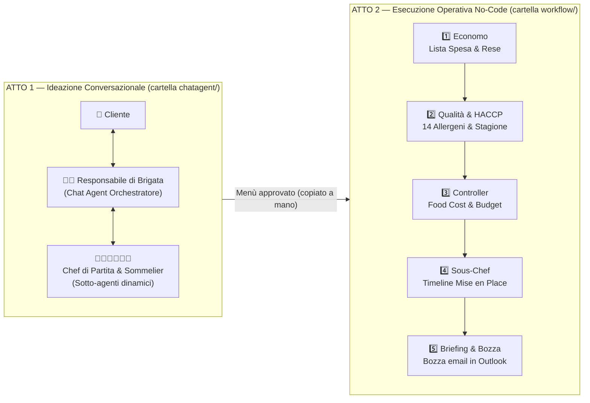

# 🍽️ Brigata di Cucina — Demo No-Code per Gemini Enterprise (Chat Agent & Workflow)

Questo repository contiene tutto il materiale (prompt, descrizioni, file di Knowledge, esempi di test) per costruire **passo dopo passo, in modalità 100% No-Code dentro Gemini Enterprise Agent Designer**, due esperienze complementari basate sulla metafora della **brigata di cucina**:

1. 💬 **[`chatagent/`](./chatagent/README.md) — Modalità Chat Agent (Multi-Agente Conversazionale)**
   L'utente dialoga con il **Responsabile di Brigata** (agente orchestratore) che raccoglie i requisiti dell'evento e delega dinamicamente la creazione delle portate ai singoli **Chef di Partita** (sotto-agenti specializzati) fino all'approvazione del menù.
2. ⚙️ **[`workflow/`](./workflow/README.md) — Modalità Workflow No-Code (Pipeline Sequenziale & Automazione)**
   Una volta che il menù è stato approvato, si lancia il **Workflow Operativo di Brigata** (trigger manuale con il menù incollato in un campo di input): una catena sequenziale deterministica di 5 step che trasforma il menù in **Lista della Spesa con scarti, Matrice dei 14 Allergeni, Calcolo del Food Cost & Semaforo Budget, Cronoprogramma di *Mise en Place* (`T-24h`, `T-4h`, `Pass`) e Bozza di Briefing creata in Outlook (senza invio)**.

---

## 1. Perché due modalità nella stessa demo?

Mostrare entrambi gli approcci sullo stesso caso d'uso permette di spiegare con estrema chiarezza la differenza architetturale tra **Agente Conversazionale** e **Workflow Sequenziale** in Gemini Enterprise:



| Dimensione | 💬 Parte 1: `chatagent/` (Chat Agent) | ⚙️ Parte 2: `workflow/` (Workflow No-Code) |
|---|---|---|
| **Quando usarla** | Quando serve **dialogo, esplorazione e co-creazione** con l'utente | Quando serve **esecuzione rigorosa, calcoli ripetibili e automazione** |
| **Logica di controllo** | **Dinamica**: l'agente principale decide chi interpellare e fa domande all'utente | **Sequenziale / Deterministica (Flow)**: i 5 step girano sempre in ordine fisso senza interrompersi |
| **Modalità di attivazione** | Conversazione in chat con l'utente | **Trigger manuale** con un campo di input (`Menu_approvato`): si lancia dalla tab **Test** o da una chat con `@nome-workflow`. Il trigger **Schedule** esiste ma non ha campi di input, quindi non adatto a ricevere un menù |
| **Grounding & Connettori** | File in **Knowledge** (orchestratore) + **Google Search** (sotto-agenti chef) | File di listino/protocollo in **Knowledge** + **Google Search** + **Outlook** (solo creazione bozza) |

---

## 2. Struttura completa del repository

```text
ge-demo-brigata/
├── README.md                                          <- sei qui: panoramica generale dei 2 moduli
│
├── chatagent/                                         <- PARTE 1: Demo Multi-Agente Conversazionale
│   ├── README.md                                      <- Guida passo-passo per il Chat Agent
│   ├── orchestrator/
│   │   ├── README.md                                  <- Nome, Descrizione e Istruzioni dell'Orchestratore
│   │   ├── regole-brigata-e-flusso-lavoro.md          <- File Knowledge
│   │   ├── struttura-menu-italiano.md                 <- File Knowledge
│   │   └── glossario-e-stile-comunicazione.md         <- File Knowledge
│   ├── chef-antipasti/README.md                       <- Sotto-agente + Google Search
│   ├── chef-primi/README.md                           <- Sotto-agente + Google Search
│   ├── chef-secondi/README.md                         <- Sotto-agente + Google Search
│   ├── chef-contorni/README.md                        <- Sotto-agente + Google Search
│   ├── chef-dolci/README.md                           <- Sotto-agente + Google Search
│   └── sommelier/README.md                            <- Sotto-agente opzionale + Google Search
│
└── workflow/                                          <- PARTE 2: Demo Workflow No-Code Sequenziale
    ├── README.md                                      <- Guida passo-passo per il Workflow No-Code
    ├── 01-analisi-fabbisogni/README.md                <- Step 1: Economo (grammature, scarti, lista spesa)
    ├── 02-controllo-allergeni-e-mercato/README.md     <- Step 2: Qualità & 14 Allergeni (Google Search)
    ├── 03-food-cost-e-preventivo/README.md            <- Step 3: Food Cost Controller & Semaforo Budget
    ├── 04-piano-mise-en-place/README.md               <- Step 4: Sous-Chef (Timeline T-24h / T-4h / Pass)
    ├── 05-briefing-e-notifica/README.md               <- Step 5: Dossier Evento + bozza email in Outlook
    ├── knowledge/
    │   ├── listino-fornitori-e-rese.md                <- File Knowledge: prezzi €/kg, % scarto, grammature
    │   ├── regole-food-cost-e-margini.md              <- File Knowledge: formule food cost e semafori budget
    │   └── protocollo-servizio-e-tempi.md             <- File Knowledge: tempi e compiti delle partite
    └── esempi-input/
        └── menu-approvato-esempio.md                  <- 3 scenari pronti da incollare nel campo Menu_approvato
```

---

## 3. Come eseguire la demo completa (Percorso Consigliato)

### Passo 1 — Costruisci e prova il Chat Agent (`chatagent/`)
Segui la guida [`chatagent/README.md`](./chatagent/README.md) per configurare il **Responsabile di Brigata** e i suoi **Chef di Partita**.
Avvia una conversazione di prova, ad esempio:
> *"Ciao! Devo organizzare una cena per 6 persone, stagione autunnale, una persona è vegetariana e un'altra ha un'intolleranza ai crostacei. Vorrei un menù elegante ma non troppo formale."*

Quando il Responsabile di Brigata ti presenta il menù completo approvato, **copia il testo del menù**.

### Passo 2 — Costruisci ed esegui il Workflow No-Code (`workflow/`)
Segui la guida [`workflow/README.md`](./workflow/README.md) per configurare il **Workflow Operativo di Brigata** in **Workflow Builder** di Gemini Enterprise: trigger **Manuale** con il campo `Menu_approvato`, i 5 nodi in serie con le **variabili** che passano il menù e gli output da uno step all'altro, e i 3 file di `workflow/knowledge/` collegati ai nodi indicati nella guida.

> ⚠️ **Il passaggio dal Chat Agent al Workflow è manuale**: il Chat Agent non lancia il workflow da solo. Copia il menù finale, aggiungi numero ospiti, stagione, allergie e budget, poi incollalo nel campo di input dalla tab **Test** (**Start a test run**) oppure da una chat con `@nome-workflow`.

Usa il menù appena generato dal Chat Agent (oppure uno dei 3 scenari pronti in [`workflow/esempi-input/menu-approvato-esempio.md`](./workflow/esempi-input/menu-approvato-esempio.md)) e osserva il workflow produrre in sequenza:
1. 📦 **Lista della Spesa per Fornitore** (con calcolo automatico degli scarti di pulitura)
2. ⚠️ **Matrice dei 14 Allergeni e "Piatti Sentinella"** per gli ospiti con intolleranze
3. 💶 **Preventivo Food Cost e Semaforo Budget** (🟢 Verde / 🟡 Giallo / 🔴 Rosso)
4. ⏱️ **Piano di *Mise en Place* (`T-24h`, `T-4h`, `Servizio al Pass`)** per ogni partita della cucina
5. ✉️ **Dossier Evento + Bozza Email di Briefing in Outlook** (non inviata) per i capi partita

---

Buona costruzione e buona demo! 👨‍🍳⚙️🤖
