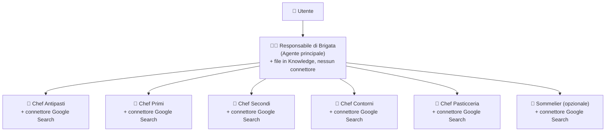

# 💬 Brigata di Cucina (Modalità Chat Agent) — Demo Multi-Agente Conversazionale

Questa cartella contiene tutto il materiale (prompt, descrizioni, file di contesto) per costruire passo dopo passo, in **Gemini Enterprise Agent Designer**, la versione **Chat Agent conversazionale multi-agente** della Brigata di Cucina.

> 💡 **Vuoi vedere cosa succede dopo che il menù è stato approvato?** Vai nella cartella sorella [`../workflow/`](../workflow/README.md) per scoprire il caso d'uso in **modalità Workflow No-Code** (dal menù approvato alla lista della spesa, calcolo del food cost, piano di *mise en place* e invio del briefing di brigata).

> ⚠️ **Nota sull'interfaccia**: questa guida usa le etichette esatte di Gemini Enterprise Agent Designer confermate al momento della stesura — **Nome**, **Descrizione**, **Istruzioni**, sezione **Knowledge** per i file di contesto, connettore **Google Search** per l'accesso a Internet. Posizione dei menu e dettagli minori dell'interfaccia possono comunque cambiare tra un rilascio e l'altro.

---

## 1. Obiettivo della demo (Modalità Chat Agent)

Mostrare, con un caso d'uso semplice da capire per chiunque, i tre concetti chiave della progettazione di un multi-agente conversazionale enterprise:

1. **Orchestrazione dinamica**: un agente "capo" che dialoga con l'utente, raccoglie i requisiti mancanti e decide in autonomia chi interpellare.
2. **Specializzazione**: sotto-agenti con un compito ristretto e ben definito.
3. **Grounding/Knowledge misto**: due modalità di grounding a confronto sullo stesso agente, ciascuna abbinata al connettore giusto.
   - L'**agente principale** non ha il connettore **Google Search** abilitato: viene creato caricando **direttamente in fase di creazione** i propri file nella sezione **Knowledge**, così le regole di flusso, la struttura del menù e lo stile di comunicazione sono coerenti e verificabili invece che "inventate".
   - Ogni **sotto-agente (chef)** non carica nulla in Knowledge: ha invece il connettore **Google Search** abilitato, e le sue Istruzioni indicano direttamente le pagine web specifiche da consultare (niente ricerca libera). Ogni nodo ha i propri riferimenti, distinti da quelli degli altri.

Il risultato finale, una volta costruito, sarà un agente capace di guidare un utente nella creazione di un **menù completo** (antipasto, primo, secondo, contorno, dolce — e volendo l'abbinamento vini) tramite una conversazione guidata.

---

## 2. Il caso d'uso: la brigata di cucina

La brigata di cucina classica è il sistema organizzativo delle cucine professionali: uno **chef responsabile** coordina più **chef di partita**, ognuno specializzato in una tipologia di piatto. È una metafora naturale per un'architettura multi-agente:



| Ruolo | Nella brigata reale | Nella demo |
|---|---|---|
| Executive Chef / Responsabile di Brigata | Coordina tutti, decide il menu finale | **Agente principale** |
| Chef de Partie (Garde Manger) | Antipasti freddi | **Chef Antipasti** (sotto-agente) |
| Chef de Partie (Primi) | Paste, risotti, zuppe | **Chef Primi** (sotto-agente) |
| Chef de Partie (Rôtisseur) | Carni, pesci, secondi | **Chef Secondi** (sotto-agente) |
| Chef de Partie (Entremetier) | Verdure, contorni | **Chef Contorni** (sotto-agente) |
| Pâtissier | Dolci e dessert | **Chef Pasticceria** (sotto-agente) |
| — | Abbinamento vini | **Sommelier** (sotto-agente bonus/opzionale) |

> 🧩 **Punto chiave sull'architettura**: in Gemini Enterprise Agent Designer questa demo è **un solo agente** (il Responsabile di Brigata). Tutti i chef non sono agenti separati, ma **sotto-agenti creati all'interno dello stesso agente**: nella UI di Agent Designer li vedrai come card collegate con una linea tratteggiata sotto la card dell'agente principale.
>
> 📎 **Connettore giusto per ogni nodo**: quando crei l'agente principale, carica direttamente nella sezione **Knowledge** della sua configurazione tutti i file `.md` indicati nella cartella `orchestrator/` e **non** abilitare il connettore **Google Search**: deve rispondere solo in base a quei file. I chef e il sommelier, invece, **non caricano nulla in Knowledge**: vanno configurati abilitando il connettore **Google Search**, perché le loro Istruzioni indicano già le pagine web specifiche da consultare (nessuna ricerca libera). Questo permette di confrontare nella stessa demo entrambe le modalità di grounding.

---

## 3. Struttura della cartella `chatagent/`

```
chatagent/
├── README.md                     <- sei qui: guida per il Chat Agent multi-agente
├── orchestrator/
│   ├── README.md                 <- Istruzioni + Descrizione per l'agente principale
│   ├── regole-brigata-e-flusso-lavoro.md
│   ├── struttura-menu-italiano.md
│   └── glossario-e-stile-comunicazione.md
├── chef-antipasti/
│   └── README.md                 <- Istruzioni (con i riferimenti web) + Descrizione + connettore Google Search
├── chef-primi/
│   └── README.md                 <- Istruzioni (con i riferimenti web) + Descrizione + connettore Google Search
├── chef-secondi/
│   └── README.md                 <- Istruzioni (con i riferimenti web) + Descrizione + connettore Google Search
├── chef-contorni/
│   └── README.md                 <- Istruzioni (con i riferimenti web) + Descrizione + connettore Google Search
├── chef-dolci/
│   └── README.md                 <- Istruzioni (con i riferimenti web) + Descrizione + connettore Google Search
└── sommelier/                     <- sotto-agente opzionale (facoltativo per la demo base)
    └── README.md                 <- Istruzioni (con i riferimenti web) + Descrizione + connettore Google Search
```

Ogni sottocartella corrisponde a un "nodo" della gerarchia da ricreare in Agent Designer:
- **`orchestrator/`** → l'**unico agente di primo livello** da creare (il Responsabile di Brigata).
- **`chef-*/` e `sommelier/`** → i **sotto-agenti da aggiungere dentro** l'agente `orchestrator`, non agenti a sé stanti.

---

## 4. Percorso guidato passo-passo

### Fase 0 — Leggi prima tutto
Sfoglia rapidamente tutte le sottocartelle prima di iniziare, così hai chiaro il quadro d'insieme. Decidi se includere anche il **Sommelier** (opzionale) o fermarti ai 5 chef "core".

### Fase 1 — Crea l'agente principale: Responsabile di Brigata

In Gemini Enterprise Agent Designer crea **un solo agente**, seguendo [`orchestrator/README.md`](./orchestrator/README.md):
1. Nuovo agente → assegna il **Nome** indicato nel README.
2. Incolla la **Descrizione**.
3. Incolla il blocco **Istruzioni**.
4. Nella sezione **Knowledge** della configurazione dell'agente, **carica direttamente tutti i file `.md` della cartella `orchestrator/` tranne il `README.md`** (il README non va caricato: contiene le istruzioni per te, non contesto per l'agente).
5. Non abilitare il connettore **Google Search** su questo agente: deve basarsi solo sui file caricati e sulle proposte dei chef.

### Fase 2 — Aggiungi i sotto-agenti (i chef) dentro lo stesso agente

Per **ciascun** chef (in qualsiasi ordine, ma consigliato: antipasti → primi → secondi → contorni → dolci → sommelier):

1. Dentro l'agente **Responsabile di Brigata**, usa la funzione per **aggiungere un sotto-agente** (nella UI compare come una nuova card collegata con linea tratteggiata sotto l'agente principale). Non creare un nuovo agente indipendente: il sotto-agente nasce e resta dentro l'agente principale.
2. Apri il `README.md` della cartella corrispondente (es. [`chef-primi/README.md`](./chef-primi/README.md)).
3. Copia il campo **Nome** e il campo **Descrizione** così come indicati: la descrizione è ciò che l'agente principale userà per capire *quando* invocare quel sotto-agente, quindi non modificarla in modo generico.
4. Copia il blocco **Istruzioni** nel campo Istruzioni del sotto-agente: contiene già le pagine web specifiche che il chef deve consultare.
5. Abilita il connettore **Google Search** per questo specifico sotto-agente (senza di esso non può consultare le pagine indicate nelle Istruzioni). Non caricare nulla nella sezione Knowledge.
6. Salva il sotto-agente.

### Fase 3 — Verifica prima di testare

Un rapido controllo incrociato prima del test:
- L'agente principale ha, in Knowledge, tutti e soli i file di `orchestrator/` (nessun file dei chef caricato qui per errore) e **il connettore Google Search non è abilitato**.
- Ogni sotto-agente ha il connettore **Google Search abilitato** e **nulla caricato in Knowledge**.
- Ogni sotto-agente ha le Istruzioni copiate per intero dal proprio README, comprese le pagine web indicate come fonte.
- Ogni sotto-agente ha una Descrizione specifica (non generica), da cui dipende il corretto instradamento (routing) da parte dell'agente principale.

### Fase 4 — Testa il flusso end-to-end

Apri una conversazione con l'agente Responsabile di Brigata e prova, ad esempio:

> "Ciao! Devo organizzare una cena per 6 persone, stagione autunnale, una persona è vegetariana e un'altra ha un'intolleranza ai crostacei. Vorrei un menù elegante ma non troppo formale."

Una volta ottenuto e confermato il menù finale, **copia il menù generato**: potrai usarlo direttamente come input per testare la seconda parte della demo nella cartella [`../workflow/`](../workflow/README.md)!
