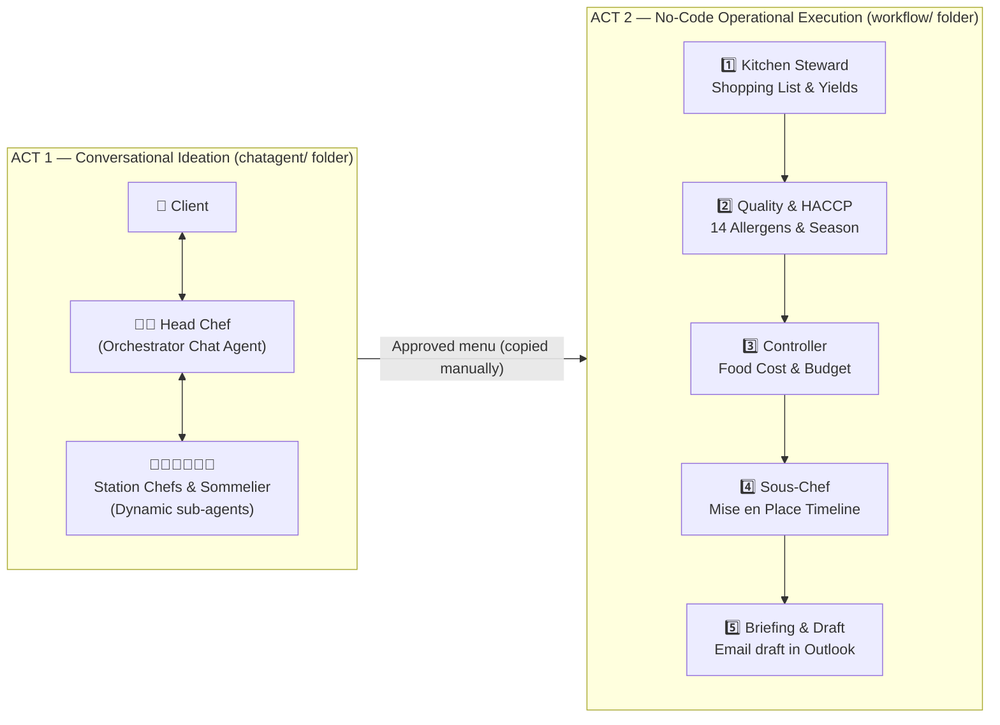

# 🍽️ Kitchen Brigade — No-Code Demo for Gemini Enterprise (Chat Agent & Workflow)

This repository contains all the materials (prompts, descriptions, Knowledge files, test examples) needed to build **step by step, 100% No-Code inside Gemini Enterprise Agent Designer**, two complementary experiences based on the **kitchen brigade** metaphor:

1. 💬 **[`chatagent/`](./chatagent/README.md) — Chat Agent Mode (Conversational Multi-Agent)**
   The user chats with the **Head Chef (Brigade Lead)** (orchestrator agent), who gathers event requirements and dynamically delegates the creation of individual courses to specialized **Station Chefs** (sub-agents) until the menu is approved.
2. ⚙️ **[`workflow/`](./workflow/README.md) — No-Code Workflow Mode (Sequential Pipeline & Automation)**
   Once the menu is approved, you launch the **Kitchen Brigade Operational Workflow** (manual trigger with the menu pasted into an input field): a deterministic 5-step sequential chain that turns the menu into a **Shopping List with trim waste, 14-Allergen Matrix, Food Cost Calculation & Budget Traffic Light, *Mise en Place* Timeline (`T-24h`, `T-4h`, `Pass`), and a Briefing Draft created in Outlook (without sending)**.

---

## 1. Why Two Modes in the Same Demo?

Showcasing both approaches on the same use case makes it crystal clear how to explain the architectural difference between a **Conversational Agent** and a **Sequential Workflow** in Gemini Enterprise:



| Dimension | 💬 Part 1: `chatagent/` (Chat Agent) | ⚙️ Part 2: `workflow/` (No-Code Workflow) |
|---|---|---|
| **When to use it** | When you need **dialogue, exploration, and co-creation** with the user | When you need **strict execution, repeatable calculations, and automation** |
| **Control logic** | **Dynamic**: the main agent decides whom to consult and asks the user follow-up questions | **Sequential / Deterministic (Flow)**: the 5 steps always run in a fixed order without pausing |
| **Trigger mechanism** | Interactive chat conversation with the user | **Manual trigger** with an input field (`Approved_menu`): launched from the **Test** tab or from chat via `@workflow-name`. The **Schedule** trigger exists, but it has no input fields and is therefore unsuitable for receiving a pasted menu |
| **Grounding & Connectors** | Files in **Knowledge** (orchestrator) + **Google Search** (chef sub-agents) | Price list/protocol files in **Knowledge** + **Google Search** + **Outlook** (draft creation only) |

---

## 2. Complete Structure of the `kitchen-brigade/` Folder

```text
kitchen-brigade/
├── README.md                                          <- you are here: general overview of both modules
│
├── chatagent/                                         <- PART 1: Conversational Multi-Agent Demo
│   ├── README.md                                      <- Step-by-step guide for the Chat Agent
│   ├── orchestrator/
│   │   ├── README.md                                  <- Name, Description, and Instructions for the Orchestrator
│   │   ├── brigade-rules-and-workflow.md              <- Knowledge file
│   │   ├── italian-menu-structure.md                  <- Knowledge file
│   │   └── glossary-and-communication-style.md        <- Knowledge file
│   ├── starters-chef/README.md                        <- Sub-agent + Google Search
│   ├── first-courses-chef/README.md                   <- Sub-agent + Google Search
│   ├── main-courses-chef/README.md                    <- Sub-agent + Google Search
│   ├── side-dishes-chef/README.md                     <- Sub-agent + Google Search
│   ├── pastry-chef/README.md                          <- Sub-agent + Google Search
│   └── sommelier/README.md                            <- Optional sub-agent + Google Search
│
└── workflow/                                          <- PART 2: Sequential No-Code Workflow Demo
    ├── README.md                                      <- Step-by-step guide for the No-Code Workflow
    ├── 01-requirements-analysis/README.md             <- Step 1: Kitchen Steward (portions, waste, shopping list)
    ├── 02-allergen-and-market-check/README.md         <- Step 2: Quality & 14 Allergens (Google Search)
    ├── 03-food-cost-and-quote/README.md               <- Step 3: Food Cost Controller & Budget Traffic Light
    ├── 04-mise-en-place-plan/README.md                <- Step 4: Sous-Chef (T-24h / T-4h / Pass timeline)
    ├── 05-briefing-and-notification/README.md         <- Step 5: Event Dossier + email draft in Outlook
    ├── knowledge/
    │   ├── supplier-price-list-and-yields.md          <- Knowledge file: €/kg prices, % waste, portion weights
    │   ├── food-cost-and-margin-rules.md              <- Knowledge file: food cost formulas and budget traffic lights
    │   └── service-protocol-and-timing.md             <- Knowledge file: timing and tasks for each kitchen station
    └── sample-inputs/
        └── sample-approved-menu.md                    <- 3 ready-to-use scenarios to paste into Approved_menu
```

---

## 3. How to Run the Full Demo (Recommended Path)

### Step 1 — Build and Test the Chat Agent (`chatagent/`)
Follow the [`chatagent/README.md`](./chatagent/README.md) guide to configure the **Head Chef** and the **Station Chefs**.
Start a test conversation, for example:
> *"Hi! I need to organize a dinner for 6 guests in autumn. One guest is vegetarian and another has a crustacean intolerance. I'd like an elegant menu, but not overly formal."*

When the Head Chef presents the complete approved menu, **copy the menu text**.

### Step 2 — Build and Run the No-Code Workflow (`workflow/`)
Follow the [`workflow/README.md`](./workflow/README.md) guide to configure the **Kitchen Brigade Operational Workflow** in Gemini Enterprise **Workflow Builder**: a **Manual** trigger with the `Approved_menu` input field, the 5 nodes in series with **variables** passing the menu and step outputs down the chain, and the 3 files from `workflow/knowledge/` attached to the designated nodes.

> ⚠️ **Handing off from the Chat Agent to the Workflow is manual**: the Chat Agent does not trigger the workflow automatically. Copy the final menu, add the guest count, season, allergies, and budget, and paste it into the input field from the **Test** tab (**Start a test run**) or from a chat using `@workflow-name`.

Use the menu just generated by the Chat Agent (or one of the 3 ready-made scenarios in [`workflow/sample-inputs/sample-approved-menu.md`](./workflow/sample-inputs/sample-approved-menu.md)) and watch the workflow produce in sequence:
1. 📦 **Shopping List by Supplier** (with automatic calculation of prep/trim waste)
2. ⚠️ **14-Allergen Matrix and "Sentinel Dishes"** for guests with dietary restrictions or allergies
3. 💶 **Food Cost Quote and Budget Traffic Light** (🟢 Green / 🟡 Yellow / 🔴 Red)
4. ⏱️ ***Mise en Place* Plan (`T-24h`, `T-4h`, `Service at the Pass`)** for every kitchen station
5. ✉️ **Event Dossier + Briefing Email Draft in Outlook** (unsent) for the station chefs

---

Happy building and enjoy the demo! 👨‍🍳⚙️🤖
