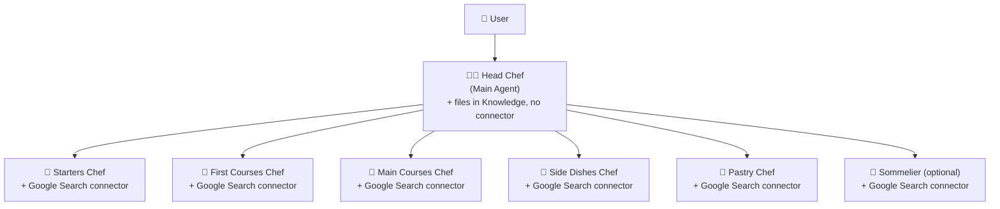

# 💬 Kitchen Brigade (Chat Agent Mode) — Conversational Multi-Agent Demo

This folder contains all the materials (prompts, descriptions, context files) needed to build step by step, in **Gemini Enterprise Agent Designer**, the **conversational multi-agent Chat Agent** version of the Kitchen Brigade.

> 💡 **Want to see what happens after the menu is approved?** Head over to the sibling folder [`../workflow/`](../workflow/README.md) to explore the use case in **No-Code Workflow mode** (from the approved menu to the shopping list, food cost calculation, *mise en place* plan, and brigade briefing draft).

> ⚠️ **UI Note**: this guide uses the exact Gemini Enterprise Agent Designer labels confirmed at the time of writing — **Name**, **Description**, **Instructions**, the **Knowledge** section for context files, and the **Google Search** connector for Internet access. Menu placements and minor UI details may still change across releases.

---

## 1. Demo Objective (Chat Agent Mode)

Demonstrate, through an intuitive use case anyone can relate to, the three core concepts of enterprise conversational multi-agent design:

1. **Dynamic orchestration**: a "lead" agent that converses with the user, gathers missing requirements, and autonomously decides whom to consult.
2. **Specialization**: sub-agents with a narrow, clearly defined scope.
3. **Hybrid Grounding / Knowledge**: two grounding approaches compared side by side within the same agent architecture, each paired with the right connector.
   - The **main agent** does **not** have the **Google Search** connector enabled: it is created by uploading its reference files **directly into the Knowledge section**, ensuring workflow rules, menu structure, and communication style remain consistent and verifiable rather than improvised.
   - Each **sub-agent (chef)** has nothing uploaded in Knowledge: instead, it has the **Google Search** connector enabled, and its Instructions point directly to the specific web pages to consult (no open-ended web browsing). Every node has its own dedicated sources, distinct from the others.

Once built, the resulting agent will guide a user through creating a **complete Italian menu** (starter, first course, main course, side dish, dessert — plus optional wine pairing) via a natural, guided conversation.

---

## 2. The Use Case: The Kitchen Brigade

The classic kitchen brigade is the organizational system of professional kitchens: a **head chef** coordinates multiple **station chefs** (*chefs de partie*), each specializing in a specific category of dishes. It is a natural metaphor for a multi-agent architecture:



| Role | In a Real Kitchen Brigade | In the Demo |
|---|---|---|
| Executive Chef / Head Chef (Brigade Lead) | Coordinates everyone, approves the final menu | **Main Agent** (`Head Chef`) |
| Chef de Partie (Garde Manger) | Cold and hot starters | **Starters Chef** (sub-agent) |
| Chef de Partie (Primi) | Pasta, risotto, soups | **First Courses Chef** (sub-agent) |
| Chef de Partie (Rôtisseur) | Meat, fish, main courses | **Main Courses Chef** (sub-agent) |
| Chef de Partie (Entremetier) | Vegetables, side dishes | **Side Dishes Chef** (sub-agent) |
| Pâtissier | Cakes, pastries, and desserts | **Pastry Chef** (sub-agent) |
| — | Wine pairing | **Sommelier** (bonus/optional sub-agent) |

> 🧩 **Key architectural takeaway**: in Gemini Enterprise Agent Designer, this demo is **a single agent** (the Head Chef). All the station chefs are not standalone agents, but **sub-agents created inside that same agent**: in the Agent Designer UI, you will see them as cards linked by a dashed line beneath the main agent card.
>
> 📎 **Right connector for each node**: when creating the main agent, upload all the `.md` files listed in the `orchestrator/` folder directly into its **Knowledge** section and **do not** enable the **Google Search** connector — it must rely strictly on those files. Conversely, the station chefs and the sommelier **upload nothing to Knowledge**: configure them by enabling the **Google Search** connector, because their Instructions already specify the exact web pages to consult (no open-ended web search). This lets you compare both grounding patterns within a single demo.

---

## 3. Structure of the `chatagent/` Folder

```text
chatagent/
├── README.md                           <- you are here: multi-agent Chat Agent guide
├── orchestrator/
│   ├── README.md                       <- Instructions + Description for the main agent
│   ├── brigade-rules-and-workflow.md
│   ├── italian-menu-structure.md
│   └── glossary-and-communication-style.md
├── starters-chef/
│   └── README.md                       <- Instructions (with web sources) + Description + Google Search connector
├── first-courses-chef/
│   └── README.md                       <- Instructions (with web sources) + Description + Google Search connector
├── main-courses-chef/
│   └── README.md                       <- Instructions (with web sources) + Description + Google Search connector
├── side-dishes-chef/
│   └── README.md                       <- Instructions (with web sources) + Description + Google Search connector
├── pastry-chef/
│   └── README.md                       <- Instructions (with web sources) + Description + Google Search connector
└── sommelier/                          <- optional sub-agent (optional for the core demo)
    └── README.md                       <- Instructions (with web sources) + Description + Google Search connector
```

Each subfolder maps to one "node" in the hierarchy you will build in Agent Designer:
- **`orchestrator/`** → the **only top-level agent** to create (the Head Chef).
- **`*-chef/` and `sommelier/`** → the **sub-agents to add inside** the `orchestrator` agent, not standalone agents.

---

## 4. Step-by-Step Guided Walkthrough

### Phase 0 — Read Everything First
Skim through all the subfolders before starting so you have the full picture. Decide whether to include the **Sommelier** (optional) or stick to the 5 core chefs.

### Phase 1 — Create the Main Agent: Head Chef

In Gemini Enterprise Agent Designer, create **a single agent** following [`orchestrator/README.md`](./orchestrator/README.md):
1. Create agent → enter the **Name** specified in the README (`Head Chef`).
2. Paste the **Description**.
3. Paste the **Instructions** block.
4. In the **Knowledge** section of the agent configuration, **directly upload all `.md` files in the `orchestrator/` folder except `README.md`** (do not upload the README: it contains build instructions for you, not context for the agent).
5. Do **not** enable the **Google Search** connector on this agent: it must rely solely on its uploaded Knowledge files and on the proposals returned by the chefs.

### Phase 2 — Add the Sub-Agents (Station Chefs) Inside the Same Agent

For **each** chef (in any order, though we recommend: starters → first courses → main courses → side dishes → pastry → sommelier):

1. Inside the **Head Chef** agent, use **Add subagent** (in the UI it appears as a new card connected by a dashed line below the main agent). Do not create a separate top-level agent: the sub-agent lives inside the main agent.
2. Open the `README.md` in the corresponding folder (e.g., [`first-courses-chef/README.md`](./first-courses-chef/README.md)).
3. Copy the **Name** and **Description** fields verbatim: the main agent relies on the Description to understand *when* to invoke each sub-agent, so keep it specific rather than generic.
4. Copy the **Instructions** block into the sub-agent's Instructions field: it already includes the specific web pages the chef must consult.
5. Enable the **Google Search** connector for this specific sub-agent (without it, the sub-agent cannot access the web pages listed in its Instructions). Do not upload anything to Knowledge.
6. Save the sub-agent.

### Phase 3 — Pre-Flight Verification

Run a quick cross-check before testing:
- The main agent has, in **Knowledge**, all and only the context files from `orchestrator/` (no chef READMEs uploaded by mistake), and **Google Search is disabled**.
- Every sub-agent has **Google Search enabled** and **nothing uploaded in Knowledge**.
- Every sub-agent has the full Instructions copied from its README, including its reference URLs.
- Every sub-agent has a specific (non-generic) Description, which drives accurate routing from the main agent.

### Phase 4 — Test the End-to-End Flow

Open a chat with the **Head Chef** agent and try a prompt like:

> "Hi! I need to organize a dinner for 6 guests in autumn. One guest is vegetarian and another has a crustacean intolerance. I'd like an elegant menu, but not overly formal."

Once you receive and confirm the final menu, **copy the generated menu**: you can use it directly as the input to test Part 2 of the demo in [`../workflow/`](../workflow/README.md)!
