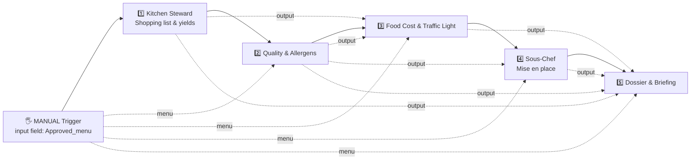

# ⚙️ Kitchen Brigade Operational Workflow — No-Code Demo for Gemini Enterprise (Workflow Builder)

This folder contains everything needed (prompts for all 5 steps, Knowledge files, test inputs) to build in **Gemini Enterprise → Workflow Builder** the pipeline that turns an **approved menu** into: a shopping list, an allergen matrix, a food cost quote and budget traffic light, a *mise en place* schedule, and a brigade briefing draft.

> **Tested and verified version**: compared to an initial draft, this guide includes:
> - a **Manual trigger with an input field** (the **Schedule** trigger has no input fields and cannot receive a pasted menu);
> - **variables** linking every step to the approved menu and to the outputs of preceding steps;
> - **anti-hallucination rules** (no invented seat numbers, plate colors, or details absent from the menu or service protocol);
> - **non-blocking rules** (no step may ever pause to ask the user clarifying questions);
> - refined food cost and budget traffic-light logic (see `knowledge/food-cost-and-margin-rules.md`).

---

## 1. Workflow Architecture



**Core rule**: in a workflow, every step is an isolated agent. It sees **only** what you pass into its prompt. The menu and outputs from previous steps **do not flow in automatically**: they must be inserted into each step's instructions as variables.

| Step | Input Variables |
|---|---|
| 1 Kitchen Steward | `Approved_menu` |
| 2 Quality & Allergens | `Approved_menu`, Step 1 output |
| 3 Food Cost | `Approved_menu`, Step 1 output, Step 2 output |
| 4 Sous-Chef | `Approved_menu`, Step 2 output |
| 5 Dossier | `Approved_menu`, outputs of Steps 1, 2, 3, 4 (+ `Briefing_recipients` if created) |

---

## 2. Placeholder Convention in the Prompts

In the step READMEs, you will find placeholders such as `${APPROVED_MENU}` and `${OUTPUT_STEP_1}`. **Do not copy them as plain literal text**: replace each placeholder with the actual variable inserted via the Workflow Builder variable picker.

| Placeholder in README | What to Insert in the Editor |
|---|---|
| `${APPROVED_MENU}` | the variable for the `Approved_menu` field of the Manual trigger |
| `${OUTPUT_STEP_1}` | the output variable from Step 1 |
| `${OUTPUT_STEP_2}` | the output variable from Step 2 |
| `${OUTPUT_STEP_3}` | the output variable from Step 3 |
| `${OUTPUT_STEP_4}` | the output variable from Step 4 |
| `${BRIEFING_RECIPIENTS}` | the variable for the optional `Briefing_recipients` field (Step 5 only) |

> 💡 **How to insert a variable**: inside the step's instructions editor, look for the variable selector (a button or menu for referencing trigger fields and prior step outputs). Google documentation notes the `${step_name.output}` syntax for existing agent steps; for Gemini Agent nodes, always use the built-in variable picker when available, as exact internal syntax may vary.
>
> 💡 **Verify that the variable resolved**: after a test run, expand the step and inspect its **Input** (the "Input" row right above "Output" in the test panel). If the menu text does not appear inside the Input, the variable binding was not set properly.

---

## 3. Step-by-Step Build Guide

### Phase 1 — Workflow Container
1. **+ New agent → Workflow → Build manually**.
2. **Name**: `Kitchen Brigade Operational Workflow — From Menu to Service`
3. **Description**:
```text
Sequential no-code workflow that receives an approved menu and event details (guest count, season, dietary restrictions/allergies, budget) and executes in chain: 1) ingredient breakdown and shopping list with prep yields, 2) allergen and seasonality check, 3) food cost calculation and quote, 4) mise en place timeline across kitchen stations, 5) operational event dossier and briefing email draft for kitchen and front of house.
```

### Phase 2 — MANUAL Trigger with Input Field
1. On the canvas, click the trigger node (by default it may start as a **Schedule**, e.g., "Daily at 9:00 AM").
2. In the configuration panel, switch the trigger type to **Manual trigger**.
3. Under **Input fields**, add **a single text field**:
   - **Name**: `Approved_menu`
   - **Type**: text (long text, if the editor offers the option)
   - **Required**: yes
4. On every run, you will paste the block containing menu + guest count + allergies + budget into this field (see `sample-inputs/sample-approved-menu.md`).
5. **(Optional) Second field `Briefing_recipients`**: text, not required. If you populate it with the station chefs' email addresses, the Outlook draft will be created with recipients pre-filled; if left blank, the draft is created with no recipients so you can add them manually. If you skip creating this field altogether, remove `${BRIEFING_RECIPIENTS}` from the Step 5 prompt.

### Phase 3 — Per-Step Knowledge & Connectors
Knowledge is uploaded **per individual node**, not globally on the workflow:

| Step | Knowledge Files to Attach | Google Search |
|---|---|---|
| 1 | `supplier-price-list-and-yields.md` | ❌ |
| 2 | none | ✅ |
| 3 | `supplier-price-list-and-yields.md` + `food-cost-and-margin-rules.md` | ❌ |
| 4 | `service-protocol-and-timing.md` | ❌ |
| 5 | none | ❌ (**Outlook** connector enabled, draft creation only — see Step 5) |

### Phase 4 — The 5 Steps
Create the 5 **Gemini Agent** nodes in series and paste each step's name and instructions from its README:

1. [`01-requirements-analysis/README.md`](./01-requirements-analysis/README.md)
2. [`02-allergen-and-market-check/README.md`](./02-allergen-and-market-check/README.md)
3. [`03-food-cost-and-quote/README.md`](./03-food-cost-and-quote/README.md)
4. [`04-mise-en-place-plan/README.md`](./04-mise-en-place-plan/README.md)
5. [`05-briefing-and-notification/README.md`](./05-briefing-and-notification/README.md)

In every prompt, **replace the `${...}` placeholders with the real editor variables** (Section 2).

> 🔁 **Tip**: build and test **one step at a time**. Run a test right after adding Step 1; once you confirm it completes without pausing and outputs the shopping table, apply the same pattern to Steps 2–5.

---

## 4. How to Run the Workflow

### A) Test from the Editor
1. Open the **Test** tab.
2. Click **Start a test run**: with the Manual trigger configured, the `Approved_menu` input field appears.
3. Paste one of the scenarios from `sample-inputs/sample-approved-menu.md` and start the run.
4. When finished, expand each step to inspect its **Input** and **Output**.

### B) From a Gemini Enterprise Chat (Bridging from the Chat Agent)
A manual-trigger workflow can be invoked directly from chat by typing `@` followed by the workflow name. This is the closest experience to a seamless "approved menu → operational workflow" handoff:
1. Finish your conversation with the **Head Chef** (`../chatagent/`).
2. Copy the final menu and include guest count, season, allergies, and budget.
3. In chat, type `@Kitchen Brigade Operational Workflow` and paste the block into the input field.

> ⚠️ The workflow likely needs to be toggled on (**Turn on**) to appear in `@` mentions. Verify this behavior in your environment.

### C) Schedule (Optional — Not Suitable for Ad-Hoc Menus)
The **Schedule** trigger runs the workflow on a fixed timetable, but **it has no input fields**: it cannot accept a pasted menu. It only makes sense if the menu is read from a fixed external location (e.g., a Google Drive document via connector) and the step prompts are rewritten accordingly. Use the Manual trigger for this demo.

---

## 5. Expected Workflow Outputs

1. 📦 Stewarding Breakdown and Supplier Shopping List (net weights, % waste, gross order weights)
2. ⚠️ 14-Allergen Matrix and Sentinel Dishes
3. 💶 Food Cost, recommended quote, and budget traffic light (with explicit two-condition check)
4. ⏱️ `T-24h` / `T-4h` / Service at the Pass timeline by kitchen station
5. ✉️ 4-section Operational Dossier + briefing email **draft** created in Outlook (unsent)

---

## 6. Troubleshooting Common Issues

| Symptom | Probable Cause | Solution |
|---|---|---|
| A step pauses with **"Human input required"** asking for the menu | The menu variable was not passed into the step's prompt | Insert `${APPROVED_MENU}` as a real variable in the step's instructions and verify the step's **Input** |
| The **Test** tab only shows **Start a test run** with no input fields | The trigger is still set to **Schedule** | Switch it to **Manual trigger** and add the `Approved_menu` field |
| A mid-chain step asks for data already computed earlier | Missing output variable from a previous step | Insert `${OUTPUT_STEP_n}` into the INPUT DATA section |
| The briefing email mentions seat numbers, plate colors, or details never provided | Model hallucination | Anti-hallucination rules are built into the prompts — double-check that the full prompt text was pasted |
| Step 5 pauses asking for approval before creating the draft | Built-in human-in-the-loop review for connector write actions | Approve draft creation (it creates a draft only and does not send any email) |
| Step 5 fails to create the draft | Outlook connector not enabled on the node, or Outlook data store not configured by admin | Check the node's connector settings and ask your admin to verify the Outlook data store and mail write permissions |
| The traffic light shows green even though Food Cost % exceeds the tier target | Green condition rule not enforced | Ensure Step 3 uses the full prompt and `food-cost-and-margin-rules.md` is attached to Knowledge |

---

## 7. Folder Structure

```text
workflow/
├── README.md                                  <- you are here
├── 01-requirements-analysis/README.md         <- Step 1 (Kitchen Steward)
├── 02-allergen-and-market-check/README.md     <- Step 2 (Quality & Allergens)
├── 03-food-cost-and-quote/README.md           <- Step 3 (Food Cost)
├── 04-mise-en-place-plan/README.md            <- Step 4 (Sous-Chef)
├── 05-briefing-and-notification/README.md     <- Step 5 (Dossier & Briefing)
├── knowledge/
│   ├── supplier-price-list-and-yields.md      <- Supplier prices, % waste, portion weights
│   ├── food-cost-and-margin-rules.md          <- +10% off-list rule and green traffic-light check
│   └── service-protocol-and-timing.md         <- Cooking back-timing and anti-hallucination rules
└── sample-inputs/sample-approved-menu.md      <- 3 test scenarios formatted for Approved_menu
```
