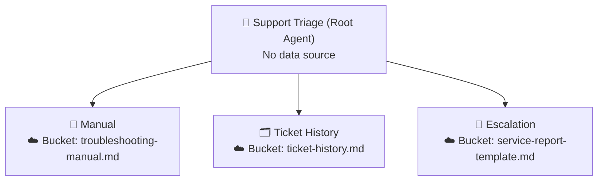

# Case 2 · Technical Support

**Objective:** help Level 1 technical support respond to a field issue using solely the official manual, look up historical tickets, and prepare the escalation service report for the L2 technician when required.

---

## 📁 Data Kit (`data-kit/`)

All fictional files ready for use in the workshop are located in the [`./data-kit/`](./data-kit/) subfolder:

| File | Usage | Description |
|---|---|---|
| [`troubleshooting-manual.md`](./data-kit/troubleshooting-manual.md) | **Knowledge** (Step 1) / **Data Bucket** (Manual sub-agent) | Alarm table (`E101`–`E110`) and code-free symptoms, probable causes, step-by-step procedures, and escalation rules. **Code `E199` is absent (edge case)** |
| [`ticket-history.md`](./data-kit/ticket-history.md) | **Data Bucket** (Ticket History sub-agent) | 20 historical tickets in a table with machine serial number, alarm code, description, resolution, and resolution hours (including 3 repeated `E104` tickets on serial number `M-0042`) |
| [`service-report-template.md`](./data-kit/service-report-template.md) | **Data Bucket** (Escalation sub-agent) | Official service report template with mandatory fields for the technician |

---

## 🪜 Step 1 · Chat Agent: "Manual Support"

### Configuration in Agent Designer

- **Knowledge to upload:** [`data-kit/troubleshooting-manual.md`](./data-kit/troubleshooting-manual.md)
- **Connectors / Google Search:** Disabled (use Knowledge only)

#### Field: `Name`
```text
G2 – Manual Support
```

#### Field: `Description`
```text
Guides the Level 1 support operator through machine alarm verification using exclusively the troubleshooting manual.
```

#### Field: `Instructions`
```text
ROLE
You are a Level 1 technical support assistant for industrial machines.

OBJECTIVE
Guide the operator through verifying an alarm using exclusively the troubleshooting manual.

PROCEDURE
1. Identify the alarm code or the symptom described.
2. Search for the corresponding entry in the manual.
3. Report the probable causes and verification procedure in the exact order of the manual.

OUTPUT FORMAT
- Alarm: code and description.
- Probable causes.
- Verification procedure (numbered steps).
- When to call the technician.
- Source: manual section.

RULES
- Always cite the section of the manual from which you took the procedure.
- Do not suggest actions that are not in the manual, even if they seem reasonable to you.

EDGE CASES
- If the code or symptom is not in the manual, state that the procedure is not documented and recommend escalating to the technician. Do not suggest generic checks.
```

### 🧪 Gate Test to Advance to Step 2
1. **Prompt 1:** `"The machine is showing E104, what should I check?"` → **Expected:** Reports causes, numbered steps, and manual section for `E104`.
2. **Prompt 2:** `"The customer says the extruder stops mid-print with no error code."` → **Expected:** Finds the code-free symptoms section in the manual and reports the numbered steps.
3. **Prompt 3 (Edge case / Gate):** `"Alarm E199, how do I proceed?"` → **Expected:** States that code `E199` is not documented in the manual and recommends escalating to the technician, **without** proposing invented generic checks.

---

## 🪜 Step 2 · Root Agent: "Support Triage"

### Multi-Agent Architecture



---

### 1. Main Agent (Root)

- **Data source:** None

#### Field: `Name`
```text
G2 – Support Triage
```

#### Field: `Description`
```text
Triages technical support reports by coordinating troubleshooting manual lookup, historical ticket analysis, and escalation service report preparation.
```

#### Field: `Instructions`
```text
ROLE
You triage incoming technical support reports.

PROCEDURE
1. Always call Manual with the alarm code or symptom.
2. Always call Ticket History to check whether the issue has occurred previously.
3. Call Escalation if: the manual does not document the issue, OR the manual says to call the technician, OR the history shows the issue has recurred more than 2 times on the same serial number.

OUTPUT FORMAT
- Priority: HIGH / MEDIUM / LOW, with rationale.
- Immediate actions (from Manual).
- Past occurrences (from Ticket History).
- Service report (from Escalation), only if required.

RULES
- Do not rephrase manual procedures: report them verbatim.
- If sub-agents return conflicting information, flag it.
```

---

### 2. Sub-agent 1: `Manual`

- **Data source:** point to the bucket hosting the data ([`data-kit/troubleshooting-manual.md`](./data-kit/troubleshooting-manual.md))

#### Field: `Name`
```text
Manual
```

#### Field: `Description`
```text
Consults the troubleshooting manual to return probable causes, step-by-step verification procedures, and escalation conditions for an alarm code or symptom.
```

#### Field: `Instructions`
Use the exact same instructions as **Step 1**.

---

### 3. Sub-agent 2: `Ticket History`

- **Data source:** point to the bucket hosting the data ([`data-kit/ticket-history.md`](./data-kit/ticket-history.md))

#### Field: `Name`
```text
Ticket History
```

#### Field: `Description`
```text
Searches the support ticket history for past cases with the same alarm code, a similar symptom, or the same machine serial number.
```

#### Field: `Instructions`
```text
ROLE
You are the service history analyst for the technical support team.

OBJECTIVE
Identify previous tickets in the historical database matching the same alarm code, a similar description, or the same machine serial number.

INPUT
Alarm code, symptom description, and optional machine serial number.

PROCEDURE
1. Search ticket-history.md for tickets with the same alarm code or a similar description.
2. If a machine serial number is provided, count how many times the problem has occurred on that specific serial number and highlight it.
3. Select at most 3 of the most relevant tickets.

OUTPUT FORMAT
- Occurrences on specified serial number: [number of tickets found on that serial number, or "serial number not specified"].
- Relevant tickets list (maximum 3) with: Ticket ID | Date | Serial Number | Resolution Applied | Resolution Time (hours).

RULES
- Search exclusively in ticket-history.md. Do not invent past cases.
- Return at most 3 tickets with ID, date, resolution, and resolution time.

EDGE CASES
- If there are no matching tickets by code or symptom, write explicitly: "No previous tickets found in history".
```

---

### 4. Sub-agent 3: `Escalation`

- **Data source:** point to the bucket hosting the data ([`data-kit/service-report-template.md`](./data-kit/service-report-template.md))

#### Field: `Name`
```text
Escalation
```

#### Field: `Description`
```text
Completes the service report for the Level 2 technician following the official template whenever escalation is required.
```

#### Field: `Instructions`
```text
ROLE
You prepare escalation service reports for Level 2 technicians.

OBJECTIVE
Fill out the service report strictly following the structure of service-report-template.

INPUT
Issue report details, Manual output, and Ticket History output passed by the coordinator.

PROCEDURE
1. Read the required fields in service-report-template.
2. Fill out each field using exclusively the data received.
3. In the "Suspected Spare Parts" field, enter only components explicitly cited by the manual or by resolutions in the ticket history.

OUTPUT FORMAT
Completed service report containing all entries specified in the official template.

RULES
- Fill out the service report using solely the data received.
- Write "to be completed" in fields for which you received no data (e.g., missing customer name or serial number).
- Do not list spare parts unless specified by the manual or ticket history.
```

### 🧪 Gate Test to Advance to Step 3
1. **Prompt 1 (Gate):** `"Alarm E104 reported on serial number M-0042"`
   - **Expected:** The response combines the manual procedure for `E104`, displays past tickets from history (detecting that on serial number `M-0042` the issue has already occurred 3 times, i.e., more than 2 times), and generates the completed **Service Report** via `Escalation`.
2. **Prompt 2:** `"Alarm E199 reported on serial number M-0018"`
   - **Expected:** Since `E199` is not in the manual, escalation triggers with high priority and a completed report containing no invented checks or spare parts.

---

## 🪜 Step 3 · Workflow: "New Support Ticket"

> **Architectural note:** In Gemini Enterprise, you cannot invoke a no-code agent created in Agent Designer inside a workflow (only ADK or A2A agents are supported). We therefore rebuild the Step 2 sub-agents as a **sequential chain of `Gemini Agent` blocks**, copy-pasting the same instructions and linking the data bucket.

### Configuration in Workflow Builder

| # | Step | Type | Data Source (Bucket) | Configuration / Prompt |
|---|---|---|---|---|
| **0** | **Trigger** | `Manual` | — | Input fields: `description`, `alarm_code`, `serial_number` *(the last one **optional**)* |
| **1** | **Serial Number Check** | `Human in the loop (Request info)` | — | If `serial_number` is empty, ask the operator to enter it *(if the builder does not support conditions, always prompt to confirm the serial number or type "already provided")* |
| **2** | **Manual** | `Gemini Agent` | Bucket (`troubleshooting-manual.md`) | Copy the Step 2 `Manual` sub-agent instructions and append at the bottom: `Alarm code: ${trigger.alarm_code} | Description: ${trigger.description}` |
| **3** | **Ticket History** | `Gemini Agent` | Bucket (`ticket-history.md`) | Copy the Step 2 `Ticket History` sub-agent instructions and append at the bottom: `Code: ${trigger.alarm_code} | Description: ${trigger.description} | Serial number: ${trigger.serial_number} ${step1.output}` |
| **4** | **Escalation and Triage** | `Gemini Agent` | Bucket (`service-report-template.md`) | Copy the Step 2 `Escalation` sub-agent instructions and append at the bottom: `Determine Priority (HIGH/MEDIUM/LOW), report immediate actions from ${step2.output}, past occurrences from ${step3.output}, and complete the service report if required (Serial number: ${trigger.serial_number} ${step1.output}).` |
| **5** | **Service Approval** | `Human in the loop (Approval)` | — | The service manager approves the priority and service report (`${step4.output}`) |
| **6** | **Technician Notification** | `Connector Action` | — | Send notification to the technician via Gmail or Google Chat *(or close with output)* |

### 🧪 Final Test
- Start the workflow leaving the `serial_number` field blank: verify that the flow pauses on **Request info** before running the `Gemini Agent` triage steps.
