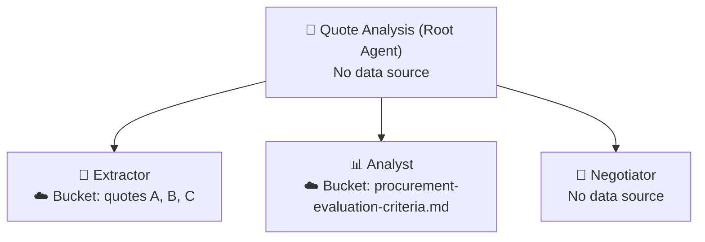

# Case 3 · Supplier Quotes

**Objective:** extract and compare supplier quotes uniformly against a weighted evaluation grid and prepare renegotiation talking points for the procurement department.

---

## 📁 Data Kit (`data-kit/`)

All fictional files ready for use in the workshop are located in the [`./data-kit/`](./data-kit/) subfolder:

| File | Usage | Description |
|---|---|---|
| [`supplier-quote-A.md`](./data-kit/supplier-quote-A.md) | **Knowledge / Input** (Step 1) / **Data Bucket** (Extractor sub-agent) | Complete quote (*PoliGranuli S.r.l.*): price `4.50 €/kg`, 5,000 kg, delivery 4 weeks, payment 60 days EOM, validity 60 days, warranty 12 months |
| [`supplier-quote-B.md`](./data-kit/supplier-quote-B.md) | **Knowledge / Input** (Step 1) / **Data Bucket** (Extractor sub-agent) | Complete quote (*ResinTech Europe GmbH*): higher price (`5.10 €/kg`), shorter lead time (2 weeks), payment 30 days from invoice date, validity 30 days, warranty 24 months |
| [`supplier-quote-C.md`](./data-kit/supplier-quote-C.md) | **Knowledge / Input** (Step 1) / **Data Bucket** (Extractor sub-agent, **Edge case**) | Quote (*EcoCompound Nord S.p.A.*): low price (`4.20 €/kg`), **missing payment terms**, and quote validity (`15 days`) buried in the legal footer notes |
| [`procurement-evaluation-criteria.md`](./data-kit/procurement-evaluation-criteria.md) | **Data Bucket** (Analyst sub-agent) | Weighted evaluation criteria: Price `40%`, Delivery Lead Time `30%`, Payment Terms `20%`, Warranty `10%`, plus `1–5` scoring scales |

---

## 🪜 Step 1 · Chat Agent: "Quote Extractor"

### Configuration in Agent Designer

- **Knowledge to upload:** Upload all three quotes ([`supplier-quote-A.md`](./data-kit/supplier-quote-A.md), [`supplier-quote-B.md`](./data-kit/supplier-quote-B.md), [`supplier-quote-C.md`](./data-kit/supplier-quote-C.md)) or paste them one at a time into chat.
- **Connectors / Google Search:** Disabled

#### Field: `Name`
```text
G3 – Quote Extractor
```

#### Field: `Description`
```text
Extracts key commercial terms from supplier quotes and returns them in a standardized table for side-by-side comparison.
```

#### Field: `Instructions`
```text
ROLE
You are a procurement assistant who extracts structured data from supplier quotes.

OBJECTIVE
Return the details of a quote in an identical, standardized table every time so it can be compared with other quotes.

OUTPUT FORMAT
Two-column table, Field | Value, with these exact rows in order:
Supplier, Unit Price, Quantity, Total Price, Delivery Lead Time, Payment Terms, Quote Validity, Warranty, Notes.

RULES
- Report values exactly as written in the quote, including units of measurement.
- If a field is missing, write "not specified". Never provide an estimated or "typical" value.
- Calculate Total Price only when both Unit Price and Quantity are present.
- In Notes, flag any ambiguities or special terms.
```

### 🧪 Gate Test to Advance to Step 2
1. **Prompt 1:** `"Extract the quote details for Supplier A"` → **Expected:** Complete table with all fields populated and total price calculated (`22,500 €`).
2. **Prompt 2:** `"Extract the quote details for Supplier B"` → **Expected:** Complete table with total price calculated (`25,500 €`).
3. **Prompt 3 (Edge case / Gate):** `"Extract the quote details for Supplier C"` → **Expected:** **Payment Terms** shows `"not specified"` (without inventing "30 days" or similar), and **Quote Validity** (`15 days`) is accurately extracted from the legal footer note.

---

## 🪜 Step 2 · Root Agent: "Quote Analysis"

### Multi-Agent Architecture



---

### 1. Main Agent (Root)

- **Data source:** None

#### Field: `Name`
```text
G3 – Quote Analysis
```

#### Field: `Description`
```text
Coordinates supplier quote extraction, weighted evaluation matrix scoring, and renegotiation lever identification.
```

#### Field: `Instructions`
```text
ROLE
You coordinate the supplier quote analysis and comparison process for the procurement department. You do not extract data or calculate scores yourself: you delegate to sub-agents.

PROCEDURE
1. Call Extractor for each available quote.
2. Pass all extracted tables to Analyst.
3. Pass the evaluation matrix to Negotiator.

OUTPUT FORMAT
- Comparison matrix (from Analyst).
- Scored ranking.
- Renegotiation points per supplier (from Negotiator).

RULES
- Any quote with "not specified" fields must be marked as INCOMPLETE in the ranking, never excluded and never filled in.
```

---

### 2. Sub-agent 1: `Extractor`

- **Data source:** point to the bucket hosting the data ([`supplier-quote-A.md`](./data-kit/supplier-quote-A.md), [`supplier-quote-B.md`](./data-kit/supplier-quote-B.md), [`supplier-quote-C.md`](./data-kit/supplier-quote-C.md))

#### Field: `Name`
```text
Extractor
```

#### Field: `Description`
```text
Extracts structured commercial data from each supplier quote (A, B, C) into a standardized table.
```

#### Field: `Instructions`
Use the exact same instructions as **Step 1**.

---

### 3. Sub-agent 2: `Analyst`

- **Data source:** point to the bucket hosting the data ([`data-kit/procurement-evaluation-criteria.md`](./data-kit/procurement-evaluation-criteria.md))

#### Field: `Name`
```text
Analyst
```

#### Field: `Description`
```text
Builds the quote comparison matrix by applying the official weights and scoring scales from the procurement evaluation criteria.
```

#### Field: `Instructions`
```text
ROLE
You are the procurement analyst responsible for scoring supplier quotes against the official evaluation grid.

OBJECTIVE
Build a comparative matrix with 1-to-5 scores and calculate the weighted total score for every supplier.

INPUT
The extracted tables for each supplier passed by the coordinator.

PROCEDURE
1. Consult the weights and scoring thresholds in procurement-evaluation-criteria.
2. Build a table with suppliers as columns and criteria as rows.
3. Assign a score from 1 to 5 per criterion according to the evaluation criteria and calculate the weighted total.
4. If a criterion is "not specified", assign a score of 0 to that criterion and mark the quote as INCOMPLETE.

OUTPUT FORMAT
- Comparison matrix: Criterion (Weight %) | Supplier A (Value + Score) | Supplier B (Value + Score) | Supplier C (Value + Score).
- Summary ranking with Weighted Total Score and status (COMPLETE / INCOMPLETE).

RULES
- Use exclusively the rules and weights in procurement-evaluation-criteria.
- If a criterion is "not specified", assign 0 and write INCOMPLETE next to that supplier.
```

---

### 4. Sub-agent 3: `Negotiator`

- **Data source:** None

#### Field: `Name`
```text
Negotiator
```

#### Field: `Description`
```text
Identifies weak points for each supplier where improvements should be requested during renegotiation by comparing values across the matrix.
```

#### Field: `Instructions`
```text
ROLE
You are the procurement department's negotiation specialist.

OBJECTIVE
Identify which levers to negotiate improvements on with each supplier, backing every request with an objective comparison against competing quotes.

INPUT
The comparison matrix and supplier tables.

PROCEDURE
1. For each supplier, analyze the criteria where they scored lower than competitors or where information is missing ("not specified").
2. Identify at most 3 renegotiation or clarification points per supplier.

OUTPUT FORMAT
For each supplier (A, B, C), a bulleted list of at most 3 points with:
- **Negotiation point:** [what to ask for] — *Rationale:* [comparison against the best values in competing quotes].

RULES
- For each supplier, list at most 3 points on which to request an improvement, justifying them by comparing against the other suppliers.
- Use solely the values in the matrix. Do not invent discounts or external market terms.
```

### 🧪 Gate Test to Advance to Step 3
- **Prompt (Gate):** `"Compare all available quotes (Supplier A, B, and C), prepare the ranking, and tell me what to renegotiate with each one."`
- **Expected:** The matrix compares all three quotes, assigns `0` to Supplier C's payment terms while marking Supplier C as `INCOMPLETE` in the ranking, and proposes renegotiation points grounded in actual values from the competing quotes.

---

## 🪜 Step 3 · Workflow: "New Supplier Quote"

> **Architectural note:** In Gemini Enterprise, you cannot invoke a no-code agent created in Agent Designer inside a workflow (only ADK or A2A agents are supported). We therefore rebuild the Step 2 sub-agents as a **sequential chain of `Gemini Agent` blocks**, copy-pasting the same instructions and linking the data bucket.

### Configuration in Workflow Builder

| # | Step | Type | Data Source (Bucket) | Configuration / Prompt |
|---|---|---|---|---|
| **0** | **Trigger** | `Manual` (or `Event`) | — | **Manual** with field `target_supplier` (e.g., `Supplier A` or `Supplier C`) |
| **1** | **Extractor** | `Gemini Agent` | Bucket (`supplier-quote-A.md`, `B`, `C`) | Copy the Step 2 `Extractor` sub-agent instructions and append at the bottom: `Extract the standardized table for all quotes present in the bucket (Supplier A, B, and C).` |
| **2** | **Analyst** | `Gemini Agent` | Bucket (`procurement-evaluation-criteria.md`) | Copy the Step 2 `Analyst` sub-agent instructions and append at the bottom: `Extracted quote tables: ${step1.output}` |
| **3** | **Negotiator and Email Draft** | `Gemini Agent` | None | Copy the Step 2 `Negotiator` sub-agent instructions and append at the bottom: `Comparison matrix: ${step2.output}. Focus on ${trigger.target_supplier} and write a draft renegotiation email (professional tone, maximum 120 words) using solely the points identified.` |
| **4** | **Buyer Approval** | `Human in the loop (Approval)` | — | The buyer reviews the matrix (`${step2.output}`) and approves the email draft (`${step3.output}`) |
| **5** | **Send Email** | `Connector Action` | — | Send via Gmail *(or close with final output)* |

### 🧪 Final Test
- Verify that the draft email cites exclusively the points surfaced by the comparison and pauses at the **Approval** step in *Needs Review* status before any email is sent.
