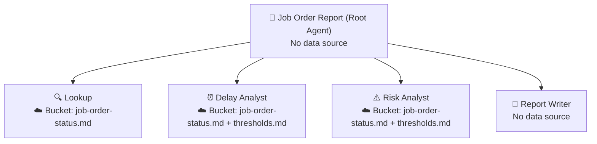

# Case 5 · Job Order Status

**Objective:** get fast, accurate answers on the progress of production job orders and automatically generate a weekly report on delays and operational risks.

---

## 📁 Data Kit (`data-kit/`)

All fictional ready-to-use workshop files are located in the [`./data-kit/`](./data-kit/) subfolder:

| File | Usage | Description |
|---|---|---|
| [`job-order-status.md`](./data-kit/job-order-status.md) | **Knowledge** (Step 1) / **Data bucket** (Step 2 sub-agents) | 15 active/delivered job orders in tabular format. Includes **job orders with a past due date and status `"in progress"`** (e.g., `C-2026-004` and `C-2026-009` relative to November 2026) and job orders with progress risks or supplier/spare-parts issues in the notes (`C-2026-007`, `C-2026-011`, `C-2026-012`) |
| [`thresholds.md`](./data-kit/thresholds.md) | **Data bucket** (`Delay Analyst` and `Risk Analyst` sub-agents) | Official rules for classifying a job order as **DELAYED**, **AT RISK**, or **ON TRACK** |
| [`job-order-status-quiet-week.md`](./data-kit/job-order-status-quiet-week.md) | **Data bucket for Step 3 Test (Edge case)** | Table of 15 job orders that are all either delivered or on track (zero delayed or at-risk job orders) |

---

## 🪜 Step 1 · Chat Agent: "Job Order Lookup"

### Configuration in Agent Designer

- **Knowledge to upload:** [`data-kit/job-order-status.md`](./data-kit/job-order-status.md) *(or connect the Sheet via connector)*
- **Connectors / Google Search:** Disabled

#### Field: `Name`
```text
G5 – Job Order Lookup
```

#### Field: `Description`
```text
Answers specific questions about the status, phase, progress, and delivery date of job orders using only the job order sheet.
```

#### Field: `Instructions`
```text
ROLE
You are the operational assistant for quick lookups on the production job order register.

OBJECTIVE
Answer specific questions about job order status using only the data in the job order sheet.

INPUT
A user question about one or more job orders, production phases, customers, or delivery dates.

PROCEDURE
1. Search the job-order-status sheet for rows relevant to the user's question.
2. Report the requested data, always citing the exact job order code.
3. Compare expected_delivery_date against today's date to indicate whether the deadline has already passed.

OUTPUT FORMAT
Concise response as a bulleted list or table containing: Job order code, Customer, Machine, Phase, Expected delivery date, Status, Progress %, and Notes.

RULES
- Always cite the job order code in your answer.
- If the requested job order is not in the sheet, state that explicitly. Never suggest "similar" job orders.
- If the question asks for data not present in the sheet (e.g., margin, cost), state that explicitly.
- Use today's date to determine whether a delivery date is already in the past.

EDGE CASES
- If the user asks for a non-existent job order code, reply: "Job order [code] is not present in the job-order-status sheet."
```

### 🧪 Gate Test to advance to Step 2
1. **Prompt 1:** `"Which job orders are in testing?"` → **Expected:** Lists all job orders in the `testing` phase, citing their codes (`C-2026-004`, `C-2026-011`, `C-2026-014`).
2. **Prompt 2:** `"When do we deliver C-2026-014 and what is its progress?"` → **Expected:** Reports the exact figures for `C-2026-014`.
3. **Prompt 3 (Edge case / Gate):** `"What is the status of C-2026-099?"` → **Expected:** Explicitly states that job order `C-2026-099` is not present in the sheet, without suggesting alternative codes.

---

## 🪜 Step 2 · Root Agent: "Job Order Report"

### Multi-Agent Architecture



---

### 1. Main Agent (Root)

- **Data source:** None

#### Field: `Name`
```text
G5 – Job Order Report
```

#### Field: `Description`
```text
Coordinates point lookups on individual job orders and generates the weekly report on delays and operational risks.
```

#### Field: `Instructions`
```text
ROLE
You coordinate job order status monitoring for Operations Management.

PROCEDURE
- Specific question about one or more job orders -> call only Lookup.
- Request for a report or overall status overview -> call Delay Analyst, Risk Analyst, and then Report Writer.

REPORT FORMAT
1. Delayed (ordered by days overdue, most severe at the top).
2. At Risk (with the reason).
3. On Track (total count only).

RULES
- A job order with a past delivery date and status other than "delivered" is delayed, even if its status reads "in progress".
- If there are no delayed or at-risk job orders, state so explicitly. Never invent issues.
```

---

### 2. Sub-agent 1: `Lookup`

- **Data source:** points to the bucket hosting the data ([`data-kit/job-order-status.md`](./data-kit/job-order-status.md))

#### Field: `Name`
```text
Lookup
```

#### Field: `Description`
```text
Answers specific questions about individual job orders, customers, or production phases by reading the job order sheet.
```

#### Field: `Instructions`
Use the exact same instructions from **Step 1**.

---

### 3. Sub-agent 2: `Delay Analyst`

- **Data source:** points to the bucket hosting the data ([`data-kit/job-order-status.md`](./data-kit/job-order-status.md), [`data-kit/thresholds.md`](./data-kit/thresholds.md))

#### Field: `Name`
```text
Delay Analyst
```

#### Field: `Description`
```text
Identifies all delayed job orders by applying the official rules in thresholds.md and calculating days overdue relative to today's date.
```

#### Field: `Instructions`
```text
ROLE
You are the production delay analyst.

OBJECTIVE
Identify all delayed job orders according to the rules in thresholds.md and sort them from most severe to least severe.

INPUT
Delay analysis request from the coordinator (use today's current date as reference).

PROCEDURE
1. Read the definition of "DELAYED" in thresholds.md: expected_delivery_date earlier than today AND status different from "delivered" (note: even if the status column says "in progress", if the date has passed, the job order is DELAYED).
2. Calculate the days overdue relative to today's date.
3. Sort delayed job orders by days overdue in descending order (most severe at the top).

OUTPUT FORMAT
Ordered list of delayed job orders with: Job order code | Customer | Phase | Expected delivery date | Days overdue | Progress % | Notes.
If no job order meets the condition, write: "No delayed job orders".

RULES
- Apply only the rule defined in thresholds.md.
- Never exclude overdue job orders just because their status reads "in progress".
```

---

### 4. Sub-agent 3: `Risk Analyst`

- **Data source:** points to the bucket hosting the data ([`data-kit/job-order-status.md`](./data-kit/job-order-status.md), [`data-kit/thresholds.md`](./data-kit/thresholds.md))

#### Field: `Name`
```text
Risk Analyst
```

#### Field: `Description`
```text
Identifies job orders that are not yet overdue but are at risk of delay based on progress percentage or supplier/spare-parts issues in the notes.
```

#### Field: `Instructions`
```text
ROLE
You are the operational risk analyst for active job orders.

OBJECTIVE
Identify job orders not yet delayed that exhibit risk conditions according to thresholds.md, and count the remaining on-track job orders.

INPUT
Risk analysis request from the coordinator.

PROCEDURE
1. Exclude job orders with status "delivered" and those already classified as delayed (past delivery date).
2. On the remaining active job orders, apply the two "AT RISK" rules defined in thresholds.md:
   - Rule R1 (Progress): fewer than 15 days remaining until expected_delivery_date AND progress_% is strictly below 70%.
   - Rule R2 (Supply Chain / Technical): the notes field mentions issues with "supplier", "suppliers", or "spare parts".
3. Count how many job orders are neither delayed nor at risk (On Track job orders, including delivered ones).

OUTPUT FORMAT
- List of AT RISK job orders with: Job order code | Customer | Expected delivery date | Progress % | Specific risk reason (R1 and/or R2 + note).
- Total count of ON TRACK job orders.

RULES
- If there are no job orders at risk, write: "No job orders at risk". Do not invent risks from neutral notes.
```

---

### 5. Sub-agent 4: `Report Writer`

- **Data source:** None

#### Field: `Name`
```text
Report Writer
```

#### Field: `Description`
```text
Assembles the outputs of Delay Analyst and Risk Analyst into the standard weekly executive report format.
```

#### Field: `Instructions`
```text
ROLE
You are the Operations weekly report writer.

OBJECTIVE
Combine the findings from Delay Analyst and Risk Analyst into a clear, concise executive report.

OUTPUT FORMAT
1. **Delayed** (ordered by days overdue, most severe at the top).
2. **At Risk** (with the reason).
3. **On Track** (overall count only).

RULES
- Use exclusively the data passed by the coordinator.
- If there are no delayed or at-risk job orders, state so clearly without inventing issues.
```

### 🧪 Gate Test to advance to Step 3
- **Prompt (Gate):** `"Prepare the weekly job order status report"`
- **Expected:** Job orders whose delivery date has already passed while status is `"in progress"` (`C-2026-004` due `2026-10-15` and `C-2026-009` due `2026-10-25`) appear in section **1. Delayed**, with `C-2026-004` at the top because it has more days overdue; section **2. At Risk** lists `C-2026-007`, `C-2026-011`, and `C-2026-012` with their respective reasons; section **3. On Track** shows only the total count.

---

## 🪜 Step 3 · Workflow: "Weekly Status Report"

> **Architectural note:** In Gemini Enterprise, a no-code agent created in Agent Designer cannot be invoked inside a workflow (only ADK or A2A agents are supported). We therefore rebuild the Step 2 sub-agents as a **sequential chain of `Gemini Agent` blocks**, reusing the same instructions via copy-paste along with the data bucket connection.

### Configuration in Workflow Builder

| # | Step | Type | Data Source (Bucket) | Configuration / Prompt |
|---|---|---|---|---|
| **0** | **Trigger** | `Schedule` (or `Manual` for classroom testing) | — | Weekly schedule (e.g., every Monday at `08:00`) + manual trigger for testing |
| **1** | **Delay Analyst** | `Gemini Agent` | Bucket (`job-order-status.md`, `thresholds.md`) | Copy the `Delay Analyst` sub-agent instructions from Step 2 and append at the end: `Run the delayed job orders analysis relative to today's date.` |
| **2** | **Risk Analyst** | `Gemini Agent` | Bucket (`job-order-status.md`, `thresholds.md`) | Copy the `Risk Analyst` sub-agent instructions from Step 2 and append at the end: `Run the at-risk job orders analysis and count the on-track job orders (excluding those already delayed in ${step1.output}).` |
| **3** | **Report Writer** | `Gemini Agent` | None | Copy the `Report Writer` sub-agent instructions from Step 2 and append at the end: `Delayed job orders: ${step1.output} | At-risk and on-track job orders: ${step2.output}` |
| **4** | **OPS Approval** | `Human in the loop (Approval)` | — | The Operations Manager approves the generated report (`${step3.output}`) |
| **5** | **Send to Team** | `Connector Action` | — | Send via Google Chat or Gmail *(or finish with output)* |

### 🧪 Final Test
- In the data bucket, use [`job-order-status-quiet-week.md`](./data-kit/job-order-status-quiet-week.md) and trigger the workflow: verify that the report explicitly states that **there are no delayed or at-risk job orders**, without inventing any issues.
