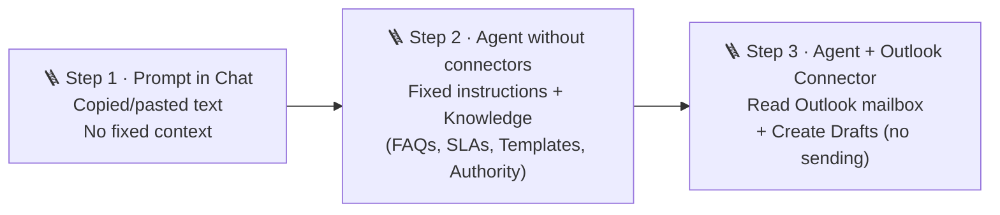

# Case 6 · Inbox Triage and Reply Drafts *(Simple Mode — Outlook Only)*

**Objective:** rapidly classify incoming emails by priority and responsible department, check mandatory data, and prepare reply drafts compliant with company FAQs, SLAs, and authority limits — progressing all the way to automated inbox reading and draft creation directly in **Microsoft Outlook**.

> **"Simple Mode" Track (3 progressive steps, Outlook connector only):**
> 1. **Step 1 · Prompt (direct use in chat):** multi-email triage summary and quick initial reply drafts by copying and pasting text into Gemini Enterprise chat.
> 2. **Step 2 · Simple agent without connectors:** a single agent in *Agent Designer* with fixed instructions and company documents uploaded to *Knowledge* (SLA guidelines, FAQs, and templates).
> 3. **Step 3 · Simple agent with Outlook connector:** the same single agent connected **exclusively to the Microsoft Outlook connector** to read live emails in the mailbox and save reply drafts (*Create message*) without sending them.



---

## 📁 Data Kit (`data-kit/`)

All fictional files (set in **NovaServizi S.r.l.**, a cross-industry B2B services company) are located in the [`./data-kit/`](./data-kit/) subfolder:

| File | Usage | Description |
|---|---|---|
| [`triage-guidelines-and-sla.md`](./data-kit/triage-guidelines-and-sla.md) | **Knowledge** (Steps 2 and 3) | Triage categories, official internal mailboxes, Priority/SLA matrix (`2h`, `1d`, `3d`), mandatory minimum data, and authority limits ("Red Rules") |
| [`faq-and-reply-templates.md`](./data-kit/faq-and-reply-templates.md) | **Knowledge** (Steps 2 and 3) | 5 certified customer FAQs and the 3 official reply templates (*Template A* standard, *Template B* urgent, *Template C* out of authority) |
| [`email-01-invoice-clarification.txt`](./data-kit/email-01-invoice-clarification.txt) | **Test 1 (Standard)** | Request for courtesy copy of invoice `FT-2026/1148` and clarification on user pro-rata billing + question on whether the payment due date is suspended |
| [`email-02-incomplete-operational-urgency.txt`](./data-kit/email-02-incomplete-operational-urgency.txt) | **Test 2 (Urgency with missing data)** | Portal outage affecting 18 operators with a request for *Premium* 24/7 on-call coverage, but **missing Contract Code (`NS-XXXX`)** and exact error message |
| [`email-03-out-of-authority-refund-request.txt`](./data-kit/email-03-out-of-authority-refund-request.txt) | **Test 3 (Edge case / Gate)** | Customer demanding written confirmation today for a **25% credit note** and a reduction of the **notice period from 60 to 15 days** |
| [`morning-inbox-batch.txt`](./data-kit/morning-inbox-batch.txt) | **Test 4 (Multi-email triage)** | Batch of 4 mixed morning emails (quote for 15 user licenses, promotional no-reply newsletter, IBAN change, out-of-authority dispute) |

---

## 🪜 Step 1 · Prompt (Direct Use in Chat)

In this first step **Agent Designer is not used**: participants open the main **Gemini Enterprise** chat directly and work on copied-and-pasted text to run quick triage and draft an initial reply.

### Configuration
- **Tool:** Main Gemini Enterprise chat
- **Uploaded documents / Connectors:** None (pasted text in the message only)

### Prompt 1A — Rapid triage of multiple pasted emails
Copy this prompt into chat and paste the contents of [`morning-inbox-batch.txt`](./data-kit/morning-inbox-batch.txt) at the bottom:

```text
Act as an operations assistant for corporate inbox management.
Analyze the emails pasted below and produce a triage table with the following columns:
1. Sender and Company
2. Request Summary (maximum 15 words)
3. Estimated Priority (High / Medium / Low / No action)
4. Suggested Internal Department
5. Recommended Next Action

Rules:
- Use only the information present in the pasted emails, without inventing details.
- If a message is a newsletter or an automated promotional notification, mark "No action".

EMAILS TO ANALYZE:
[Paste the contents of morning-inbox-batch.txt here]
```

### Prompt 1B — Quick reply draft for a single email
Copy this prompt into chat and test it first with [`email-01-invoice-clarification.txt`](./data-kit/email-01-invoice-clarification.txt) and then with [`email-03-out-of-authority-refund-request.txt`](./data-kit/email-03-out-of-authority-refund-request.txt):

```text
Act as a Customer Operations representative.
Read the customer email pasted below and prepare:
1. A bulleted list of the items requested by the customer and any missing or sensitive information.
2. An email reply draft in English, polite and professional tone, maximum 130 words, without making any unverified financial or contractual commitments.

CUSTOMER EMAIL:
[Paste the email contents here]
```

### 🧪 Gate Test and classroom takeaway to advance to Step 2
- **What already works well:** the chat accurately summarizes the batch of 4 emails, isolates the newsletter, and produces a well-written draft in seconds.
- **The limitation to highlight in class (Conceptual Gate):**
  1. On [`email-01-invoice-clarification.txt`](./data-kit/email-01-invoice-clarification.txt), the chat **does not know company FAQs** (it does not know that the PDF courtesy copy takes `2 business days`, that the accounting check takes `5 business days`, and that the invoice payment due date is *not* suspended).
  2. On [`email-02-incomplete-operational-urgency.txt`](./data-kit/email-02-incomplete-operational-urgency.txt), it does not know that activating 24/7 on-call coverage requires asking for the **Contract Code `NS-XXXX`**.
  3. On [`email-03-out-of-authority-refund-request.txt`](./data-kit/email-03-out-of-authority-refund-request.txt), you have to remember every single time to type *"without making any financial commitments"* in the prompt, and neither the official escalation mailboxes nor company *Template C* appear.

Once the group can explain what information a standalone prompt lacks, they move up to **Step 2**.

---

## 🪜 Step 2 · (Simple) Agent Without Connectors: "Inbox Triage Assistant"

Now we turn the prompt into a **reusable agent** with fixed instructions and certified company knowledge, still **without connectors** (participants continue pasting email text into chat).

### Configuration in Agent Designer

- **Knowledge to upload (*Add files*):**
  1. [`data-kit/triage-guidelines-and-sla.md`](./data-kit/triage-guidelines-and-sla.md)
  2. [`data-kit/faq-and-reply-templates.md`](./data-kit/faq-and-reply-templates.md)
- **Data sources & tools (Connectors):** None (all disabled)
- **Google Search:** Disabled (use only the files uploaded to *Knowledge*)

#### Field: `Name`
```text
G6 – Inbox Triage Assistant
```

#### Field: `Description`
```text
Classifies incoming emails according to company SLA guidelines, flags out-of-authority requests or missing mandatory data, and drafts replies using official FAQs and templates.
```

#### Field: `Instructions`
```text
ROLE
You are the Customer Operations assistant at NovaServizi S.r.l., responsible for triaging incoming emails and preparing reply drafts.

OBJECTIVE
Analyze one or more emails pasted by the user, classify them according to internal guidelines (category, priority/SLA, internal mailbox, any required escalations), and prepare a reply draft compliant with official FAQs and templates.

INPUT
The text of a single email or a batch of multiple emails pasted by the user in chat.

PROCEDURE
1. For each email, identify the sender, company, Contract Code (NS-XXXX) if present, and subject of the request.
2. Assign Category, Priority with corresponding SLA, and Official Internal Mailbox using exclusively "triage-guidelines-and-sla.md".
3. Check whether any Mandatory Minimum Data for that category is missing and whether the request falls within Authority Limits ("Red Rules": refunds, credit notes, discounts > 10%, waivers to clauses/60-day notice period, 24/7 on-call coverage without a verified Premium contract).
4. If the email is classified as "INFORMATIONAL ONLY", do not generate any reply draft.
5. For operational emails, draft the reply by selecting the appropriate template from "faq-and-reply-templates.md":
   - Template A for standard/informational requests;
   - Template B for HIGH Priority operational urgencies;
   - Template C for any request touching Authority Limits ("ESCALATE INTERNALLY").

OUTPUT FORMAT
For each analyzed email, produce two distinct blocks:
1. INTERNAL TRIAGE CARD (table or list):
   - Category | Priority & SLA | Authority Outcome (WITHIN AUTHORITY / ESCALATE INTERNALLY / NO ACTION) | Internal Mailbox to Involve | Missing Mandatory Data.
2. CUSTOMER REPLY DRAFT (only when a reply is required):
   - Subject + Email body filled out using the selected Template A, B, or C (maximum 130 words).

RULES
- Use exclusively the information contained in "triage-guidelines-and-sla.md" and "faq-and-reply-templates.md". Do not use general knowledge and do not invent timeframes, discounts, or procedures.
- Never invent internal or external email addresses not present in the email or in the guidelines.
- If a mandatory data item is missing from the customer's email, write "not provided" in the internal triage card and ask for it in the draft.
- Never promise refunds, credit notes, discounts > 10%, reductions of the 60-day notice period, or 24/7 on-call coverage without a verified Premium Contract Code.

EDGE CASES
- If a single email contains multiple out-of-authority requests of different kinds (e.g., financial credit note + contractual clause modification), mark "ESCALATE INTERNALLY", list all relevant internal mailboxes, and use only Template C without commenting on the merits of approval.
- If the user pastes a batch of multiple emails, first display a summary triage table sorted by priority (from HIGH to NONE) and then only the required reply drafts.
```

### 🧪 Gate Test to advance to Step 3
1. **Prompt 1:** Paste [`email-01-invoice-clarification.txt`](./data-kit/email-01-invoice-clarification.txt)
   - **Expected:** Category `ADMINISTRATION` (`amministrazione@novaservizi-demo.example`), Priority `MEDIUM (within 1 business day)`, *Template A* stating the exact **2 business days** for the PDF copy, **5 business days** for the pro-rata accounting check, and clarifying that payment due dates are **not** suspended.
2. **Prompt 2:** Paste [`email-02-incomplete-operational-urgency.txt`](./data-kit/email-02-incomplete-operational-urgency.txt)
   - **Expected:** Category `OPERATIONAL SUPPORT` (`supporto.urgente@novaservizi-demo.example`), Priority `HIGH (within 2 business hours)`, flags missing **Contract Code (`NS-XXXX`)** and exact error message, uses *Template B*, and does **not** confirm 24/7 on-call coverage past 18:00 until the *Premium* plan is verified.
3. **Prompt 3 (Edge case / Gate):** Paste [`email-03-out-of-authority-refund-request.txt`](./data-kit/email-03-out-of-authority-refund-request.txt)
   - **Expected (Gate):** Marks `ESCALATE INTERNALLY`, involves **both** `amministrazione@novaservizi-demo.example` (25% credit note) **and** `ufficio.legale@novaservizi-demo.example` (waiver of the 60-day notice period), and generates the draft using **Template C** without granting or pre-approving anything.
4. **Prompt 4:** Paste [`morning-inbox-batch.txt`](./data-kit/morning-inbox-batch.txt)
   - **Expected:** Summary table sorted by priority; `EMAIL 2` (newsletter) classified as `INFORMATIONAL ONLY` / `NO ACTION` with no draft generated.

---

## 🪜 Step 3 · (Simple) Agent With Outlook Connector: "Outlook Inbox Assistant"

At Step 3 **no sub-agents or workflows are added**: we keep the **exact same single agent**, but connect **exclusively the Microsoft Outlook connector** to eliminate copy-pasting when reading emails and save reply drafts directly in Outlook's *Drafts* folder.

### 1. Quick Outlook mailbox setup for testing (2 minutes)
Before testing Step 3, each participant (or the facilitator on the demo account) sends 2 or 3 test emails to their own **Outlook** mailbox by copying Subject and Body from:
- [`email-01-invoice-clarification.txt`](./data-kit/email-01-invoice-clarification.txt)
- [`email-02-incomplete-operational-urgency.txt`](./data-kit/email-02-incomplete-operational-urgency.txt)
- [`email-03-out-of-authority-refund-request.txt`](./data-kit/email-03-out-of-authority-refund-request.txt)

> 💡 **Why keep the `[WORKSHOP]` prefix in the subject:** every file in the data kit already has a subject starting with `[WORKSHOP]`. By asking the agent to search only for emails with `[WORKSHOP]` in the subject, the exercise ignores any real work emails in the user's mailbox.

### 2. Configuration in Agent Designer

Reopen the Step 2 agent (or duplicate it to keep the connector-free version) and configure:

- **Knowledge (*Add files*):** keep the same 2 files from Step 2 (`triage-guidelines-and-sla.md` and `faq-and-reply-templates.md`)
- **Data sources & tools:** enable **ONLY the Microsoft Outlook connector** (no other connectors active)
  - **Read / Search mail:** Enabled
  - **Outlook write actions:** enable **only `Create message`** (*creates a draft in the user's mailbox*) and **disable `Send mail` / `Reply`**
  - > **Connector safety note:** if the tenant administrator only allows enabling the entire group of Outlook write actions without granular selection, the strict ban on sending remains enforced both by the `Instructions` below and by Gemini Enterprise's UI confirmation prompt before any connector action runs. Conversely, if the connector is configured as read-only, the agent will still read emails from Outlook and output ready-to-copy drafts in chat.
- **Google Search:** Disabled

#### Field: `Name`
```text
G6 – Outlook Inbox Assistant
```

#### Field: `Description`
```text
Reads and triages emails from the Microsoft Outlook mailbox applying company SLAs, FAQs, and authority limits, and saves reply drafts in Outlook without ever sending them.
```

#### Field: `Instructions`
```text
ROLE
You are the Customer Operations assistant at NovaServizi S.r.l., connected to the user's Microsoft Outlook mailbox for email triage and safe reply draft preparation.

OBJECTIVE
Search and read emails in the Outlook mailbox according to the user's request, produce the triage card based on internal guidelines, and, when requested by the user, save the reply as a DRAFT in Outlook without ever sending it.

INPUT
Natural-language request from the user (e.g., "Check today's emails with subject [WORKSHOP]", "Prepare the reply draft in Outlook for the email from Studio Associato Verdi").

PROCEDURE
1. Use exclusively the Microsoft Outlook connector to search and read emails matching the user's request (always filter by "[WORKSHOP]" when specified by the user, or by the requested sender/subject).
2. Analyze every retrieved email strictly applying "triage-guidelines-and-sla.md" (Category, Priority/SLA, Mandatory Minimum Data, Authority Limits) and "faq-and-reply-templates.md" (FAQs 1-5 and Templates A, B, C).
3. Always display in chat both the Internal Triage Card and a preview of the proposed draft.
4. If the user asks to prepare/save the draft in Outlook:
   - Use exclusively the Outlook "Create message" action to create a DRAFT in the user's mailbox;
   - Set the recipient to the actual sender address read from the Outlook email (never invent addresses);
   - Set Subject and Body strictly according to the selected Template A, B, or C;
   - NEVER use sending actions ("Send mail", immediate "Reply", or "Forward").

OUTPUT FORMAT
1. Summary of emails read from Outlook (Date/Time, Sender, Subject).
2. Internal Triage Card (Category | Priority & SLA | Authority Outcome | Internal Mailbox to Involve | Missing Data).
3. Reply Draft Text (Template A, B, or C, maximum 130 words).
4. Outlook Operation Status: explicit confirmation "Draft saved in Outlook (NOT sent)" or notice that confirmation is awaited before creating it.

RULES
- Use only the Microsoft Outlook connector and the two Knowledge documents ("triage-guidelines-and-sla.md" and "faq-and-reply-templates.md").
- NEVER send emails externally or internally: the only permitted write action on Outlook is creating a draft ("Create message").
- Do not create drafts for emails classified as "INFORMATIONAL ONLY".
- Never promise refunds, credit notes, discounts > 10%, waivers of the 60-day notice period, or 24/7 on-call coverage without a verified Premium contract.

EDGE CASES
- If no email matching the search criteria is found in the Outlook mailbox, state this explicitly without inventing sample messages.
- If the draft creation action is not enabled in the tenant or is declined by the user, report "Draft not created in Outlook" and leave the full text in chat ready to copy.
```

### 🧪 Test Prompts and Final Test (Step 3)

1. **Prompt 1 (Automated reading and triage from Outlook):**
   > *"Read from my Outlook mailbox the emails received today that contain `[WORKSHOP]` in the subject and show me the triage table sorted by priority."*
   - **Expected:** The agent queries the Outlook connector, retrieves the live emails in the mailbox, and sorts them with the operational outage at the top (`Priority HIGH — SLA 2h`), flagging `ESCALATE INTERNALLY` on the 25% credit note dispute.

2. **Prompt 2 (Creating a standard draft in Outlook):**
   > *"Prepare and save in Outlook Drafts the reply to the email about invoice FT-2026/1148."*
   - **Expected:** The agent displays text compliant with *Template A* (with the FAQ timeframes of 2 and 5 business days), requests/obtains confirmation for the connector action, and creates a **draft** in Outlook's *Drafts* folder without sending it.

3. **Prompt 3 — Final Test (Final Gate on out-of-authority request):**
   > *"Prepare and save in Outlook Drafts the reply to the dispute about the Analytics module (Contract NS-3190)."*
   - **Expected (Gate):**
     - In the chat triage card, marks `ESCALATE INTERNALLY` to `amministrazione@novaservizi-demo.example` and `ufficio.legale@novaservizi-demo.example`;
     - Creates **only a draft** in Outlook's *Drafts* folder based on **Template C** (no promise on either the 25% credit note or reducing the notice period to 15 days);
     - Opening Microsoft Outlook directly in the **Drafts** folder, the participant verifies that the email is ready for review and has **not** been sent in *Sent Items*.
