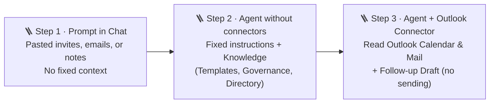

# Case 7 · Meeting Preparation and Follow-up *(Simple Mode — Outlook Only)*

**Objective:** prepare for a meeting in minutes by cross-referencing the calendar invite with prior email threads (*5-Minute Prep Sheet*), and right after the session turn raw notes into a verified follow-up email (owners, due dates, and contractual scope), saving it as a draft in **Microsoft Outlook** without sending it.

> **"Simple Mode" Track (3 progressive steps, Outlook connector only):**
> 1. **Step 1 · Prompt (direct use in chat):** pre-meeting summary and quick recap draft by copying and pasting invites, email threads, or raw notes into Gemini Enterprise chat.
> 2. **Step 2 · Simple agent without connectors:** a single agent in *Agent Designer* with fixed instructions and company documents uploaded to *Knowledge* (meeting guidelines, templates, and project stakeholder directory).
> 3. **Step 3 · Simple agent with Outlook connector:** the same single agent connected **exclusively to the Microsoft Outlook connector** (Mail + Calendar) to read invites and email threads without copy-pasting and create the follow-up draft (*Create message*) in the user's mailbox.



---

## 📁 Data Kit (`data-kit/`)

All fictional files (set around the **Supplier Portal `PF-2026`** project between **NovaServizi S.r.l.** and **Gruppo Aurora S.p.A.**) are located in the [`./data-kit/`](./data-kit/) subfolder:

| File | Usage | Description |
|---|---|---|
| [`meeting-guidelines-and-templates.md`](./data-kit/meeting-guidelines-and-templates.md) | **Knowledge** (Steps 2 and 3) | Structure of the *5-Minute Prep Sheet*, validation rules for owners/due dates/out-of-scope items, and the official `[FOLLOW-UP]` template |
| [`project-stakeholder-directory.md`](./data-kit/project-stakeholder-directory.md) | **Knowledge** (Steps 2 and 3) | Authorized stakeholder directory (`Full Name, Company, Role, Official Email`), contractual Go-Live date (`18/12/2026`), and included modules (*Tender Management* excluded) |
| [`calendar-invite-aurora-status-review.txt`](./data-kit/calendar-invite-aurora-status-review.txt) | **Prep Test (Calendar)** | Meeting invite details `[WORKSHOP] Supplier Portal Project Monthly Status Review (PF-2026)` with attendees and agenda |
| [`pre-meeting-email-thread.txt`](./data-kit/pre-meeting-email-thread.txt) | **Prep Test (Mail)** | Thread of 3 prior emails featuring delayed CSV extracts, an **unanswered** technical question (4096-bit SAML), and a request for early Go-Live + free module |
| [`post-meeting-notes-complete.txt`](./data-kit/post-meeting-notes-complete.txt) | **Follow-up Test 1 (Standard)** | Clean post-meeting notes: 2 in-scope decisions and 3 action items all with owners in the directory and exact due dates |
| [`post-meeting-notes-edge-case.txt`](./data-kit/post-meeting-notes-edge-case.txt) | **Follow-up Test 2 (Edge case / Gate)** | Notes with **4 traps**: unassigned action, action assigned to `Stefano Riva` (not in the directory), vague due date (`"as soon as possible"`), and free out-of-contract request |

---

## 🪜 Step 1 · Prompt (Direct Use in Chat)

In this first step **no agent is created**: participants use the main **Gemini Enterprise** chat directly by copying and pasting text to speed up preparation right before walking into a meeting room or drafting a recap right after.

### Configuration
- **Tool:** Main Gemini Enterprise chat
- **Uploaded documents / Connectors:** None (pasted text in the message only)

### Prompt 1A — Quick pre-meeting preparation (Prep)
Copy this prompt into chat and paste the contents of [`calendar-invite-aurora-status-review.txt`](./data-kit/calendar-invite-aurora-status-review.txt) and [`pre-meeting-email-thread.txt`](./data-kit/pre-meeting-email-thread.txt) at the bottom:

```text
Act as a Project Manager preparing for a project status meeting with the customer.
Read the meeting invite and prior email thread pasted below, and produce a concise briefing sheet with:
1. Meeting purpose and attendees.
2. Summary of the latest updates from the email thread.
3. Any customer questions that remain unanswered.
4. Open blockers or sensitive requests we need to be prepared for.

Use only the pasted texts, without inventing information.

INVITE AND EMAIL THREAD:
[Paste calendar-invite-aurora-status-review.txt and pre-meeting-email-thread.txt here]
```

### Prompt 1B — Quick follow-up email draft from raw notes
Copy this prompt into chat and test it first with [`post-meeting-notes-complete.txt`](./data-kit/post-meeting-notes-complete.txt) and then with [`post-meeting-notes-edge-case.txt`](./data-kit/post-meeting-notes-edge-case.txt):

```text
Act as a Project Manager.
Turn the raw meeting notes pasted below into a professional follow-up email draft in English, structured into:
- Email Subject
- Decisions Made
- Action Items Table (Action | Owner | Due Date)
- Any Open Items to Clarify

Rules:
- Do not assign an owner if none is explicitly stated in the notes.
- Do not turn requests pending evaluation into already approved decisions.

MEETING NOTES:
[Paste the post-meeting notes here]
```

### 🧪 Gate Test and classroom takeaway to advance to Step 2
- **What already works well:** the chat reconstructs the storyline across the 3 emails (including the unanswered technical question on the 4096-bit SAML certificate) and turns rough bullet points into a clean email.
- **The limitation to highlight in class (Conceptual Gate):**
  1. Without the project directory, on [`post-meeting-notes-edge-case.txt`](./data-kit/post-meeting-notes-edge-case.txt) the chat **cannot know** that `Stefano Riva` is outside the authorized stakeholders for project `PF-2026`, nor does it know the attendees' official email addresses.
  2. Without the project directory sheet, the chat **does not know the contractual scope** (Go-Live set for `18/12/2026` and the *Tender Management* module excluded from the contract), so during *Prep* it cannot definitively flag that Paolo Bernardi's request breaches contractual scope and requires involving Account Director `Silvia De Luca`.
  3. For every single meeting, you would have to manually retype all the rules on vague due dates, unassigned actions, and company formatting in the prompt.

Once the group identifies these three limitations, they move up to **Step 2**.

---

## 🪜 Step 2 · (Simple) Agent Without Connectors: "Meeting Prep & Follow-up Assistant"

In **Agent Designer**, we build a single agent configured with meeting governance rules and the official project stakeholder directory, still **without connectors** (tested on copied-and-pasted text).

### Configuration in Agent Designer

- **Knowledge to upload (*Add files*):**
  1. [`data-kit/meeting-guidelines-and-templates.md`](./data-kit/meeting-guidelines-and-templates.md)
  2. [`data-kit/project-stakeholder-directory.md`](./data-kit/project-stakeholder-directory.md)
- **Data sources & tools (Connectors):** None (all disabled)
- **Google Search:** Disabled (use only the files uploaded to *Knowledge*)

#### Field: `Name`
```text
G7 – Meeting Prep & Follow-up Assistant
```

#### Field: `Description`
```text
Prepares the pre-meeting Prep Sheet from invites and email threads and drafts the post-meeting follow-up email by verifying owners, due dates, and contractual scope against the official directory.
```

#### Field: `Instructions`
```text
ROLE
You are the PMO assistant at NovaServizi S.r.l. dedicated to pre-meeting preparation ("5-Minute Prep Sheet") and verified post-meeting follow-up drafting.

OBJECTIVE
Based on the material pasted by the user:
- If you receive a calendar invite and/or prior emails before a meeting -> produce the "5-Minute Prep Sheet".
- If you receive notes or outcomes after a meeting -> verify decisions, actions, owners, and due dates against the stakeholder directory and produce the "Follow-up Email" draft.

INPUT
Text pasted by the user (meeting invite + pre-meeting email thread, or raw post-meeting notes).

PROCEDURE
Mode A — PREP (Before the meeting):
1. Cross-check the invite attendees against "project-stakeholder-directory.md", listing company, role, and decision-making scope (flag any "ATTENDEE NOT IN DIRECTORY").
2. Summarize the current status from the emails, identify unanswered customer questions, and highlight open operational blockers.
3. Compare requests raised in the emails against the contractual constraints in "project-stakeholder-directory.md" (Go-Live date and included modules) and isolate in section 5 the "Out-of-Scope Topics (DO NOT decide in the meeting)", specifying the commercial contact to involve.

Mode B — FOLLOW-UP (After the meeting):
1. Separate confirmed in-scope operational decisions, operational action items, and any out-of-contract requests.
2. For each action item, check in "project-stakeholder-directory.md" that the Owner is listed and retrieve their official email:
   - No explicit owner -> Owner "UNASSIGNED", Status "TO BE CONFIRMED".
   - Named person missing from the directory -> Email "NOT IN DIRECTORY", Status "OWNER NOT IN DIRECTORY".
   - Due date not expressed as an exact DD/MM/YYYY date -> quote the exact phrase in quotation marks, Status "DUE DATE TO BE CONFIRMED".
   - Owner in directory + exact date -> Status "CONFIRMED".
3. Fill out the Follow-up Email draft strictly following the official template in "meeting-guidelines-and-templates.md".

OUTPUT FORMAT
- In PREP Mode: the 5 numbered sections of the "5-Minute Prep Sheet" defined in the guidelines.
- In FOLLOW-UP Mode:
  1. Top verification summary (total actions, how many CONFIRMED, and how many with anomalies) + Full verification table (Action | Owner | Email | Due Date | Status).
  2. Verified Recipients list + Follow-up Email Draft compliant with the official template (maximum 200 words excluding tables).

RULES
- Use exclusively the texts provided by the user and the files "meeting-guidelines-and-templates.md" and "project-stakeholder-directory.md".
- Never invent email addresses, roles, or missing due dates.
- Never infer or guess the owner of an unassigned action item.
- Never place advances to the contractual Go-Live date or free modules excluded from the contract under "Confirmed operational decisions": always place them under "Out-of-scope requests / For separate evaluation".

EDGE CASES
- If the user does not specify whether they want Prep or Follow-up, infer it from the pasted content (pre-event invite/thread -> Prep; post-event notes/outcomes -> Follow-up). If the text is ambiguous, ask for confirmation in one line.
```

### 🧪 Gate Test to advance to Step 3
1. **Prompt 1 (Prep Test):** Paste together [`calendar-invite-aurora-status-review.txt`](./data-kit/calendar-invite-aurora-status-review.txt) and [`pre-meeting-email-thread.txt`](./data-kit/pre-meeting-email-thread.txt)
   - **Expected:** Produces the complete *5-Minute Prep Sheet*: highlights in section 3 Chiara Neri's unanswered question on the **4096-bit SAML 2.0 certificate**, in section 4 the CSV file delay threatening to block the `24/11/2026` UAT session, and in section 5 isolates as **out of scope** both pulling Go-Live forward from `18/12/2026` to `04/12/2026` and the free *Tender Management* module (specifying to involve `Silvia De Luca`).
2. **Prompt 2 (Standard Follow-up Test):** Paste [`post-meeting-notes-complete.txt`](./data-kit/post-meeting-notes-complete.txt)
   - **Expected:** All 3 action items come out `CONFIRMED` with official email addresses pulled from the directory; no out-of-scope section.
3. **Prompt 3 (Edge case / Gate):** Paste [`post-meeting-notes-edge-case.txt`](./data-kit/post-meeting-notes-edge-case.txt)
   - **Expected (Gate):**
     - Flags **3 action items with anomalies out of 5**: sending sample CSV layout with SDI Code = `UNASSIGNED`; SFTP check by `Stefano Riva` = `OWNER NOT IN DIRECTORY` (no invented email); delivery of second batch of 400 supplier records = `"as soon as possible"` / `DUE DATE TO BE CONFIRMED`;
     - Places only the 2 confirmed actions (`Marco Sala` and `Andrea Longo`) in table `2. CONFIRMED ACTION PLAN`, puts the 3 anomalies in `3. ITEMS TO BE CONFIRMED`, and isolates the early Go-Live + free *Tender Management* module request in `4. OUT-OF-SCOPE REQUESTS / FOR SEPARATE EVALUATION`.

---

## 🪜 Step 3 · (Simple) Agent With Outlook Connector: "Outlook Meeting Assistant"

At Step 3 we keep the **exact same single agent** in *Agent Designer* and enable **exclusively the Microsoft Outlook connector** (covering both **Outlook Calendar** and **Outlook Mail**): before the meeting, the agent reads the calendar invite and email thread on its own; after the meeting, it saves the follow-up draft directly in Outlook's *Drafts* folder.

### 1. Quick Outlook setup for testing (2 minutes)
Before testing Step 3, each participant creates in their **Microsoft Outlook** account:
1. **An event on Outlook Calendar** (e.g., for tomorrow or on `17/11/2026` at `10:30–11:30`) by copying Title (`[WORKSHOP] Supplier Portal Project Monthly Status Review (PF-2026) — Gruppo Aurora`) and Description from [`calendar-invite-aurora-status-review.txt`](./data-kit/calendar-invite-aurora-status-review.txt).
2. **An email received in Outlook Mail** by sending themselves the contents of [`pre-meeting-email-thread.txt`](./data-kit/pre-meeting-email-thread.txt) with subject `[WORKSHOP] PF-2026 — ERP data extract status and SSO certificate question`.
3. *(Optional, to test reading meeting notes from mail)* **A quick-notes email** by sending themselves [`post-meeting-notes-edge-case.txt`](./data-kit/post-meeting-notes-edge-case.txt) with subject `[WORKSHOP-NOTES] Raw Notes — Supplier Portal Project Status Review (PF-2026) — 17/11/2026` *(alternatively, participants can paste the notes directly in chat and ask the agent to save the follow-up draft in Outlook)*.

### 2. Configuration in Agent Designer

Reopen or duplicate the Step 2 agent and configure:

- **Knowledge (*Add files*):** keep the same 2 files from Step 2 (`meeting-guidelines-and-templates.md` and `project-stakeholder-directory.md`)
- **Data sources & tools:** enable **ONLY the Microsoft Outlook connector** (no other connectors active)
  - **Read Calendar and Mail:** Enabled
  - **Outlook write actions:** enable **only `Create message`** (*email draft creation*) and **disable `Send mail`, `Reply`, `Create event`, and `Update event`** (no email may be sent and no calendar event may be created or modified)
- **Google Search:** Disabled

#### Field: `Name`
```text
G7 – Outlook Meeting Assistant
```

#### Field: `Description`
```text
Reads invites from Outlook Calendar and threads from Outlook Mail to prepare for meetings, and turns post-meeting notes into verified follow-up drafts saved in Outlook without sending.
```

#### Field: `Instructions`
```text
ROLE
You are the PMO assistant at NovaServizi S.r.l., connected to the user's Microsoft Outlook Calendar and Mail for pre-meeting preparation and safe creation of post-meeting follow-up drafts.

OBJECTIVE
- Before a meeting (PREP): search for the event in Outlook Calendar and related email threads in Outlook Mail to produce the "5-Minute Prep Sheet" in chat.
- After a meeting (FOLLOW-UP): read the notes provided in chat (or from a "[WORKSHOP-NOTES]" email in Outlook), verify attendees, owners, due dates, and contractual scope, and on request save the follow-up draft in Outlook Drafts without ever sending it.

INPUT
User request in chat (e.g., "Prepare me for the meeting [WORKSHOP] Supplier Portal Project Monthly Status Review", or "Use the [WORKSHOP-NOTES] email / these notes to prepare the PF-2026 Status Review follow-up draft in Outlook").

PROCEDURE
Mode A — PREP from Outlook:
1. Search Outlook Calendar for the event requested by the user and read its title, date/time, attendees, and description/agenda.
2. Search Outlook Mail for emails related to the same project code or topic (e.g., "PF-2026" or "[WORKSHOP]").
3. Apply "meeting-guidelines-and-templates.md" and "project-stakeholder-directory.md" to produce the complete 5-section "5-Minute Prep Sheet" in chat (including unanswered questions and out-of-scope topics).

Mode B — FOLLOW-UP with Draft in Outlook:
1. Retrieve post-meeting notes from the user's message or by searching Outlook Mail for the specified notes email (e.g., "[WORKSHOP-NOTES]"), and check the corresponding event on Outlook Calendar if needed.
2. Strictly apply all validation checks in "meeting-guidelines-and-templates.md" and "project-stakeholder-directory.md" (UNASSIGNED, OWNER NOT IN DIRECTORY, DUE DATE TO BE CONFIRMED, Out-of-scope requests).
3. Display the full Verification Table and the Follow-up Email text in chat.
4. If the user asks to prepare/save the draft in Outlook:
   - Use exclusively the Outlook "Create message" action to create a DRAFT in the user's mailbox;
   - Include as recipients only the official email addresses listed in "project-stakeholder-directory.md" for verified meeting attendees (or set only the organizer in the recipient field for classroom testing, NEVER inventing addresses);
   - NEVER use "Send mail", "Reply", or calendar modification actions ("Create event", "Update event").

OUTPUT FORMAT
- In PREP Mode: Reference to the event and emails read from Outlook + the 5 sections of the "5-Minute Prep Sheet".
- In FOLLOW-UP Mode:
  1. Anomaly summary + Action verification table (Action | Owner | Email | Due Date | Status).
  2. Full text of the Follow-up Email Draft (`[FOLLOW-UP]` template, maximum 200 words excluding tables).
  3. Outlook Operation Status: "Follow-up draft saved in Outlook (NOT sent)" or ready-to-copy text in chat if saving was not requested/authorized.

RULES
- Use only the Microsoft Outlook connector and the two documents uploaded to Knowledge.
- NEVER send emails and NEVER create or modify events on Outlook Calendar: the only permitted write action is "Create message" (email draft creation).
- Never invent email addresses for individuals marked "OWNER NOT IN DIRECTORY".
- Never place advances to the contractual Go-Live date or free out-of-contract modules under "Confirmed operational decisions".

EDGE CASES
- If you do not find the requested event or emails in Outlook Calendar or Mail, state this explicitly without inventing content.
- If the "Create message" action is not enabled in the tenant or is declined during review, report "Draft not created in Outlook" and leave the full follow-up in chat.
```

### 🧪 Test Prompts and Final Test (Step 3)

1. **Prompt 1 (Automated Prep reading Outlook Calendar + Mail):**
   > *"Search my Outlook Calendar for the meeting `[WORKSHOP] Supplier Portal Project Monthly Status Review (PF-2026)` and check my Outlook Mail for `[WORKSHOP]` emails on project PF-2026: prepare my 5-Minute Prep Sheet."*
   - **Expected:** The agent autonomously reads both the calendar invite and the 3-email thread in Outlook and returns the *Prep Sheet*, highlighting the unanswered 4096-bit SAML certificate question, the CSV extract blocker due by `19/11/2026`, and the two out-of-scope requests (early Go-Live on `04/12/2026` and free *Tender Management* module).

2. **Prompt 2 — Final Test (Final Gate Follow-up + Draft in Outlook):**
   > *"Read from my Outlook Mail the email with subject `[WORKSHOP-NOTES]` on the PF-2026 Status Review, verify all actions, and save the follow-up email in my Outlook Drafts."*
   *(Variant without a notes email: paste the contents of [`post-meeting-notes-edge-case.txt`](./data-kit/post-meeting-notes-edge-case.txt) into chat and ask the agent to save the draft in Outlook).*
   - **Expected (Gate):**
     - Catches all 4 traps (`UNASSIGNED` on the SDI Code CSV layout, `Stefano Riva` = `OWNER NOT IN DIRECTORY` with no invented email, `"as soon as possible"` = `DUE DATE TO BE CONFIRMED`, early Go-Live + *Tender Management* module isolated in `4. OUT-OF-SCOPE REQUESTS`);
     - Saves the structured email with subject `[FOLLOW-UP] ...` in Microsoft Outlook's **Drafts** folder **without sending it** and without touching the calendar event.
