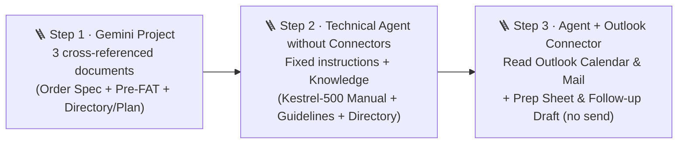

# Case 9 · Machine Commissioning, Technical Support and Meeting Management *(2h Workshop Track — Project + Technical Manual + Outlook Only)*

**Objective:** guide the Project & Application Engineering (Technical PMO) team through a hands-on 3-step progression of increasing capability: (1) cross-reference the customer order specification, Pre-FAT test report, and project stakeholder directory inside a **Gemini Project** to extract gaps and *Go/No-Go* conditions, (2) build a **connector-free technical agent** grounded in the **Operation and Maintenance Manual** of the `Kestrel-500 Hybrid` hybrid robotic center, and (3) connect that same agent to the **Microsoft Outlook connector only** (Calendar + Mail) to prepare the technical Status Review (*5-Minute Prep Sheet*) and automatically save the verified follow-up draft in Outlook *Drafts* without ever sending it.

> **"2h Workshop Track — Project + Technical Manual + Outlook Only" Progression:**
> 1. **Step 1 · Gemini Project (Cross-document data extraction):** create a Project with 3 project documents (`customer order specification`, `Pre-FAT test report`, `stakeholder directory & plan`) to extract numerical deviations, leads, *Go/No-Go* assessment, and anomalies/missing data.
> 2. **Step 2 · Simple Agent without Connectors (Technical Domain):** a single agent in *Agent Designer* configured with fixed instructions and context documents uploaded to *Knowledge* (`kestrel-500-operation-and-maintenance-manual.md`, meeting guidelines, and stakeholder directory).
> 3. **Step 3 · Simple Agent with Outlook Connector Only:** the same agent connected **exclusively to Microsoft Outlook (Calendar + Mail)** to read the Status Review invite and pre-meeting email thread, produce the *Prep Sheet* with Manual-certified answers, and save the `[FOLLOW-UP]` in *Drafts* (*Create message*, never sending emails or modifying calendar events).



---

## 📁 Data Kit (`data-kit/`)

All fictitious files (set around project **`COMM-2026-088`** between the LFAM Department and **Aerospace Tooling Nord S.p.A.** for the `Kestrel-500 Hybrid` cell, serial number `KS-2026-011`) are located in the [`./data-kit/`](./data-kit/) subfolder:

| File | Usage Level | Description |
|---|---|---|
| [`dossier-01-customer-order-specification.md`](./data-kit/dossier-01-customer-order-specification.md) | **Project** (Step 1) | Contractual specifications for `COMM-2026-088`: tolerance `± 0.20 mm`, roughness `Ra <= 1.6 µm`, site requirements (`>= 3,500 kg/m²`, `ISO 8573-1 Class 4`), Go-Live `22/12/2026`, exclusions (*Advanced Thermal Simulation*, `PEKK-CF`), no late-delivery penalty stated |
| [`dossier-02-fat-test-report.md`](./data-kit/dossier-02-fat-test-report.md) | **Project** (Step 1) | Results of the 6 Pre-FAT tests (`FAT-01`–`FAT-06`): `FAT-03` critical (`± 0.34 mm`), `FAT-05` minor (`K404` alarm), `FAT-06` critical (`2,800 kg/m²` floor + missing compressed air certificate); **`FAT-07` does not exist** |
| [`dossier-03-stakeholder-directory-and-plan.md`](./data-kit/dossier-03-stakeholder-directory-and-plan.md) | **Project** (Step 1) + **Knowledge** (Steps 2 & 3) | 6 official stakeholders with roles, emails, and decision-making authority + milestone plan (`18/11` Status Review, `26/11` FAT retest, `04/12` *Go/No-Go*, `11/12` shipment, `22/12` SAT Go-Live) and contractual scope summary |
| [`kestrel-500-operation-and-maintenance-manual.md`](./data-kit/kestrel-500-operation-and-maintenance-manual.md) | **Knowledge** (Steps 2 & 3) | Complete fictitious Operation and Maintenance Manual for `Kestrel-500 Hybrid` (5 chapters: site requirements, PPE and 3 absolute prohibitions — no metals/aluminum, no > `360 °C`, no compressed-air blowing on carbon dust — spindle warm-up, 8h/500h/2000h maintenance, alarms `K401`–`K406`; **`K488` absent**) |
| [`technical-meeting-guidelines-and-templates.md`](./data-kit/technical-meeting-guidelines-and-templates.md) | **Knowledge** (Steps 2 & 3) | Rules for technical answers, *5-Minute Prep Sheet* structure, owner/deadline/out-of-scope validation, and official `[FOLLOW-UP]` template |
| [`calendar-invite-kestrel-status-review.txt`](./data-kit/calendar-invite-kestrel-status-review.txt) | **Outlook Prep Test (Calendar)** | Invite `[WORKSHOP] Pre-FAT Technical Status Review Kestrel-500 Hybrid (COMM-2026-088)` on `18/11/2026` (`14:30–15:30`) with participants and agenda |
| [`pre-meeting-email-thread-kestrel.txt`](./data-kit/pre-meeting-email-thread-kestrel.txt) | **Outlook Prep Test (Mail)** | 3 pre-Status Review emails: **unanswered** technical questions (`2,800 kg/m²` floor, `ISO 8573-1` air class, dust filter, blowing carbon dust with compressed air) + requests for aluminum milling, early Go-Live on `15/12`, and free software/PEKK qualification |
| [`post-meeting-notes-complete.txt`](./data-kit/post-meeting-notes-complete.txt) | **Follow-up Test 1 (Standard)** | Clean notes: 2 in-scope decisions and 3 actions with directory owners and `DD/MM/YYYY` deadlines |
| [`post-meeting-notes-edge-case.txt`](./data-kit/post-meeting-notes-edge-case.txt) | **Outlook Follow-up Test 2 (Edge case / Gate)** | Notes containing **4 traps**: ownerless action (air certificate), `Marco Bellini` (**not in directory**), vague deadline (`"as soon as possible"` on `PS-AIR1`), out-of-contract request + aluminum milling trial prohibited by the manual |

---

## 🪜 Step 1 · Gemini Project: "G9 – Kestrel-500 FAT Commissioning Dossier"

In the first step, participants **do not open Agent Designer yet**: they create a **Project** in Gemini Enterprise, upload the 3 documents for project `COMM-2026-088`, and pass three **cross-document data extraction** tests.

### Project Setup
1. In the Gemini Enterprise sidebar, create a new **Project** named `G9 – Kestrel-500 FAT Commissioning Dossier` *(use your group prefix)*.
2. Upload these **3 documents** to the Project files:
   - [`data-kit/dossier-01-customer-order-specification.md`](./data-kit/dossier-01-customer-order-specification.md)
   - [`data-kit/dossier-02-fat-test-report.md`](./data-kit/dossier-02-fat-test-report.md)
   - [`data-kit/dossier-03-stakeholder-directory-and-plan.md`](./data-kit/dossier-03-stakeholder-directory-and-plan.md)
3. *(Optional)* Set as brief Project instructions: *"Answer using exclusively the 3 uploaded documents. Calculate numerical deviations accurately and, if a test or contractual clause does not exist in the files, state so explicitly without inventing anything."*

### Cross-Document Extraction Tests (to run inside the Project)

#### Test 1A — Cross-Referenced Table: Specification vs Pre-FAT Report Gaps + Leads & Emails
```text
Cross-referencing the customer order specification, Pre-FAT test report, and stakeholder directory, extract into a table ALL and ONLY the tests with outcome FAILED or PASSED WITH RESERVATION.
Required columns: Test ID | Contractual Requirement (from order specification) | Measured Value (from Pre-FAT report) | Numerical Deviation or Missing Document | Severity | Verification Lead and Official Email (from stakeholder directory).
```
- **Expected outcome (objective check):** exactly **3 out of 6 tests**:
  - `FAT-03`: required `± 0.20 mm`, measured `± 0.34 mm`, deviation **`+0.14 mm`** out of tolerance, `CRITICAL`, `Luca Visconti` (`luca.visconti@lfam-demo.example`).
  - `FAT-05`: required `PC-CF20` printing and smooth head change (`6.5–8.0 bar` air), measured 1 false `K404` alarm (`6.1 bar` at peak), `MINOR`, `Sara Fontana` (`sara.fontana@lfam-demo.example`).
  - `FAT-06`: required floor load capacity `>= 3,500 kg/m²` and `ISO 8573-1 Class 4` compressed air certificate, measured `2,800 kg/m²` floor (deviation **`-700 kg/m²`**) + **missing compressed air certificate**, `CRITICAL`, `Giulia Moretti` (`giulia.moretti@lfam-demo.example`) involving customer counterpart `Eng. Chiara Galli` (`c.galli@aerospacetooling.example`).

#### Test 1B — Shipment *Go/No-Go* Decision Cross-Referencing Specification, Pre-FAT and Milestones
```text
Based on the acceptance rules in the order specification and the milestone plan, can we release the Green Light (Go) today for the 11/12/2026 shipment?
Justify your answer by citing the exact contractual rule, the Go/No-Go checkpoint date, and the blocking actions that must be closed before that date (along with their respective owners).
```
- **Expected outcome:** **NO (`NO-GO`)**, because the order specification requires **`0 open CRITICAL deviations`** as of the Shipment *Go/No-Go* date (**`04/12/2026`**), whereas **2 `CRITICAL` deviations** remain open:
  1. `FAT-03` (`KM-18` spindle laser realignment and retest within `± 0.20 mm` by `26/11/2026` — `Luca Visconti`);
  2. `FAT-06` (structural solution / load-distribution plate for `>= 3,500 kg/m²` + delivery of `ISO 8573-1 Class 4` compressed air certificate before `04/12/2026` — `Giulia Moretti` / `Eng. Chiara Galli`).

#### Test 1C — Edge Case / Gate Test to Advance to Step 2
```text
Answer using exclusively the 3 documents in the project:
1. What is the outcome of test FAT-07 on the PEKK-CF material?
2. What daily late-delivery penalty is specified in the contract if Go-Live slips past 22/12/2026?
```
- **Expected outcome (Gate):**
  1. Explicitly states that test **`FAT-07` does not exist** (only `FAT-01`–`FAT-06` exist) and that **`PEKK-CF` qualification is expressly excluded from the contract** (requires a commercial Change Request with `Matteo Ferretti`).
  2. Explicitly states that **no daily late-delivery penalty is provided for or indicated** in the order specification (without guessing standard industry percentages!).

### 💡 Key Takeaway Before Moving to Step 2
A **Gemini Project** extracts and cross-references project data in seconds, capability-wise, yet it does not autonomously enforce technical safety rules from the machine manual or automatically apply standardized templates and governance rules when preparing and documenting customer meetings.

Once the group passes Tests 1A–1C, they advance to **Step 2**.

---

## 🪜 Step 2 · Simple Agent without Connectors: "G9 – Kestrel-500 Technical Manual Assistant"

In **Agent Designer**, we build a single technical agent configured with fixed instructions and the `Kestrel-500 Hybrid` **Operation and Maintenance Manual** uploaded to *Knowledge* (along with the meeting guidelines and project stakeholder directory), **with no connectors enabled**.

### Configuration in Agent Designer

- **Creation mode:** *Proceed to builder*
- **Knowledge to upload (*Add files*):**
  1. [`data-kit/kestrel-500-operation-and-maintenance-manual.md`](./data-kit/kestrel-500-operation-and-maintenance-manual.md)
  2. [`data-kit/technical-meeting-guidelines-and-templates.md`](./data-kit/technical-meeting-guidelines-and-templates.md)
  3. [`data-kit/dossier-03-stakeholder-directory-and-plan.md`](./data-kit/dossier-03-stakeholder-directory-and-plan.md)
- **Data sources & tools (Connectors):** None (all disabled)
- **Google Search:** Disabled (use only files in *Knowledge*)

#### Field: `Name`
```text
G9 – Kestrel-500 Technical Manual Assistant
```

#### Field: `Description`
```text
Answers technical questions from the Kestrel-500 Hybrid Operation and Maintenance Manual (site requirements, safety, prohibited operations, maintenance, alarms) and prepares Prep Sheets and follow-up validations for project Status Reviews.
```

#### Field: `Instructions`
```text
ROLE
You are the technical and PMO assistant of the LFAM Department dedicated to the Kestrel-500 Hybrid hybrid robotic cell (project COMM-2026-088).

OBJECTIVE
Support engineers and Project Managers across three activities using exclusively the files in Knowledge:
1. Answer technical questions on installation, safety, PPE, prohibited operations, setup, maintenance, and alarms of the Kestrel-500 Hybrid.
2. Given a pasted calendar invite and/or pre-meeting email thread, produce the "5-Minute Prep Sheet" by cross-referencing customer technical questions against the Manual and the contractual scope.
3. Given pasted post-meeting notes, validate owners, deadlines, Manual constraints, and contractual scope and draft the "[FOLLOW-UP]" email.

INPUT
A direct technical question about the machine, or text pasted in chat (invite + pre-meeting emails, or post-meeting notes).

PROCEDURE
Mode 1 — TECHNICAL MANUAL QUERY:
1. Look up the answer exclusively in "kestrel-500-operation-and-maintenance-manual.md".
2. Report exact numerical values, mandatory PPE, kit/spare-part codes (RIC-K5-...), and numbered steps.
3. Always cite the exact Chapter and Section of the manual.

Mode 2 — PREP (Pre-meeting):
1. Follow the 5 sections of the "5-Minute Prep Sheet" in "technical-meeting-guidelines-and-templates.md".
2. Cross-reference participants and scope against "dossier-03-stakeholder-directory-and-plan.md".
3. For every unanswered technical question in the emails and for every practice/operation proposed by the customer, check and immediately provide the exact answer from the Kestrel-500 Manual (with Chapter and Section).
4. Isolate in Section 5 any out-of-contract requests (bringing Go-Live forward from 22/12/2026, free "Advanced Thermal Simulation" software, PEKK-CF qualification) and operations prohibited by the manual (e.g., aluminum milling), naming Matteo Ferretti for commercial Change Requests.

Mode 3 — FOLLOW-UP (Post-meeting):
1. Validate every action against "dossier-03-stakeholder-directory-and-plan.md" and the rules in "technical-meeting-guidelines-and-templates.md":
   - No explicit owner -> Owner "TO BE ASSIGNED", Status "TO BE CONFIRMED".
   - Person absent from directory -> Email "NOT IN DIRECTORY", Status "OWNER NOT IN DIRECTORY".
   - Deadline not in DD/MM/YYYY date format -> quote the exact phrase in quotation marks, Status "DEADLINE TO BE CONFIRMED".
   - Owner in directory + exact date -> Status "CONFIRMED".
2. Populate the draft using the "[FOLLOW-UP]" template (max 200 words excluding tables), isolating in Section 4 any out-of-scope requests or operations prohibited by the manual.

OUTPUT FORMAT
- Technical query: Technical Answer | Safety & PPE | L2 Escalation (if applicable) | Source (Chapter/Section).
- PREP: the 5 numbered sections of the "5-Minute Prep Sheet".
- FOLLOW-UP: Anomaly Summary + Verification Table (Action | Owner | Email | Deadline | Status) + Verified Recipients + "[FOLLOW-UP]" Email Draft.

RULES
- Use EXCLUSIVELY the 3 documents uploaded to Knowledge. Never invent codes, parameters, emails, or dates.
- ALWAYS and firmly prohibit: milling metals/aluminum alloys on KM-18 (Ch. 2, Sec. 2.2), extrusion > 360 °C / neat PEEK, blowing carbon-fiber dust with open compressed air (ATEX / HEPA H13 vacuum extractor only), and installation on flooring < 3,500 kg/m² without a certified load-distribution plate (Ch. 1, Sec. 1.2).
- NEVER place out-of-contract requests or prohibited operations under "Confirmed Operational Decisions".

EDGE CASES
- If an alarm code (e.g., K488) or procedure does not appear in the Kestrel-500 Manual (Rev. 2.4), state so explicitly without inventing generic troubleshooting checks and indicate L2 escalation to luca.visconti@lfam-demo.example / sara.fontana@lfam-demo.example.
- If the pasted text is ambiguous between Prep and Follow-up, infer the mode from its content (invite/emails -> Prep; meeting notes -> Follow-up) or ask for confirmation in one line.
```

### 🧪 Gate Tests to Advance to Step 3 (in *Preview*)

1. **Prompt 1 (Site requirements & Dust safety from the Manual):**
   > *"What mandatory flooring, compressed air, and dust extraction requirements apply to the Kestrel-500 Hybrid? Can operators blow away carbon-fiber dust with compressed air at the end of the shift?"*
   - **Expected:** Cites **Ch. 1, Sec. 1.2** (`>= 3,500 kg/m²`, flatness `<= 3 mm / 2 m`, air `6.5–8.0 bar` **`ISO 8573-1 Class 4`** dew point `<= +3 °C`, dust extraction `>= 2,200 m³/h` with **`HEPA H13`**) and **strictly prohibits** compressed-air blowing citing **Ch. 2, Sec. 2.2** (conductive fibers → electrical short circuits; use only an `ATEX / HEPA H13` vacuum extractor with `FFP3` mask and sealed goggles).

2. **Prompt 2 (Scheduled maintenance + Documented alarm `K404`):**
   > *"What does the 500-hour maintenance include (kit code and tasks), and what is the L1 procedure for alarm K404?"*
   - **Expected:** Cites **Ch. 4** (`RIC-K5-KIT500`: `RIC-K5-HEPA` wearing `FFP3`, coalescing cartridge `RIC-K5-AIR4`, `HSK-63F >= 18 kN` drawbar check, guideway oil) and **Ch. 5 (`K404`)** (plant air check `>= 6.5 bar`, FRL condensate drain / oil check `RIC-K5-AIR4`, **`PS-AIR1` pressure switch check at `6.8 bar`**).

3. **Prompt 3 (Technical edge case / Gate 1):**
   > *"The customer asks whether we can mill aluminum-alloy inserts with the KM-18 electrospindle and how to resolve alarm K488."*
   - **Expected (Gate):**
     - **Firmly prohibits** milling aluminum/metals citing **Ch. 2, Sec. 2.2** (risk of ceramic bearing seizure and dust fire ignition);
     - Explicitly states that alarm **`K488` is not documented** in the `Kestrel-500 Hybrid (Rev. 2.4)` Manual **without inventing checks**, pointing to L2 escalation (`luca.visconti@lfam-demo.example` / `sara.fontana@lfam-demo.example`).

4. **Prompt 4 (Quick Follow-up validation on pasted edge-case notes / Gate 2):**
   > Paste [`post-meeting-notes-edge-case.txt`](./data-kit/post-meeting-notes-edge-case.txt)
   - **Expected:** Detects **3 actions with anomalies out of 5** (air certificate = `TO BE ASSIGNED`; `Marco Bellini` = `OWNER NOT IN DIRECTORY` with no invented email; `PS-AIR1` = `"as soon as possible"` / `DEADLINE TO BE CONFIRMED`) and isolates free software, early `15/12` Go-Live, and the aluminum milling trial in **Section 4** (never under Confirmed Operational Decisions).

---

## 🪜 Step 3 · Simple Agent with Outlook Connector Only: "G9 – Outlook Technical Meeting Assistant"

In the third step, we keep the **same single technical agent** in *Agent Designer* and enable **exclusively the Microsoft Outlook connector (Calendar + Mail)**: the agent autonomously reads the Status Review invite from Outlook Calendar and the email thread from Outlook Mail, cross-references the customer's questions against the **`Kestrel-500 Hybrid` Manual** to generate the *5-Minute Prep Sheet*, and after the meeting saves the verified `[FOLLOW-UP]` draft directly in Outlook's **Drafts** folder without ever sending it or modifying the calendar.

### 1. Quick Outlook Setup for Testing (2 minutes)
Before testing, each participant creates in their own **Microsoft Outlook** mailbox:
1. **An event on Outlook Calendar** (e.g., tomorrow or on `18/11/2026`, `14:30–15:30`) copying the Title (`[WORKSHOP] Pre-FAT Technical Status Review Kestrel-500 Hybrid (COMM-2026-088) — Aerospace Tooling Nord`) and Description from [`calendar-invite-kestrel-status-review.txt`](./data-kit/calendar-invite-kestrel-status-review.txt).
2. **An email received in Outlook Mail** by sending [`pre-meeting-email-thread-kestrel.txt`](./data-kit/pre-meeting-email-thread-kestrel.txt) to themselves with subject `[WORKSHOP] COMM-2026-088 — Kestrel-500 technical clarifications and requests ahead of Status Review`.
3. *(Optional, to test reading meeting notes from mail)* **A notes email** by sending [`post-meeting-notes-edge-case.txt`](./data-kit/post-meeting-notes-edge-case.txt) to themselves with subject `[WORKSHOP-NOTES] Pre-FAT Status Review Notes Kestrel-500 (COMM-2026-088) — 18/11/2026` *(alternatively, notes can be pasted directly in chat while asking the agent to save the draft in Outlook)*.

### 2. Configuration in Agent Designer

Reopen or duplicate the Step 2 agent and update:

- **Knowledge (*Add files*):** keep the same 3 files (`kestrel-500-operation-and-maintenance-manual.md`, `technical-meeting-guidelines-and-templates.md`, `dossier-03-stakeholder-directory-and-plan.md`)
- **Data sources & tools:** enable **ONLY the Microsoft Outlook connector** (no Teams, no other connector)
  - **Calendar and Mail read access:** Enabled
  - **Outlook write actions:** enable **only `Create message`** (*create email draft*) and **disable `Send mail`, `Reply`, `Forward`, `Create event`, `Update event`**
- **Google Search:** Disabled

#### Field: `Name`
```text
G9 – Outlook Technical Meeting Assistant
```

#### Field: `Description`
```text
Reads invites from Outlook Calendar and pre-meeting emails from Outlook Mail, cross-references them with the Kestrel-500 Hybrid Manual to produce the Prep Sheet, and saves verified follow-up drafts in Outlook without sending them.
```

#### Field: `Instructions`
```text
ROLE
You are the technical and PMO assistant of the LFAM Department for the Kestrel-500 Hybrid machine (project COMM-2026-088), connected to the user's Microsoft Outlook Calendar and Mail.

OBJECTIVE
- Before the meeting (PREP): read the event on Outlook Calendar and the related emails in Outlook Mail, cross-reference every technical question against the Kestrel-500 Hybrid Manual (Rev. 2.4) and the Stakeholder Directory/Contract, and produce the "5-Minute Prep Sheet" in chat.
- After the meeting (FOLLOW-UP): read the notes in chat or from a "[WORKSHOP-NOTES]" email in Outlook, validate owners, deadlines, Manual constraints, and contractual scope, and upon request save the "[FOLLOW-UP]" draft in Outlook Drafts without ever sending it.

INPUT
Natural-language user request in chat (e.g., "Prepare me for the [WORKSHOP] Kestrel-500 Status Review by reading Outlook Calendar and Mail", or "Read [WORKSHOP-NOTES] and save the Status Review follow-up in Outlook Drafts").

PROCEDURE
Mode A — PREP from Outlook:
1. Search Outlook Calendar for the specified event (e.g., "[WORKSHOP] Pre-FAT Technical Status Review Kestrel-500 Hybrid") and read its title, date/time, participants, and agenda.
2. Search Outlook Mail for emails related to the project (e.g., "[WORKSHOP]" or "COMM-2026-088").
3. Apply "technical-meeting-guidelines-and-templates.md", "dossier-03-stakeholder-directory-and-plan.md", and "kestrel-500-operation-and-maintenance-manual.md" to produce the 5 sections of the "5-Minute Prep Sheet", attaching Manual-certified technical answers (Chapter/Section) to the customer's unanswered questions and isolating prohibited or out-of-scope requests.

Mode B — FOLLOW-UP with Draft in Outlook:
1. Retrieve the post-meeting notes from chat or from the "[WORKSHOP-NOTES]" email in Outlook.
2. Apply all checks from "technical-meeting-guidelines-and-templates.md", "dossier-03-stakeholder-directory-and-plan.md", and "kestrel-500-operation-and-maintenance-manual.md" (TO BE ASSIGNED, OWNER NOT IN DIRECTORY, DEADLINE TO BE CONFIRMED, out-of-scope requests / prohibited operations).
3. Always display in chat the Verification Table and the preview of the "[FOLLOW-UP]" Draft (max 200 words excluding tables).
4. When the user asks to save the draft in Outlook:
   - Use EXCLUSIVELY "Create message" to create a DRAFT in the user's Drafts folder;
   - Include as recipients only the official addresses listed in "dossier-03-stakeholder-directory-and-plan.md" for verified participants (never invented addresses for NOT IN DIRECTORY individuals);
   - NEVER use "Send mail", "Reply", "Forward", "Create event", or "Update event".

OUTPUT FORMAT
- PREP: Reference to event/emails read from Outlook + the 5 numbered sections of the "5-Minute Prep Sheet".
- FOLLOW-UP:
  1. Anomaly summary + Verification Table (Action | Owner | Email | Deadline | Status).
  2. Full text of the "[FOLLOW-UP]" Email Draft.
  3. Outlook Status: "Follow-up draft saved in Outlook (NOT sent)" or confirmation that the draft is ready in chat.

RULES
- Use only the Microsoft Outlook connector and the 3 files uploaded to Knowledge.
- NEVER send emails and NEVER create/modify Calendar events: the only permitted write action = "Create message" (email draft).
- Never invent email addresses for individuals marked "OWNER NOT IN DIRECTORY".
- Always prohibit metal/aluminum milling (Ch. 2, Sec. 2.2), compressed air on carbon dust (Ch. 2, Sec. 2.2), and flooring < 3,500 kg/m² without a certified plate (Ch. 1, Sec. 1.2).
- NEVER place out-of-contract requests (free software, PEKK-CF, early 15/12 Go-Live) or prohibited operations under Confirmed Operational Decisions.

EDGE CASES
- If you do not find the requested event or emails in Outlook Calendar or Mail, state so explicitly without inventing data.
- If "Create message" is not enabled or is declined during review, report "Draft not created in Outlook" and leave the full follow-up ready in chat.
```

### 🧪 Test Prompts and Final Test (Step 3)

1. **Prompt 1 (Automated technical Prep reading Outlook Calendar + Mail + Manual):**
   > *"Search my Outlook Calendar for the event `[WORKSHOP] Pre-FAT Technical Status Review Kestrel-500 Hybrid` and check my Outlook Mail for emails with `[WORKSHOP]` on project `COMM-2026-088`: prepare the 5-Minute Prep Sheet answering the customer's technical questions using the Manual."*
   - **Expected:** The agent reads both the calendar event and the email thread and produces the *5-Minute Prep Sheet* in which it:
     - Answers Eng. Chiara Galli's **unanswered questions** using the Manual (`>= 3,500 kg/m²` binding — Ch. 1, Sec. 1.2; `ISO 8573-1 Class 4` air with dew point `<= +3 °C`; dust extraction `>= 2,200 m³/h` with `HEPA H13`; **ABSOLUTE PROHIBITION** on blowing carbon dust with compressed air — Ch. 2, Sec. 2.2);
     - Flags the **absolute prohibition on milling aluminum inserts** on `KM-18` (Ch. 2, Sec. 2.2);
     - Isolates in Section 5 the **out-of-scope contractual requests** (bringing Go-Live forward to `15/12/2026`, free *Advanced Thermal Simulation* software, `PEKK-CF` qualification → Change Request with `Matteo Ferretti`).

2. **Prompt 2 — Final Test (Final Gate: Follow-up + Draft in Outlook):**
   > *"Read from my Outlook Mail the email with subject `[WORKSHOP-NOTES]` on the Kestrel-500 Status Review, validate all actions against the directory and manual, and save the follow-up email in my Outlook Drafts."*
   *(Variant without notes email: paste the text of [`post-meeting-notes-edge-case.txt`](./data-kit/post-meeting-notes-edge-case.txt) in chat and ask to save the draft in Outlook).*
   - **Expected (Gate):**
     - Flags all **4 traps** (`TO BE ASSIGNED` on the `ISO 8573-1` compressed air certificate; `Marco Bellini` = `OWNER NOT IN DIRECTORY` with no invented email; `"as soon as possible"` on `PS-AIR1` = `DEADLINE TO BE CONFIRMED`; free software + early `15/12` Go-Live + aluminum milling trial isolated in Section 4);
     - Saves the `[FOLLOW-UP]` email in Microsoft Outlook's **Drafts** folder **without sending it** and without modifying Outlook Calendar.
