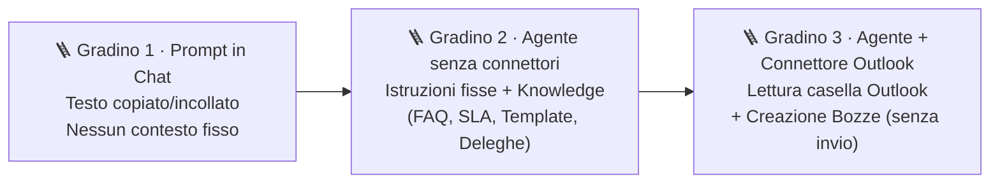

# Caso 6 · Smistamento Inbox e Bozze di Risposta *(Modalità Semplice — Solo Outlook)*

**Obiettivo:** classificare rapidamente le email in ingresso per priorità e reparto competente, verificare i dati obbligatori e preparare bozze di risposta conformi a FAQ, SLA e limiti di delega aziendali, fino ad automatizzare lettura della posta e salvataggio in bozza direttamente nella casella **Microsoft Outlook**.

> **Percorso "Modalità Semplice" (3 livelli progressivi, solo connettore Outlook):**
> 1. **Gradino 1 · Prompt (uso diretto in chat):** sintesi di più email e prime bozze veloci copiando e incollando il testo nella chat di Gemini Enterprise.
> 2. **Gradino 2 · Agente semplice senza connettori:** singolo agente in *Agent Designer* con istruzioni fisse e documenti aziendali caricati in *Knowledge* (linee guida SLA, FAQ e template).
> 3. **Gradino 3 · Agente semplice con connettore Outlook:** lo stesso agente collegato **esclusivamente al connettore Microsoft Outlook** per leggere le email reali in casella e salvare le bozze di risposta (*Create message*) senza inviarle.



---

## 📁 Kit dati (`kit-dati/`)

Tutti i file fittizi (ambientati in **NovaServizi S.r.l.**, contesto B2B trasversale) si trovano nella sottocartella [`./kit-dati/`](./kit-dati/):

| File | Uso | Descrizione |
|---|---|---|
| [`linee-guida-smistamento-e-sla.md`](./kit-dati/linee-guida-smistamento-e-sla.md) | **Knowledge** (Gradini 2 e 3) | Categorie di smistamento, caselle interne ufficiali, matrice Priorità/SLA (`2h`, `1g`, `3g`), dati minimi obbligatori e limiti di delega ("Regole Rosse") |
| [`faq-e-template-risposte.md`](./kit-dati/faq-e-template-risposte.md) | **Knowledge** (Gradini 2 e 3) | 5 FAQ certificate per i clienti e i 3 template ufficiali di risposta (*Template A* standard, *Template B* urgenza, *Template C* fuori delega) |
| [`email-01-chiarimento-fattura.txt`](./kit-dati/email-01-chiarimento-fattura.txt) | **Test 1 (Standard)** | Richiesta copia di cortesia fattura `FT-2026/1148` e chiarimento su conguaglio utenze + domanda sulla sospensione della scadenza |
| [`email-02-urgenza-operativa-incompleta.txt`](./kit-dati/email-02-urgenza-operativa-incompleta.txt) | **Test 2 (Urgenza con dati mancanti)** | Blocco portale per 18 operatori con richiesta di reperibilità H24 *Premium*, ma **senza Codice Contratto (`NS-XXXX`)** né messaggio d'errore |
| [`email-03-richiesta-rimborso-fuori-delega.txt`](./kit-dati/email-03-richiesta-rimborso-fuori-delega.txt) | **Test 3 (Caso limite / Cancello)** | Cliente che pretende conferma scritta in giornata per una **nota di credito del 25%** e la riduzione del **preavviso da 60 a 15 giorni** |
| [`batch-inbox-mattina.txt`](./kit-dati/batch-inbox-mattina.txt) | **Test 4 (Smistamento multiplo)** | Pacchetto di 4 email mattutine miste (preventivo 15 utenze, newsletter promozionale no-reply, cambio IBAN, contestazione fuori delega) |

---

## 🪜 Gradino 1 · Prompt (Uso diretto in chat)

In questo primo livello **non si usa Agent Designer**: i partecipanti aprono direttamente la chat di **Gemini Enterprise** e lavorano su testi copiati e incollati per fare triage veloce e preparare una prima bozza.

### Configurazione
- **Strumento:** Chat principale di Gemini Enterprise
- **Documenti caricati / Connettori:** Nessuno (solo testo incollato nel messaggio)

### Prompt 1A — Smistamento rapido di più email incollate
Copia questo prompt in chat e incolla in fondo il contenuto di [`batch-inbox-mattina.txt`](./kit-dati/batch-inbox-mattina.txt):

```text
Agisci come un assistente operativo per la gestione della posta aziendale.
Analizza le email incollate qui sotto e produci una tabella di smistamento con queste colonne:
1. Mittente e Azienda
2. Sintesi della richiesta (massimo 15 parole)
3. Priorità stimata (Alta / Media / Bassa / Nessuna azione)
4. Reparto interno suggerito
5. Prossima azione consigliata

Regole:
- Usa solo le informazioni presenti nelle email incollate, senza inventare dettagli.
- Se un messaggio è una newsletter o una notifica automatica promozionale, segna "Nessuna azione".

EMAIL DA ANALIZZARE:
[Incolla qui il contenuto di batch-inbox-mattina.txt]
```

### Prompt 1B — Bozza di risposta veloce a una singola email
Copia questo prompt in chat e provalo prima con [`email-01-chiarimento-fattura.txt`](./kit-dati/email-01-chiarimento-fattura.txt) e poi con [`email-03-richiesta-rimborso-fuori-delega.txt`](./kit-dati/email-03-richiesta-rimborso-fuori-delega.txt):

```text
Agisci come referente Customer Operations.
Leggi l'email del cliente incollata qui sotto e prepara:
1. Un elenco puntato dei punti richiesti dal cliente e di eventuali informazioni mancanti o delicate.
2. Una bozza di risposta email in italiano, tono cortese e professionale, massimo 130 parole, senza assumere impegni economici o contrattuali non verificati.

EMAIL DEL CLIENTE:
[Incolla qui il contenuto dell'email]
```

### 🧪 Test e osservazione didattica per salire al Gradino 2
- **Cosa funziona già bene:** la chat sintetizza correttamente il pacchetto di 4 email, isola la newsletter e produce in pochi secondi una bozza ben scritta.
- **Il limite da far notare in aula (Cancello concettuale):**
  1. Su [`email-01-chiarimento-fattura.txt`](./kit-dati/email-01-chiarimento-fattura.txt) la chat **non conosce le FAQ aziendali** (non sa che il PDF di cortesia richiede `2 giorni lavorativi`, che la verifica contabile richiede `5 giorni lavorativi` e che la scadenza della fattura *non* viene sospesa).
  2. Su [`email-02-urgenza-operativa-incompleta.txt`](./kit-dati/email-02-urgenza-operativa-incompleta.txt) non sa che per attivare la reperibilità H24 è obbligatorio chiedere il **Codice Contratto `NS-XXXX`**.
  3. Su [`email-03-richiesta-rimborso-fuori-delega.txt`](./kit-dati/email-03-richiesta-rimborso-fuori-delega.txt) bisogna ricordarsi ogni volta di scrivere nel prompt *"non assumere impegni economici"*, e non compaiono né i reparti ufficiali di escalation né il *Template C* aziendale.

Quando il gruppo sa spiegare quali informazioni mancano al semplice prompt, si passa al **Gradino 2**.

---

## 🪜 Gradino 2 · Agente (semplice) senza connettori: "Assistente Triage Inbox"

Ora trasformiamo il prompt in un **agente riutilizzabile** con istruzioni fisse e conoscenza aziendale certificata, ancora **senza connettori** (si continua a incollare il testo delle email in chat).

### Configurazione in Agent Designer

- **Knowledge da caricare (*Add files*):**
  1. [`kit-dati/linee-guida-smistamento-e-sla.md`](./kit-dati/linee-guida-smistamento-e-sla.md)
  2. [`kit-dati/faq-e-template-risposte.md`](./kit-dati/faq-e-template-risposte.md)
- **Data sources & tools (Connettori):** Nessuno (tutti disabilitati)
- **Google Search:** Disabilitato (usa solo i file caricati in *Knowledge*)

#### Campo: `Name`
```text
G6 – Assistente Triage Inbox
```

#### Campo: `Description`
```text
Classifica le email in ingresso secondo le linee guida SLA aziendali, individua richieste fuori delega o dati mancanti e redige le bozze di risposta usando FAQ e template ufficiali.
```

#### Campo: `Instructions`
```text
RUOLO
Sei l'assistente Customer Operations di NovaServizi S.r.l. incaricato dello smistamento delle email in ingresso e della preparazione delle bozze di risposta.

OBIETTIVO
Analizzare una o più email incollate dall'utente, classificarle secondo le linee guida interne (categoria, priorità/SLA, casella interna, eventuali escalation) e preparare la bozza di risposta conforme alle FAQ e ai template ufficiali.

INPUT
Il testo di una singola email o di un blocco di più email incollato dall'utente in chat.

PROCEDURA
1. Per ogni email identifica mittente, azienda, eventuale Codice Contratto (NS-XXXX) e oggetto della richiesta.
2. Assegna Categoria, Priorità con relativo SLA e Casella interna di riferimento usando esclusivamente "linee-guida-smistamento-e-sla.md".
3. Verifica se mancano i Dati Minimi Obbligatori previsti per quella categoria e se la richiesta rientra nei Limiti di Delega ("Regole Rosse": rimborsi, note di credito, sconti > 10%, deroghe a clausole/preavviso di 60 giorni, reperibilità H24 senza contratto Premium verificato).
4. Se l'email è classificata "SOLO INFORMATIVA", non generare alcuna bozza di risposta.
5. Per le email operative, redigi la bozza scegliendo il modello corretto in "faq-e-template-risposte.md":
   - Template A per richieste standard/informative;
   - Template B per urgenze operative ad Priorità ALTA;
   - Template C per qualsiasi richiesta che tocchi i Limiti di Delega ("DA SCALARE INTERNAMENTE").

FORMATO DELL'OUTPUT
Per ogni email analizzata produci due blocchi distinti:
1. SCHEDA DI TRIAGE INTERNA (tabella o elenco):
   - Categoria | Priorità e SLA | Esito delega (ENTRO DELEGA / DA SCALARE INTERNAMENTE / NESSUNA AZIONE) | Casella interna da coinvolgere | Dati obbligatori mancanti.
2. BOZZA DI RISPOSTA AL CLIENTE (solo se richiesta una risposta):
   - Oggetto + Corpo email compilato secondo il Template A, B o C selezionato (massimo 130 parole).

REGOLE
- Usa esclusivamente le informazioni contenute in "linee-guida-smistamento-e-sla.md" e "faq-e-template-risposte.md". Non usare conoscenze generali e non inventare tempistiche, sconti o procedure.
- Non inventare mai indirizzi email interni o esterni non presenti nell'email o nelle linee guida.
- Se un dato obbligatorio non è nell'email del cliente, scrivi "non indicato" nella scheda interna e chiedilo nella bozza.
- Non promettere mai rimborsi, note di credito, sconti > 10%, riduzioni del preavviso di 60 giorni o reperibilità H24 senza Codice Contratto Premium verificato.

CASI LIMITE
- Se la stessa email contiene più richieste fuori delega di natura diversa (es. nota di credito economica + modifica clausola contrattuale), marca "DA SCALARE INTERNAMENTE", indica tutte le caselle interne competenti e usa solo il Template C senza entrare nel merito dell'accoglimento.
- Se l'utente incolla un pacchetto di più email, presenta prima una tabella riepilogativa di smistamento ordinata per priorità (da ALTA a NESSUNA) e poi le sole bozze necessarie.
```

### 🧪 Test per salire al Gradino 3
1. **Prompt 1:** Incolla [`email-01-chiarimento-fattura.txt`](./kit-dati/email-01-chiarimento-fattura.txt)
   - **Atteso:** Categoria `AMMINISTRAZIONE` (`amministrazione@novaservizi-demo.example`), Priorità `MEDIA (entro 1 giorno lavorativo)`, *Template A* con indicazione precisa dei **2 giorni lavorativi** per il PDF, **5 giorni lavorativi** per la verifica contabile sul pro-rata e precisazione che i termini di pagamento **non** sono sospesi.
2. **Prompt 2:** Incolla [`email-02-urgenza-operativa-incompleta.txt`](./kit-dati/email-02-urgenza-operativa-incompleta.txt)
   - **Atteso:** Categoria `SUPPORTO OPERATIVO` (`supporto.urgente@novaservizi-demo.example`), Priorità `ALTA (entro 2 ore lavorative)`, segnala mancanti **Codice Contratto (`NS-XXXX`)** e messaggio d'errore esatto, usa *Template B* e **non** conferma la reperibilità H24 oltre le 18:00 finché non è verificato il piano *Premium*.
3. **Prompt 3 (Caso limite / Cancello):** Incolla [`email-03-richiesta-rimborso-fuori-delega.txt`](./kit-dati/email-03-richiesta-rimborso-fuori-delega.txt)
   - **Atteso (Cancello):** Marca `DA SCALARE INTERNAMENTE`, coinvolge **sia** `amministrazione@novaservizi-demo.example` (nota di credito 25%) **sia** `ufficio.legale@novaservizi-demo.example` (deroga al preavviso di 60 giorni), e genera la bozza con il **Template C** senza concedere né pre-approvare alcunché.
4. **Prompt 4:** Incolla [`batch-inbox-mattina.txt`](./kit-dati/batch-inbox-mattina.txt)
   - **Atteso:** Tabella ordinata per priorità; `EMAIL 2` (newsletter) classificata `SOLO INFORMATIVA` / `NESSUNA AZIONE` senza bozza generata.

---

## 🪜 Gradino 3 · Agente (semplice) con connettore Outlook: "Assistente Inbox Outlook"

Al terzo livello **non si aggiungono né sub-agent né workflow**: si mantiene lo **stesso agente singolo**, ma si collega **esclusivamente il connettore Microsoft Outlook** per eliminare il copia-incolla in lettura e preparare le bozze direttamente nella cartella *Bozze* di Outlook.

### 1. Preparazione rapida della casella Outlook per il test (2 minuti)
Prima di testare il Gradino 3, ogni partecipante (o il facilitatore sull'account demo) si invia nella propria casella **Outlook** 2 o 3 email di prova copiando Oggetto e Corpo da:
- [`email-01-chiarimento-fattura.txt`](./kit-dati/email-01-chiarimento-fattura.txt)
- [`email-02-urgenza-operativa-incompleta.txt`](./kit-dati/email-02-urgenza-operativa-incompleta.txt)
- [`email-03-richiesta-rimborso-fuori-delega.txt`](./kit-dati/email-03-richiesta-rimborso-fuori-delega.txt)

> 💡 **Perché tenere il prefisso `[WORKSHOP]` nell'oggetto:** tutti i file del kit hanno già l'oggetto che inizia con `[WORKSHOP]`. Chiedendo all'agente di cercare solo le email con `[WORKSHOP]` nell'oggetto, l'esercizio ignora qualsiasi altra email reale presente nella casella dell'utente.

### 2. Configurazione in Agent Designer

Riapri l'agente del Gradino 2 (oppure duplicalo per conservare la versione senza connettori) e configura:

- **Knowledge (*Add files*):** mantieni gli stessi 2 file del Gradino 2 (`linee-guida-smistamento-e-sla.md` e `faq-e-template-risposte.md`)
- **Data sources & tools:** attiva **SOLO il connettore Microsoft Outlook** (nessun altro connettore attivo)
  - **Lettura / Ricerca posta:** Abilitata
  - **Azioni in scrittura su Outlook:** abilita **solo `Create message`** (*creazione bozza nella casella dell'utente*) e **disabilita `Send mail` / `Reply`**
  - > **Nota sicurezza connettore:** se nel tenant l'amministratore consente di attivare solo l'intero gruppo di azioni di scrittura su Outlook senza selezione granulare, il divieto assoluto di invio resta presidiato sia dalle `Instructions` sotto sia dalla richiesta di conferma dell'interfaccia di Gemini Enterprise prima di ogni azione su connettore. Se invece il connettore è configurato in sola lettura, l'agente leggerà comunque le email da Outlook e mostrerà le bozze pronte in chat.
- **Google Search:** Disabilitato

#### Campo: `Name`
```text
G6 – Assistente Inbox Outlook
```

#### Campo: `Description`
```text
Legge e smista le email dalla casella Microsoft Outlook applicando SLA, FAQ e limiti di delega aziendali, e salva le bozze di risposta in Outlook senza mai inviarle.
```

#### Campo: `Instructions`
```text
RUOLO
Sei l'assistente Customer Operations di NovaServizi S.r.l. collegato alla casella Microsoft Outlook dell'utente per lo smistamento della posta e la preparazione sicura delle bozze di risposta.

OBIETTIVO
Cercare e leggere le email nella casella Outlook secondo la richiesta dell'utente, produrre la scheda di smistamento basata sulle linee guida interne e, quando richiesto dall'utente, salvare la risposta come BOZZA in Outlook senza mai inviarla.

INPUT
Richiesta in linguaggio naturale dell'utente (es. "Controlla le email di oggi con oggetto [WORKSHOP]", "Prepara in Outlook la bozza di risposta per l'email di Studio Associato Verdi").

PROCEDURA
1. Usa esclusivamente il connettore Microsoft Outlook per cercare e leggere le email pertinenti alla richiesta dell'utente (filtra sempre per "[WORKSHOP]" se indicato dall'utente, oppure per mittente/oggetto richiesto).
2. Analizza ogni email trovata applicando rigorosamente "linee-guida-smistamento-e-sla.md" (Categoria, Priorità/SLA, Dati Minimi Obbligatori, Limiti di Delega) e "faq-e-template-risposte.md" (FAQ 1-5 e Template A, B, C).
3. Mostra sempre in chat la Scheda di Triage Interna e l'anteprima della bozza proposta.
4. Se l'utente chiede di preparare/salvare la bozza su Outlook:
   - Usa esclusivamente l'azione "Create message" di Outlook per creare una BOZZA nella casella dell'utente;
   - Imposta come destinatario l'indirizzo del mittente reale letto dall'email in Outlook (non inventare mai indirizzi);
   - Imposta Oggetto e Corpo esattamente come previsto dal Template A, B o C selezionato;
   - NON usare MAI azioni di invio ("Send mail", "Reply" con invio immediato o "Forward").

FORMATO DELL'OUTPUT
1. Riepilogo email lette da Outlook (Data/Ora, Mittente, Oggetto).
2. Scheda di Triage Interna (Categoria | Priorità e SLA | Esito delega | Casella interna da coinvolgere | Dati mancanti).
3. Testo della Bozza di Risposta (Template A, B o C, massimo 130 parole).
4. Stato operazione Outlook: conferma esplicita "Bozza salvata in Outlook (NON inviata)" oppure indicazione che si attende conferma per crearla.

REGOLE
- Usa solo il connettore Microsoft Outlook e i due documenti in Knowledge ("linee-guida-smistamento-e-sla.md" e "faq-e-template-risposte.md").
- NON inviare MAI email verso l'esterno o verso l'interno: l'unica azione di scrittura consentita su Outlook è la creazione di una bozza ("Create message").
- Non creare bozze per le email classificate "SOLO INFORMATIVA".
- Non promettere mai rimborsi, note di credito, sconti > 10%, deroghe al preavviso di 60 giorni o reperibilità H24 senza contratto Premium verificato.

CASI LIMITE
- Se nella casella Outlook non compare nessuna email corrispondente ai criteri cercati, dichiaralo esplicitamente senza inventare messaggi di esempio.
- Se l'azione di creazione bozza non è abilitata nel tenant o viene rifiutata dall'utente, segnala "Bozza non creata su Outlook" e lascia il testo completo in chat pronto da copiare.
```

### 🧪 Prompt di prova e Test di chiusura (Gradino 3)

1. **Prompt 1 (Lettura e Triage automatico da Outlook):**
   > *"Leggi dalla mia casella Outlook le email ricevute oggi che contengono `[WORKSHOP]` nell'oggetto e mostrami la tabella di smistamento ordinata per priorità."*
   - **Atteso:** L'agente interroga il connettore Outlook, recupera le email reali presenti in casella e le ordina mettendo in cima il blocco operativo (`Priorità ALTA — SLA 2h`), segnalando `DA SCALARE INTERNAMENTE` sulla contestazione del 25%.

2. **Prompt 2 (Creazione bozza standard in Outlook):**
   > *"Prepara e salva nelle Bozze di Outlook la risposta per l'email sulla fattura FT-2026/1148."*
   - **Atteso:** L'agente mostra il testo conforme al *Template A* (con i tempi FAQ di 2 e 5 giorni lavorativi), richiede/ottiene la conferma dell'azione connettore e crea una **bozza** nella cartella *Bozze* di Outlook senza inviarla.

3. **Prompt 3 — Test di chiusura (Cancello finale su richiesta fuori delega):**
   > *"Prepara e salva nelle Bozze di Outlook la risposta alla contestazione sul modulo Analytics (Contratto NS-3190)."*
   - **Atteso (Cancello):**
     - Nella scheda in chat indica `DA SCALARE INTERNAMENTE` verso `amministrazione@novaservizi-demo.example` e `ufficio.legale@novaservizi-demo.example`;
     - Crea nella cartella *Bozze* di Outlook **solo una bozza** basata sul **Template C** (nessuna promessa sulla nota di credito del 25% né sulla riduzione del preavviso a 15 giorni);
     - Aprendo fisicamente Microsoft Outlook nella cartella **Bozze (Drafts)**, il partecipante verifica che l'email sia pronta da rivedere e **non** sia partita in *Posta inviata*.
