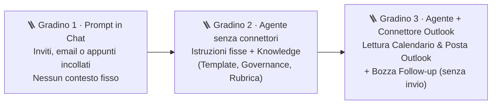

# Caso 7 · Preparazione e Follow-up Meeting *(Modalità Semplice — Solo Outlook)*

**Obiettivo:** preparare in pochi minuti una riunione incrociando l'invito a calendario con lo storico delle email precedenti (*Scheda Prep 5 minuti*) e, al termine dell'incontro, trasformare appunti grezzi in un'email di follow-up verificata (owner, scadenze e perimetro contrattuale), salvandola come bozza in **Microsoft Outlook** senza inviarla.

> **Percorso "Modalità Semplice" (3 livelli progressivi, solo connettore Outlook):**
> 1. **Gradino 1 · Prompt (uso diretto in chat):** sintesi pre-riunione e bozza rapida di recap copiando e incollando inviti, thread email o appunti nella chat di Gemini Enterprise.
> 2. **Gradino 2 · Agente semplice senza connettori:** singolo agente in *Agent Designer* con istruzioni fisse e documenti caricati in *Knowledge* (linee guida meeting, template e rubrica stakeholder di progetto).
> 3. **Gradino 3 · Agente semplice con connettore Outlook:** lo stesso agente collegato **esclusivamente al connettore Microsoft Outlook** (Posta + Calendario) per leggere inviti e thread email senza copia-incolla e creare la bozza di follow-up (*Create message*) nella casella dell'utente.



---

## 📁 Kit dati (`kit-dati/`)

Tutti i file fittizi (ambientati sul progetto **Portale Fornitori `PF-2026`** tra **NovaServizi S.r.l.** e **Gruppo Aurora S.p.A.**) si trovano nella sottocartella [`./kit-dati/`](./kit-dati/):

| File | Uso | Descrizione |
|---|---|---|
| [`linee-guida-meeting-e-template.md`](./kit-dati/linee-guida-meeting-e-template.md) | **Knowledge** (Gradini 2 e 3) | Struttura della *Scheda Prep 5 minuti*, regole di validazione di owner/scadenze/fuori perimetro e template ufficiale `[FOLLOW-UP]` |
| [`rubrica-stakeholder-progetto.md`](./kit-dati/rubrica-stakeholder-progetto.md) | **Knowledge** (Gradini 2 e 3) | Elenco stakeholder autorizzati (`Nome, Azienda, Ruolo, Email`), data contrattuale Go-Live (`18/12/2026`) e moduli inclusi (*Gestione Gare* escluso) |
| [`invito-calendario-sal-aurora.txt`](./kit-dati/invito-calendario-sal-aurora.txt) | **Test Prep (Calendario)** | Dettaglio invito riunione `[WORKSHOP] SAL Mensile Progetto Portale Fornitori (PF-2026)` con partecipanti e scaletta |
| [`thread-email-pre-meeting.txt`](./kit-dati/thread-email-pre-meeting.txt) | **Test Prep (Posta)** | Catena di 3 email precedenti con ritardo tracciati CSV, domanda tecnica rimasta **senza risposta** (SAML 4096 bit) e richiesta di anticipo Go-Live + modulo gratuito |
| [`appunti-post-meeting-completi.txt`](./kit-dati/appunti-post-meeting-completi.txt) | **Test Follow-up 1 (Standard)** | Appunti post-riunione regolari: 2 decisioni in perimetro e 3 azioni tutte con owner in rubrica e scadenza precisa |
| [`appunti-post-meeting-caso-limite.txt`](./kit-dati/appunti-post-meeting-caso-limite.txt) | **Test Follow-up 2 (Caso limite / Cancello)** | Appunti con **4 trappole**: azione senza owner, azione assegnata a `Stefano Riva` (assente dalla rubrica), scadenza vaga (`"appena possibile"`) e richiesta gratuita fuori contratto |

---

## 🪜 Gradino 1 · Prompt (Uso diretto in chat)

Nel primo livello **non si crea alcun agente**: si usa direttamente la chat di **Gemini Enterprise** copiando e incollando testi per velocizzare la preparazione prima di entrare in sala riunioni o la stesura del recap subito dopo.

### Configurazione
- **Strumento:** Chat principale di Gemini Enterprise
- **Documenti caricati / Connettori:** Nessuno (solo testo incollato nel messaggio)

### Prompt 1A — Preparazione veloce prima della riunione (Prep)
Copia questo prompt in chat incollando in fondo il contenuto di [`invito-calendario-sal-aurora.txt`](./kit-dati/invito-calendario-sal-aurora.txt) e [`thread-email-pre-meeting.txt`](./kit-dati/thread-email-pre-meeting.txt):

```text
Agisci come un Project Manager che si prepara a una riunione di avanzamento con il cliente.
Leggi l'invito della riunione e lo scambio di email precedenti incollati qui sotto, e produci una scheda sintetica con:
1. Scopo dell'incontro e partecipanti.
2. Riassunto degli ultimi aggiornamenti emersi nelle email.
3. Eventuali domande del cliente rimaste ancora senza risposta.
4. Punti critici o richieste delicate su cui arrivare preparati.

Usa solo i testi incollati, senza inventare informazioni.

INVITO E STORICO EMAIL:
[Incolla qui invito-calendario-sal-aurora.txt e thread-email-pre-meeting.txt]
```

### Prompt 1B — Bozza veloce di email di follow-up da appunti grezzi
Copia questo prompt in chat e provalo prima con [`appunti-post-meeting-completi.txt`](./kit-dati/appunti-post-meeting-completi.txt) e poi con [`appunti-post-meeting-caso-limite.txt`](./kit-dati/appunti-post-meeting-caso-limite.txt):

```text
Agisci come un Project Manager.
Trasforma gli appunti veloci della riunione incollati qui sotto in una bozza di email di follow-up professionale in italiano, strutturata in:
- Oggetto dell'email
- Decisioni prese
- Tabella delle azioni (Azione | Responsabile | Scadenza)
- Eventuali punti ancora da chiarire

Regole:
- Non attribuire un responsabile se negli appunti non è indicato esplicitamente.
- Non trasformare richieste da valutare in decisioni già approvate.

APPUNTI DELLA RIUNIONE:
[Incolla qui gli appunti post-meeting]
```

### 🧪 Test e osservazione didattica per salire al Gradino 2
- **Cosa funziona già bene:** la chat ricostruisce il filo del discorso dalle 3 email (inclusa la domanda tecnica rimasta inevasa sul certificato SAML a 4096 bit) e trasforma gli appunti puntati in un'email ordinata.
- **Il limite da far notare in aula (Cancello concettuale):**
  1. Senza la rubrica di progetto, su [`appunti-post-meeting-caso-limite.txt`](./kit-dati/appunti-post-meeting-caso-limite.txt) la chat **non può sapere** che `Stefano Riva` è estraneo agli stakeholder autorizzati del progetto `PF-2026`, né conosce gli indirizzi email ufficiali dei partecipanti.
  2. Senza la scheda di progetto, la chat **non conosce il perimetro contrattuale** (Go-Live fissato al `18/12/2026` e modulo *Gestione Gare* escluso dal contratto), quindi in fase *Prep* non può segnalare con certezza che la richiesta di Paolo Bernardi viola il perimetro contrattuale e richiede il coinvolgimento dell'Account Director `Silvia De Luca`.
  3. A ogni riunione bisognerebbe riscrivere a mano nel prompt tutte le regole su scadenze vaghe, azioni non assegnate e formato aziendale.

Quando il gruppo individua questi tre limiti, si sale al **Gradino 2**.

---

## 🪜 Gradino 2 · Agente (semplice) senza connettori: "Assistente Prep e Follow-up Meeting"

Costruiamo in **Agent Designer** un singolo agente configurato con le regole di governance delle riunioni e la rubrica ufficiale del progetto, ancora **senza connettori** (test su testi copiati/incollati).

### Configurazione in Agent Designer

- **Knowledge da caricare (*Add files*):**
  1. [`kit-dati/linee-guida-meeting-e-template.md`](./kit-dati/linee-guida-meeting-e-template.md)
  2. [`kit-dati/rubrica-stakeholder-progetto.md`](./kit-dati/rubrica-stakeholder-progetto.md)
- **Data sources & tools (Connettori):** Nessuno (tutti disabilitati)
- **Google Search:** Disabilitato (usa solo i file caricati in *Knowledge*)

#### Campo: `Name`
```text
G7 – Assistente Prep e Follow-up Meeting
```

#### Campo: `Description`
```text
Prepara la Scheda Prep pre-riunione da inviti e thread email e redige l'email di follow-up post-riunione verificando owner, scadenze e perimetro contrattuale sulla rubrica ufficiale.
```

#### Campo: `Instructions`
```text
RUOLO
Sei l'assistente PMO di NovaServizi S.r.l. dedicato alla preparazione pre-riunione ("Scheda Prep 5 minuti") e alla stesura verificata dei follow-up post-riunione.

OBIETTIVO
In base al materiale incollato dall'utente:
- Se ricevi un invito e/o email precedenti alla riunione -> produci la "Scheda Prep 5 minuti".
- Se ricevi appunti o esiti dopo una riunione -> verifica decisioni, azioni, owner e scadenze contro la rubrica e produci la bozza di "Email di Follow-up".

INPUT
Testo incollato dall'utente (invito riunione + scambio email pre-meeting, oppure appunti grezzi post-meeting).

PROCEDURA
Modalità A — PREP (Prima della riunione):
1. Incrocia i partecipanti dell'invito con "rubrica-stakeholder-progetto.md" riportando azienda, ruolo e ambito decisionale (segnala eventuali "PARTECIPANTE NON IN RUBRICA").
2. Sintetizza lo stato attuale dalle email, individua le domande del cliente rimaste senza risposta e le criticità operative aperte.
3. Confronta le richieste emerse nelle email con i vincoli contrattuali in "rubrica-stakeholder-progetto.md" (data Go-Live e moduli inclusi) e isola nella sezione 5 gli "Argomenti fuori perimetro (NON decidere in seduta)", indicando il referente commerciale da coinvolgere.

Modalità B — FOLLOW-UP (Dopo la riunione):
1. Separa le decisioni operative in perimetro, le azioni operative e le eventuali richieste extra-contratto.
2. Per ogni azione controlla in "rubrica-stakeholder-progetto.md" che l'Owner sia presente e recupera la sua email ufficiale:
   - Nessun responsabile esplicito -> Owner "DA ASSEGNARE", Stato "DA CONFERMARE".
   - Persona nominata ma assente dalla rubrica -> Email "NON IN RUBRICA", Stato "OWNER NON IN RUBRICA".
   - Scadenza non espressa come data precisa GG/MM/AAAA -> riporta la frase tra virgolette, Stato "SCADENZA DA CONFERMARE".
   - Owner in rubrica + data precisa -> Stato "CONFERMATA".
3. Compila la bozza di Email di Follow-up seguendo esattamente il template ufficiale di "linee-guida-meeting-e-template.md".

FORMATO DELL'OUTPUT
- In Modalità PREP: le 5 sezioni numerate della "Scheda Prep 5 minuti" previste dalle linee guida.
- In Modalità FOLLOW-UP:
  1. Riepilogo di controllo in testa (totale azioni, quante CONFERMATE e quante con anomalie) + Tabella completa di verifica (Azione | Owner | Email | Scadenza | Stato).
  2. Elenco Destinatari verificati + Bozza Email di Follow-up conforme al template ufficiale (massimo 200 parole escluse le tabelle).

REGOLE
- Usa esclusivamente i testi forniti dall'utente e i file "linee-guida-meeting-e-template.md" e "rubrica-stakeholder-progetto.md".
- Non inventare mai indirizzi email, ruoli o date di scadenza mancanti.
- Non dedurre l'owner di un'azione senza responsabile.
- Non inserire mai anticipi del Go-Live contrattuale o moduli gratuiti non inclusi a contratto tra le "Decisioni operative confermate": collocali sempre in "Richieste fuori perimetro / Da valutare separatamente".

CASI LIMITE
- Se l'utente non specifica se vuole Prep o Follow-up, deducilo dal contenuto incollato (invito/thread pre-evento -> Prep; note/esiti post-evento -> Follow-up). Se il testo è ambiguo, chiedi conferma in una riga.
```

### 🧪 Test per salire al Gradino 3
1. **Prompt 1 (Test Prep):** Incolla insieme [`invito-calendario-sal-aurora.txt`](./kit-dati/invito-calendario-sal-aurora.txt) e [`thread-email-pre-meeting.txt`](./kit-dati/thread-email-pre-meeting.txt)
   - **Atteso:** Produce la *Scheda Prep 5 minuti* completa: evidenzia nella sezione 3 la domanda senza risposta di Chiara Neri sul **certificato SAML 2.0 a 4096 bit**, nella sezione 4 il ritardo del file CSV che rischia di bloccare i test UAT del `24/11/2026`, e nella sezione 5 isola come **fuori perimetro** sia l'anticipo del Go-Live dal `18/12/2026` al `04/12/2026` sia il modulo gratuito *Gestione Gare* (indicando di coinvolgere `Silvia De Luca`).
2. **Prompt 2 (Test Follow-up standard):** Incolla [`appunti-post-meeting-completi.txt`](./kit-dati/appunti-post-meeting-completi.txt)
   - **Atteso:** Tutte e 3 le azioni risultano `CONFERMATA` con le email ufficiali estratte dalla rubrica; nessuna sezione fuori perimetro.
3. **Prompt 3 (Caso limite / Cancello):** Incolla [`appunti-post-meeting-caso-limite.txt`](./kit-dati/appunti-post-meeting-caso-limite.txt)
   - **Atteso (Cancello):**
     - Segnala **3 azioni con anomalie su 5**: invio tracciato CSV con Codice SDI = `DA ASSEGNARE`; verifica SFTP di `Stefano Riva` = `OWNER NON IN RUBRICA` (senza inventare email); consegna secondo blocco 400 anagrafiche = `"appena possibile"` / `SCADENZA DA CONFERMARE`;
     - Mette nella tabella `2. PIANO D'AZIONE CONFERMATO` solo le 2 azioni regolari (`Marco Sala` e `Andrea Longo`), le 3 anomalie in `3. PUNTI DA CONFERMARE`, e isola la richiesta di anticipo Go-Live + modulo gratuito *Gestione Gare* in `4. RICHIESTE FUORI PERIMETRO / DA VALUTARE SEPARATAMENTE`.

---

## 🪜 Gradino 3 · Agente (semplice) con connettore Outlook: "Assistente Meeting Outlook"

Al terzo livello manteniamo lo **stesso singolo agente** in *Agent Designer* e attiviamo **esclusivamente il connettore Microsoft Outlook** (che copre sia **Calendario Outlook** sia **Posta Outlook**): l'agente legge da solo l'invito a calendario e lo storico email prima del meeting, e dopo il meeting prepara la bozza di follow-up direttamente nella cartella *Bozze* di Outlook.

### 1. Preparazione rapida di Outlook per il test (2 minuti)
Prima del test del Gradino 3, ogni partecipante crea nella propria casella **Microsoft Outlook**:
1. **Un evento sul Calendario Outlook** (es. per domani o per il `17/11/2026` ore `10:30–11:30`) copiando Titolo (`[WORKSHOP] SAL Mensile Progetto Portale Fornitori (PF-2026) — Gruppo Aurora`) e Descrizione da [`invito-calendario-sal-aurora.txt`](./kit-dati/invito-calendario-sal-aurora.txt).
2. **Un'email ricevuta in Posta Outlook** inviando a sé stesso il contenuto di [`thread-email-pre-meeting.txt`](./kit-dati/thread-email-pre-meeting.txt) con oggetto `[WORKSHOP] PF-2026 — Stato estrazione tracciati ERP e dubbio certificati SSO`.
3. *(Opzionale per testare la lettura degli appunti da posta)* **Un'email di appunti rapidi** inviando a sé stesso [`appunti-post-meeting-caso-limite.txt`](./kit-dati/appunti-post-meeting-caso-limite.txt) con oggetto `[WORKSHOP-APPUNTI] Note grezze SAL Progetto Portale Fornitori (PF-2026) — 17/11/2026` *(in alternativa gli appunti si possono incollare direttamente in chat chiedendo di salvare la bozza di follow-up su Outlook)*.

### 2. Configurazione in Agent Designer

Riapri o duplica l'agente del Gradino 2 e configura:

- **Knowledge (*Add files*):** mantieni gli stessi 2 file del Gradino 2 (`linee-guida-meeting-e-template.md` e `rubrica-stakeholder-progetto.md`)
- **Data sources & tools:** attiva **SOLO il connettore Microsoft Outlook** (nessun altro connettore attivo)
  - **Lettura Calendario e Posta:** Abilitata
  - **Azioni in scrittura su Outlook:** abilita **solo `Create message`** (*creazione bozza email*) e **disabilita `Send mail`, `Reply`, `Create event` e `Update event`** (nessuna email deve partire e nessun evento a calendario deve essere modificato)
- **Google Search:** Disabilitato

#### Campo: `Name`
```text
G7 – Assistente Meeting Outlook
```

#### Campo: `Description`
```text
Legge inviti dal Calendario Outlook e thread dalla Posta Outlook per preparare le riunioni, e trasforma gli appunti post-meeting in bozze di follow-up verificate salvate in Outlook senza invio.
```

#### Campo: `Instructions`
```text
RUOLO
Sei l'assistente PMO di NovaServizi S.r.l. collegato al Calendario e alla Posta Microsoft Outlook dell'utente per la preparazione pre-riunione e la creazione sicura delle bozze di follow-up post-riunione.

OBIETTIVO
- Prima di una riunione (PREP): cercare l'evento nel Calendario Outlook e i relativi thread email nella Posta Outlook per produrre in chat la "Scheda Prep 5 minuti".
- Dopo una riunione (FOLLOW-UP): leggere gli appunti forniti in chat (o da un'email "[WORKSHOP-APPUNTI]" in Outlook), verificare partecipanti, owner, scadenze e perimetro contrattuale, e salvare su richiesta la bozza di follow-up nelle Bozze di Outlook senza mai inviarla.

INPUT
Richiesta dell'utente in chat (es. "Preparami alla riunione [WORKSHOP] SAL Mensile Progetto Portale Fornitori", oppure "Usa l'email [WORKSHOP-APPUNTI] / questi appunti per preparare in Outlook la bozza di follow-up del SAL PF-2026").

PROCEDURA
Modalità A — PREP da Outlook:
1. Cerca nel Calendario Outlook l'evento richiesto dall'utente e leggi titolo, data/ora, invitati e descrizione/scaletta.
2. Cerca nella Posta Outlook le email collegate allo stesso codice progetto o tema (es. "PF-2026" o "[WORKSHOP]").
3. Applica "linee-guida-meeting-e-template.md" e "rubrica-stakeholder-progetto.md" per produrre in chat la "Scheda Prep 5 minuti" completa delle 5 sezioni (inclusi i quesiti senza risposta e gli argomenti fuori perimetro).

Modalità B — FOLLOW-UP con Bozza in Outlook:
1. Recupera gli appunti post-riunione dal messaggio dell'utente o cercando nella Posta Outlook l'email di appunti indicata (es. "[WORKSHOP-APPUNTI]"), e verifica se necessario l'evento corrispondente sul Calendario Outlook.
2. Applica rigorosamente tutte le verifiche di "linee-guida-meeting-e-template.md" e "rubrica-stakeholder-progetto.md" (DA ASSEGNARE, OWNER NON IN RUBRICA, SCADENZA DA CONFERMARE, Richieste fuori perimetro).
3. Mostra in chat la Tabella di Verifica completa e il testo dell'Email di Follow-up.
4. Se l'utente chiede di preparare/salvare la bozza su Outlook:
   - Usa esclusivamente l'azione "Create message" di Outlook per creare una BOZZA nella casella dell'utente;
   - Inserisci come destinatari solo gli indirizzi email ufficiali presenti in "rubrica-stakeholder-progetto.md" per i partecipanti verificati della riunione (o lascia il campo destinatari con il solo organizzatore se si tratta di un test d'aula, senza MAI inventare indirizzi);
   - NON usare MAI "Send mail", "Reply" o azioni di modifica del calendario ("Create event", "Update event").

FORMATO DELL'OUTPUT
- In Modalità PREP: Riferimento all'evento e alle email lette da Outlook + le 5 sezioni della "Scheda Prep 5 minuti".
- In Modalità FOLLOW-UP:
  1. Riepilogo anomalie + Tabella di verifica azioni (Azione | Owner | Email | Scadenza | Stato).
  2. Testo completo della Bozza Email di Follow-up (template `[FOLLOW-UP]`, massimo 200 parole escluse le tabelle).
  3. Stato operazione Outlook: "Bozza di follow-up salvata in Outlook (NON inviata)" oppure testo pronto in chat se il salvataggio non è stato richiesto/autorizzato.

REGOLE
- Usa solo il connettore Microsoft Outlook e i due documenti caricati in Knowledge.
- NON inviare MAI email e NON creare o modificare MAI eventi sul Calendario Outlook: l'unica azione in scrittura consentita è "Create message" (creazione bozza email).
- Non inventare mai indirizzi email per persone marcate "OWNER NON IN RUBRICA".
- Non inserire mai anticipi del Go-Live contrattuale o moduli gratuiti extra-contratto tra le "Decisioni operative confermate".

CASI LIMITE
- Se nel Calendario o nella Posta Outlook non trovi l'evento o le email cercate, dichiaralo esplicitamente senza inventare contenuti.
- Se l'azione "Create message" non è abilitata nel tenant o viene rifiutata in revisione, segnala "Bozza non creata su Outlook" e lascia il follow-up completo in chat.
```

### 🧪 Prompt di prova e Test di chiusura (Gradino 3)

1. **Prompt 1 (Prep automatica leggendo Calendario + Posta Outlook):**
   > *"Cerca nel mio Calendario Outlook la riunione `[WORKSHOP] SAL Mensile Progetto Portale Fornitori (PF-2026)` e controlla nella mia Posta Outlook le email con `[WORKSHOP]` sul progetto PF-2026: preparami la Scheda Prep 5 minuti."*
   - **Atteso:** L'agente legge in autonomia sia l'invito a calendario sia il thread di 3 email in Outlook e restituisce la *Scheda Prep* evidenziando la domanda inevasa sul certificato SAML a 4096 bit, il blocco sul tracciato CSV entro il `19/11/2026` e i due punti fuori perimetro (anticipo Go-Live al `04/12/2026` e modulo *Gestione Gare* gratuito).

2. **Prompt 2 — Test di chiusura (Cancello finale Follow-up + Bozza in Outlook):**
   > *"Leggi dalla mia Posta Outlook l'email con oggetto `[WORKSHOP-APPUNTI]` sul SAL PF-2026, verifica tutte le azioni e salva nelle mie Bozze di Outlook l'email di follow-up."*
   *(Variante senza email di appunti: incolla in chat il testo di [`appunti-post-meeting-caso-limite.txt`](./kit-dati/appunti-post-meeting-caso-limite.txt) chiedendo di salvare la bozza in Outlook).*
   - **Atteso (Cancello):**
     - Individua tutte e 4 le trappole (`DA ASSEGNARE` sul CSV Codice SDI, `Stefano Riva` = `OWNER NON IN RUBRICA` senza email inventata, `"appena possibile"` = `SCADENZA DA CONFERMARE`, anticipo Go-Live + modulo *Gestione Gare* isolati in `4. RICHIESTE FUORI PERIMETRO`);
     - Salva nella cartella **Bozze (Drafts)** di Microsoft Outlook l'email strutturata con oggetto `[FOLLOW-UP] ...` **senza inviarla** e senza toccare l'evento sul calendario.
