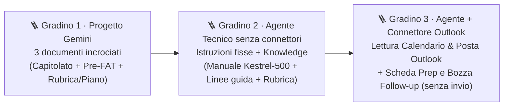

# Caso 9 · Collaudo Macchina, Supporto Tecnico e Gestione Meeting *(Workshop 2h — Progetto + Manuale Tecnico + Solo Outlook)*

**Obiettivo:** accompagnare il team Project & Application Engineering (PMO Tecnico) lungo una progressione pratica in 3 livelli crescenti: (1) incrociare capitolato d'ordine, report Pre-FAT e rubrica commessa in un **Progetto Gemini** per estrarre gap e condizioni di *Go/No-Go*, (2) costruire un **agente tecnico senza connettori** basato sul **Manuale di Uso e Manutenzione** del centro robotizzato ibrido `Kestrel-500 Hybrid`, e (3) collegare lo stesso agente al **solo connettore Microsoft Outlook** (Calendario + Posta) per preparare il SAL tecnico (*Scheda Prep 5 minuti*) e salvare in automatico la bozza di follow-up verificata nelle *Bozze* di Outlook senza mai inviarla.

> **Percorso "Workshop 2h — Progetto + Manuale Tecnico + Solo Outlook":**
> 1. **Gradino 1 · Progetto Gemini (Estrazione dati trasversale):** creazione di un Progetto con 3 documenti di commessa (`capitolato`, `report Pre-FAT`, `rubrica e piano`) per estrarre scostamenti numerici, responsabili, valutazione *Go/No-Go* e anomalie/dati mancanti.
> 2. **Gradino 2 · Agente (semplice) senza connettori (Ambito Tecnico):** singolo agente in *Agent Designer* configurato con istruzioni fisse e documenti di contesto caricati in *Knowledge* (`manuale-uso-manutenzione-kestrel-500.md`, linee guida meeting e rubrica).
> 3. **Gradino 3 · Agente (semplice) con solo connettore Outlook:** lo stesso agente collegato **esclusivamente a Microsoft Outlook (Calendario + Posta)** per leggere l'invito SAL e il thread email pre-meeting, produrre la *Scheda Prep* con risposte certificate dal Manuale e salvare il `[FOLLOW-UP]` in *Bozze* (*Create message*, mai invio né modifica calendario).



---

## 📁 Kit dati (`kit-dati/`)

Tutti i file fittizi (ambientati sulla commessa **`COMM-2026-088`** tra il Reparto LFAM e **Aerospace Tooling Nord S.p.A.** per la cella `Kestrel-500 Hybrid`, matricola `KS-2026-011`) si trovano nella sottocartella [`./kit-dati/`](./kit-dati/):

| File | Livello d'uso | Descrizione |
|---|---|---|
| [`dossier-01-capitolato-ordine-cliente.md`](./kit-dati/dossier-01-capitolato-ordine-cliente.md) | **Progetto** (Gradino 1) | Specifiche contrattuali `COMM-2026-088`: tolleranza `± 0,20 mm`, rugosità `Ra <= 1,6 µm`, requisiti sito (`>= 3.500 kg/m²`, `ISO 8573-1 Classe 4`), Go-Live `22/12/2026`, esclusioni (*Simulazione Termica Avanzata*, `PEKK-CF`), nessuna penale indicata |
| [`dossier-02-report-prove-fat.md`](./kit-dati/dossier-02-report-prove-fat.md) | **Progetto** (Gradino 1) | Risultati delle 6 prove Pre-FAT (`FAT-01`–`FAT-06`): `FAT-03` critica (`± 0,34 mm`), `FAT-05` minore (allarme `K404`), `FAT-06` critica (pavimento `2.800 kg/m²` + certificato aria mancante); **`FAT-07` non esiste** |
| [`dossier-03-rubrica-stakeholder-e-piano.md`](./kit-dati/dossier-03-rubrica-stakeholder-e-piano.md) | **Progetto** (Gradino 1) + **Knowledge** (Gradini 2 e 3) | 6 stakeholder ufficiali con ruoli, email e deleghe + piano milestone (`18/11` SAL, `26/11` riprova FAT, `04/12` *Go/No-Go*, `11/12` spedizione, `22/12` Go-Live SAT) e sintesi perimetro contrattuale |
| [`manuale-uso-manutenzione-kestrel-500.md`](./kit-dati/manuale-uso-manutenzione-kestrel-500.md) | **Knowledge** (Gradini 2 e 3) | Manuale fuffa completo di Uso e Manutenzione `Kestrel-500 Hybrid` (5 capitoli: requisiti sito, DPI e 3 divieti assoluti — no metalli/alluminio, no > `360 °C`, no soffiaggio aria su carbonio — warm-up mandrino, manutenzione 8h/500h/2000h, allarmi `K401`–`K406`; **`K488` assente**) |
| [`linee-guida-meeting-tecnici-e-template.md`](./kit-dati/linee-guida-meeting-tecnici-e-template.md) | **Knowledge** (Gradini 2 e 3) | Regole per risposte tecniche, struttura della *Scheda Prep 5 minuti*, validazione owner/scadenze/fuori perimetro e template ufficiale `[FOLLOW-UP]` |
| [`invito-calendario-sal-kestrel.txt`](./kit-dati/invito-calendario-sal-kestrel.txt) | **Test Outlook Prep (Calendario)** | Invito `[WORKSHOP] SAL Tecnico Pre-FAT Kestrel-500 Hybrid (COMM-2026-088)` del `18/11/2026` (`14:30–15:30`) con partecipanti e scaletta |
| [`thread-email-pre-meeting-kestrel.txt`](./kit-dati/thread-email-pre-meeting-kestrel.txt) | **Test Outlook Prep (Posta)** | 3 email pre-SAL: quesiti tecnici rimasti **senza risposta** (pavimento `2.800 kg/m²`, classe aria `ISO 8573-1`, filtro polveri, soffiaggio carbonio con aria) + richieste di fresatura alluminio, anticipo Go-Live al `15/12` e software/PEKK gratuiti |
| [`appunti-post-meeting-completi.txt`](./kit-dati/appunti-post-meeting-completi.txt) | **Test Follow-up 1 (Standard)** | Appunti regolari: 2 decisioni in perimetro e 3 azioni con owner in rubrica e scadenza `GG/MM/AAAA` |
| [`appunti-post-meeting-caso-limite.txt`](./kit-dati/appunti-post-meeting-caso-limite.txt) | **Test Outlook Follow-up 2 (Caso limite / Cancello)** | Appunti con **4 trappole**: azione senza owner (certificato aria), `Marco Bellini` (**non in rubrica**), scadenza vaga (`"appena possibile"` su `PS-AIR1`), richiesta fuori contratto + prova fresatura alluminio vietata dal manuale |

---

## 🪜 Gradino 1 · Progetto Gemini: "Dossier Collaudo FAT Kestrel-500"

Nel primo livello **non si apre ancora Agent Designer**: i partecipanti creano un **Progetto** in Gemini Enterprise, caricano i 3 documenti della commessa `COMM-2026-088` e superano tre test di **estrazione dati trasversale**.

### Configurazione del Progetto
1. Nella sidebar di Gemini Enterprise crea un nuovo **Progetto** chiamato `G9 – Dossier Collaudo Kestrel-500` *(usa il prefisso del tuo gruppo)*.
2. Carica nei file del Progetto questi **3 documenti**:
   - [`kit-dati/dossier-01-capitolato-ordine-cliente.md`](./kit-dati/dossier-01-capitolato-ordine-cliente.md)
   - [`kit-dati/dossier-02-report-prove-fat.md`](./kit-dati/dossier-02-report-prove-fat.md)
   - [`kit-dati/dossier-03-rubrica-stakeholder-e-piano.md`](./kit-dati/dossier-03-rubrica-stakeholder-e-piano.md)
3. *(Opzionale)* Imposta come istruzione breve del Progetto: *"Rispondi usando esclusivamente i 3 documenti caricati. Calcola gli scostamenti in modo esatto e, se una prova o una clausola non esiste nei file, dichiaralo esplicitamente senza inventare nulla."*

### Test di Estrazione Trasversale (da eseguire dentro il Progetto)

#### Test 1A — Tabella incrociata Gap Capitolato vs Report Pre-FAT + Responsabili ed Email
```text
Incrociando capitolato d'ordine, report Pre-FAT e rubrica stakeholder, estrai in tabella TUTTE e sole le prove con esito NON SUPERATA o SUPERATA CON RISERVA.
Colonne richieste: ID Prova | Requisito contrattuale (dal capitolato) | Valore rilevato (dal report Pre-FAT) | Scostamento numerico o documento mancante | Severità | Responsabile verifica e relativa email ufficiale (dalla rubrica).
```
- **Esito atteso (verifica oggettiva):** esattamente **3 prove su 6**:
  - `FAT-03`: richiesto `± 0,20 mm`, rilevato `± 0,34 mm`, scostamento **`+0,14 mm`** fuori tolleranza, `CRITICA`, `Luca Visconti` (`luca.visconti@lfam-demo.example`).
  - `FAT-05`: richiesto stampa `PC-CF20` e cambio testa regolare (aria `6,5–8,0 bar`), rilevato 1 falso allarme `K404` (`6,1 bar` al picco), `MINORE`, `Sara Fontana` (`sara.fontana@lfam-demo.example`).
  - `FAT-06`: richiesto pavimento `>= 3.500 kg/m²` e certificato aria `ISO 8573-1 Classe 4`, rilevato pavimento `2.800 kg/m²` (scostamento **`-700 kg/m²`**) + **certificato aria compressa mancante**, `CRITICA`, `Giulia Moretti` (`giulia.moretti@lfam-demo.example`) con coinvolgimento cliente `Ing. Chiara Galli` (`c.galli@aerospacetooling.example`).

#### Test 1B — Decisione *Go/No-Go* Spedizione incrociando Capitolato, Pre-FAT e Milestone
```text
In base alle regole di accettazione del capitolato e al piano milestone, oggi possiamo rilasciare il Semaforo Verde (Go) alla spedizione dell'11/12/2026?
Motiva la risposta citando la regola contrattuale esatta, la data del checkpoint Go/No-Go e le azioni bloccanti da chiudere prima di quella data (con i rispettivi responsabili).
```
- **Esito atteso:** **NO (`NO-GO`)**, perché il capitolato richiede **`0 deviazioni CRITICHE aperte`** alla data di *Go/No-Go* Spedizione (**`04/12/2026`**), mentre risultano ancora aperte **2 deviazioni `CRITICHE`**:
  1. `FAT-03` (riallineamento laser mandrino `KM-18` e riprova entro `± 0,20 mm` entro il `26/11/2026` — `Luca Visconti`);
  2. `FAT-06` (soluzione strutturale/piastra ripartizione carico per `>= 3.500 kg/m²` + consegna certificato aria `ISO 8573-1 Classe 4` prima del `04/12/2026` — `Giulia Moretti` / `Ing. Chiara Galli`).

#### Test 1C — Caso limite / Cancello per salire al Gradino 2
```text
Rispondi usando esclusivamente i 3 documenti del progetto:
1. Qual è l'esito della prova FAT-07 sul materiale PEKK-CF?
2. Quale penale giornaliera di ritardo è prevista dal contratto se il Go-Live slitta oltre il 22/12/2026?
```
- **Esito atteso (Cancello):**
  1. Dichiara esplicitamente che la prova **`FAT-07` non esiste** (le prove sono solo `FAT-01`–`FAT-06`) e che la qualifica **`PEKK-CF` è espressamente esclusa dal contratto** (richiede Change Request commerciale con `Matteo Ferretti`).
  2. Dichiara esplicitamente che **nessuna penale giornaliera per ritardo di consegna è prevista o indicata** nel capitolato (senza stimare percentuali standard!).

### 💡 Osservazione didattica per salire al Gradino 2
Il **Progetto Gemini** estrae e incrocia i dati di commessa in pochi secondi, ma non presidia in autonomia il rispetto delle norme tecniche del manuale macchina né applica in automatico template e governance standardizzati per preparare e verbalizzare i meeting con il cliente.

Quando il gruppo supera i Test 1A–1C, si sale al **Gradino 2**.

---

## 🪜 Gradino 2 · Agente (semplice) senza connettori: "Assistente Tecnico Manuale Kestrel-500"

Costruiamo in **Agent Designer** un singolo agente tecnico configurato con istruzioni fisse e il **Manuale di Uso e Manutenzione** della `Kestrel-500 Hybrid` caricato in *Knowledge* (insieme a linee guida meeting e rubrica commessa), **senza alcun connettore attivo**.

### Configurazione in Agent Designer

- **Modalità creazione:** *Proceed to builder*
- **Knowledge da caricare (*Add files*):**
  1. [`kit-dati/manuale-uso-manutenzione-kestrel-500.md`](./kit-dati/manuale-uso-manutenzione-kestrel-500.md)
  2. [`kit-dati/linee-guida-meeting-tecnici-e-template.md`](./kit-dati/linee-guida-meeting-tecnici-e-template.md)
  3. [`kit-dati/dossier-03-rubrica-stakeholder-e-piano.md`](./kit-dati/dossier-03-rubrica-stakeholder-e-piano.md)
- **Data sources & tools (Connettori):** Nessuno (tutti disabilitati)
- **Google Search:** Disabilitato (usa solo i file in *Knowledge*)

#### Campo: `Name`
```text
G9 – Assistente Tecnico Kestrel-500
```

#### Campo: `Description`
```text
Risponde a quesiti tecnici sul Manuale di Uso e Manutenzione Kestrel-500 Hybrid (requisiti sito, sicurezza, lavorazioni vietate, manutenzione, allarmi) e prepara Schede Prep e verifiche di follow-up sui SAL di commessa.
```

#### Campo: `Instructions`
```text
RUOLO
Sei l'assistente tecnico e PMO del Reparto LFAM dedicato alla cella robotizzata ibrida Kestrel-500 Hybrid (commessa COMM-2026-088).

OBIETTIVO
Supportare ingegneri e Project Manager su tre attività usando esclusivamente i file in Knowledge:
1. Rispondere a domande tecniche su installazione, sicurezza, DPI, lavorazioni vietate, setup, manutenzione e allarmi della Kestrel-500 Hybrid.
2. Dato un invito e/o un thread email pre-riunione incollati, produrre la "Scheda Prep 5 minuti" incrociando i quesiti tecnici del cliente con il Manuale e con il perimetro contrattuale.
3. Dati appunti post-riunione incollati, verificare owner, scadenze, vincoli del Manuale e perimetro contrattuale e redigere la bozza di email "[FOLLOW-UP]".

INPUT
Una domanda tecnica diretta sulla macchina, oppure testi incollati in chat (invito + email pre-meeting, oppure appunti post-meeting).

PROCEDURA
Modalità 1 — QUESITO TECNICO SUL MANUALE:
1. Cerca la risposta esclusivamente in "manuale-uso-manutenzione-kestrel-500.md".
2. Riporta valori numerici esatti, DPI obbligatori, codici kit/ricambio (RIC-K5-...) e passaggi numerati.
3. Cita sempre Capitolo e Sezione esatti del manuale.

Modalità 2 — PREP (Pre-meeting):
1. Segui le 5 sezioni della "Scheda Prep 5 minuti" in "linee-guida-meeting-tecnici-e-template.md".
2. Incrocia partecipanti e perimetro con "dossier-03-rubrica-stakeholder-e-piano.md".
3. Per ogni domanda tecnica rimasta senza risposta nelle email e per ogni pratica/lavorazione proposta dal cliente, verifica e riporta subito la risposta esatta tratta dal Manuale Kestrel-500 (con Capitolo e Sezione).
4. Isola nella sezione 5 richieste extra-contratto (anticipo Go-Live dal 22/12/2026, software gratuito "Simulazione Termica Avanzata", qualifica PEKK-CF) e lavorazioni vietate dal manuale (es. fresatura alluminio), indicando Matteo Ferretti per le Change Request commerciali.

Modalità 3 — FOLLOW-UP (Post-meeting):
1. Verifica ogni azione contro "dossier-03-rubrica-stakeholder-e-piano.md" e le regole di "linee-guida-meeting-tecnici-e-template.md":
   - Nessun responsabile esplicito -> Owner "DA ASSEGNARE", Stato "DA CONFERMARE".
   - Persona assente dalla rubrica -> Email "NON IN RUBRICA", Stato "OWNER NON IN RUBRICA".
   - Scadenza non in formato data GG/MM/AAAA -> riporta la frase tra virgolette, Stato "SCADENZA DA CONFERMARE".
   - Owner in rubrica + data precisa -> Stato "CONFERMATA".
2. Compila la bozza usando il template "[FOLLOW-UP]" (max 200 parole escluse le tabelle), isolando in Sezione 4 eventuali richieste fuori perimetro o lavorazioni vietate dal manuale.

FORMATO DELL'OUTPUT
- Quesito tecnico: Risposta tecnica | Sicurezza e DPI | Escalation L2 (se prevista) | Fonte (Capitolo/Sezione).
- PREP: le 5 sezioni numerate della "Scheda Prep 5 minuti".
- FOLLOW-UP: Riepilogo anomalie + Tabella verifica (Azione | Owner | Email | Scadenza | Stato) + Destinatari verificati + Bozza Email "[FOLLOW-UP]".

REGOLE
- Usa ESCLUSIVAMENTE i 3 documenti caricati in Knowledge. Non inventare mai codici, parametri, email o date.
- Vieta SEMPRE e con fermezza: fresatura di metalli/leghe di alluminio su KM-18 (Cap. 2, Sez. 2.2), estrusione > 360 °C / PEEK puro, soffiaggio polveri di fibra di carbonio con aria compressa libera (solo aspiratore ATEX / HEPA H13), e installazione su pavimentazione < 3.500 kg/m² senza piastra certificata (Cap. 1, Sez. 1.2).
- Non inserire MAI richieste extra-contratto o lavorazioni vietate tra le "Decisioni operative confermate".

CASI LIMITE
- Se un codice allarme (es. K488) o una procedura non compare nel Manuale Kestrel-500 (Rev. 2.4), dichiaralo esplicitamente senza inventare verifiche generiche e indica l'escalation a luca.visconti@lfam-demo.example / sara.fontana@lfam-demo.example.
- Se il testo incollato è ambiguo tra Prep e Follow-up, deducilo dal contenuto (invito/email -> Prep; appunti -> Follow-up) o chiedi conferma in una riga.
```

### 🧪 Test per salire al Gradino 3 (in *Preview*)

1. **Prompt 1 (Requisiti sito & Sicurezza polveri dal Manuale):**
   > *"Quali requisiti obbligatori di pavimentazione, aria compressa e aspirazione richiede la Kestrel-500 Hybrid? Gli operatori possono soffiare via la polvere di fibra di carbonio con aria compressa a fine turno?"*
   - **Atteso:** Cita **Cap. 1, Sez. 1.2** (`>= 3.500 kg/m²`, planarità `<= 3 mm / 2 m`, aria `6,5–8,0 bar` **`ISO 8573-1 Classe 4`** punto di rugiada `<= +3 °C`, aspirazione `>= 2.200 m³/h` con **`HEPA H13`**) e **vieta tassativamente** il soffiaggio ad aria compressa citando **Cap. 2, Sez. 2.2** (fibre conduttive → cortocircuiti; usare solo aspiratore `ATEX / HEPA H13` con maschera `FFP3` e occhiali chiusi).

2. **Prompt 2 (Manutenzione programmata + Allarme documentato `K404`):**
   > *"Cosa prevede la manutenzione delle 500 ore (codice kit e operazioni) e come si interviene in L1 sull'allarme K404?"*
   - **Atteso:** Cita **Cap. 4** (`RIC-K5-KIT500`: `RIC-K5-HEPA` con `FFP3`, disoleatore `RIC-K5-AIR4`, controllo tirante `HSK-63F >= 18 kN`, olio guide) e **Cap. 5 (`K404`)** (verifica rete `>= 6,5 bar`, scarico condensa FRL / olio `RIC-K5-AIR4`, controllo pressostato **`PS-AIR1` a `6,8 bar`**).

3. **Prompt 3 (Caso limite tecnico / Cancello 1):**
   > *"Il cliente chiede se possiamo fresare inserti in lega di alluminio con l'elettromandrino KM-18 e come risolvere l'allarme K488."*
   - **Atteso (Cancello):**
     - **Vieta fermamente** la fresatura dell'alluminio/metalli citando **Cap. 2, Sez. 2.2** (rischio grippaggio cuscinetti ceramici e incendio polveri);
     - Dichiara esplicitamente che l'allarme **`K488` non è documentato** nel Manuale `Kestrel-500 Hybrid (Rev. 2.4)` **senza inventare verifiche**, indicando l'escalation L2 (`luca.visconti@lfam-demo.example` / `sara.fontana@lfam-demo.example`).

4. **Prompt 4 (Verifica rapida Follow-up su caso limite incollato / Cancello 2):**
   > Incolla [`appunti-post-meeting-caso-limite.txt`](./kit-dati/appunti-post-meeting-caso-limite.txt)
   - **Atteso:** Rileva **3 azioni con anomalie su 5** (certificato aria = `DA ASSEGNARE`; `Marco Bellini` = `OWNER NON IN RUBRICA` senza email inventata; `PS-AIR1` = `"appena possibile"` / `SCADENZA DA CONFERMARE`) e isola software gratuito, anticipo Go-Live `15/12` e prova fresatura alluminio nella **Sezione 4** (mai tra le Decisioni Confermate).

---

## 🪜 Gradino 3 · Agente (semplice) con solo connettore Outlook: "Assistente Meeting Tecnico Outlook"

Al terzo livello manteniamo lo **stesso singolo agente tecnico** in *Agent Designer* e attiviamo **esclusivamente il connettore Microsoft Outlook (Calendario + Posta)**: l'agente legge in autonomia l'invito del SAL dal Calendario Outlook e il thread email dalla Posta Outlook, incrocia i quesiti del cliente con il **Manuale `Kestrel-500 Hybrid`** per generare la *Scheda Prep 5 minuti*, e dopo il meeting salva la bozza verificata `[FOLLOW-UP]` direttamente nella cartella **Bozze (Drafts)** di Outlook senza mai inviarla né modificare il calendario.

### 1. Preparazione rapida di Outlook per il test (2 minuti)
Prima del test, ogni partecipante crea nella propria casella **Microsoft Outlook**:
1. **Un evento sul Calendario Outlook** (es. domani o il `18/11/2026`, `14:30–15:30`) copiando Titolo (`[WORKSHOP] SAL Tecnico Pre-FAT Kestrel-500 Hybrid (COMM-2026-088) — Aerospace Tooling Nord`) e Descrizione da [`invito-calendario-sal-kestrel.txt`](./kit-dati/invito-calendario-sal-kestrel.txt).
2. **Un'email ricevuta in Posta Outlook** inviando a sé stesso [`thread-email-pre-meeting-kestrel.txt`](./kit-dati/thread-email-pre-meeting-kestrel.txt) con oggetto `[WORKSHOP] COMM-2026-088 — Chiarimenti tecnici Kestrel-500 e richieste prima del SAL`.
3. *(Opzionale per testare la lettura degli appunti da posta)* **Un'email di appunti** inviando a sé stesso [`appunti-post-meeting-caso-limite.txt`](./kit-dati/appunti-post-meeting-caso-limite.txt) con oggetto `[WORKSHOP-APPUNTI] Note SAL Pre-FAT Kestrel-500 (COMM-2026-088) — 18/11/2026` *(in alternativa gli appunti si possono incollare direttamente in chat chiedendo il salvataggio della bozza in Outlook)*.

### 2. Configurazione in Agent Designer

Riapri o duplica l'agente del Gradino 2 e aggiorna:

- **Knowledge (*Add files*):** mantieni gli stessi 3 file (`manuale-uso-manutenzione-kestrel-500.md`, `linee-guida-meeting-tecnici-e-template.md`, `dossier-03-rubrica-stakeholder-e-piano.md`)
- **Data sources & tools:** attiva **SOLO il connettore Microsoft Outlook** (nessun Teams, nessun altro connettore)
  - **Lettura Calendario e Posta:** Abilitata
  - **Azioni in scrittura su Outlook:** abilita **solo `Create message`** (*creazione bozza email*) e **disabilita `Send mail`, `Reply`, `Forward`, `Create event`, `Update event`**
- **Google Search:** Disabilitato

#### Campo: `Name`
```text
G9 – Assistente Meeting Tecnico Outlook
```

#### Campo: `Description`
```text
Legge inviti dal Calendario Outlook e email pre-meeting dalla Posta Outlook, li incrocia con il Manuale Kestrel-500 Hybrid per produrre la Scheda Prep e salva le bozze verificate di follow-up in Outlook senza inviarle.
```

#### Campo: `Instructions`
```text
RUOLO
Sei l'assistente tecnico e PMO del Reparto LFAM per la macchina Kestrel-500 Hybrid (commessa COMM-2026-088), collegato al Calendario e alla Posta Microsoft Outlook dell'utente.

OBIETTIVO
- Prima del meeting (PREP): leggere l'evento sul Calendario Outlook e le email correlate nella Posta Outlook, incrociare ogni quesito tecnico con il Manuale Kestrel-500 Hybrid (Rev. 2.4) e con la Rubrica/Contratto, e produrre in chat la "Scheda Prep 5 minuti".
- Dopo il meeting (FOLLOW-UP): leggere gli appunti in chat o da un'email "[WORKSHOP-APPUNTI]" in Outlook, verificare owner, scadenze, vincoli del Manuale e perimetro contrattuale, e salvare su richiesta la bozza "[FOLLOW-UP]" nelle Bozze di Outlook senza mai inviarla.

INPUT
Richiesta naturale dell'utente in chat (es. "Preparami al SAL [WORKSHOP] Kestrel-500 leggendo Calendario e Posta Outlook", oppure "Leggi [WORKSHOP-APPUNTI] e salva nelle Bozze di Outlook il follow-up del SAL").

PROCEDURA
Modalità A — PREP da Outlook:
1. Cerca nel Calendario Outlook l'evento indicato (es. "[WORKSHOP] SAL Tecnico Pre-FAT Kestrel-500 Hybrid") e leggi titolo, data/ora, partecipanti e scaletta.
2. Cerca nella Posta Outlook le email collegate alla commessa (es. "[WORKSHOP]" o "COMM-2026-088").
3. Applica "linee-guida-meeting-tecnici-e-template.md", "dossier-03-rubrica-stakeholder-e-piano.md" e "manuale-uso-manutenzione-kestrel-500.md" per produrre le 5 sezioni della "Scheda Prep 5 minuti", allegando alle domande inevase del cliente le risposte tecniche certificate dal Manuale (Capitolo/Sezione) e isolando le richieste vietate o fuori perimetro.

Modalità B — FOLLOW-UP con Bozza in Outlook:
1. Recupera gli appunti post-meeting dalla chat o dall'email "[WORKSHOP-APPUNTI]" in Outlook.
2. Applica tutti i controlli di "linee-guida-meeting-tecnici-e-template.md", "dossier-03-rubrica-stakeholder-e-piano.md" e "manuale-uso-manutenzione-kestrel-500.md" (DA ASSEGNARE, OWNER NON IN RUBRICA, SCADENZA DA CONFERMARE, richieste fuori perimetro / lavorazioni vietate).
3. Mostra sempre in chat la Tabella di Verifica e l'anteprima della Bozza "[FOLLOW-UP]" (max 200 parole escluse le tabelle).
4. Quando l'utente chiede di salvare la bozza su Outlook:
   - Usa ESCLUSIVAMENTE "Create message" per creare una BOZZA nella cartella Bozze dell'utente;
   - Inserisci come destinatari solo gli indirizzi ufficiali presenti in "dossier-03-rubrica-stakeholder-e-piano.md" per i partecipanti verificati (mai indirizzi inventati per persone NON IN RUBRICA);
   - NON usare MAI "Send mail", "Reply", "Forward", "Create event" o "Update event".

FORMATO DELL'OUTPUT
- PREP: Riferimento evento/email letti da Outlook + le 5 sezioni numerate della "Scheda Prep 5 minuti".
- FOLLOW-UP:
  1. Riepilogo anomalie + Tabella di verifica (Azione | Owner | Email | Scadenza | Stato).
  2. Testo completo della Bozza Email "[FOLLOW-UP]".
  3. Stato Outlook: "Bozza di follow-up salvata in Outlook (NON inviata)" oppure indicazione che la bozza è pronta in chat.

REGOLE
- Usa solo il connettore Microsoft Outlook e i 3 file caricati in Knowledge.
- NON inviare MAI email e NON creare/modificare MAI eventi su Calendario: unica azione di scrittura consentita = "Create message" (bozza email).
- Non inventare mai email per persone marcate "OWNER NON IN RUBRICA".
- Vieta sempre fresatura metalli/alluminio (Cap. 2, Sez. 2.2), aria compressa sulle polveri di carbonio (Cap. 2, Sez. 2.2) e pavimentazione < 3.500 kg/m² senza piastra certificata (Cap. 1, Sez. 1.2).
- Non mettere MAI richieste extra-contratto (software gratuito, PEKK-CF, anticipo Go-Live 15/12) o lavorazioni vietate tra le Decisioni confermate.

CASI LIMITE
- Se in Calendario o Posta Outlook non trovi l'evento o le email cercate, dichiaralo esplicitamente senza inventare dati.
- Se "Create message" non è attivo o viene rifiutato in revisione, segnala "Bozza non creata su Outlook" e lascia il follow-up completo pronto in chat.
```

### 🧪 Prompt di prova e Test di chiusura (Gradino 3)

1. **Prompt 1 (Prep tecnica automatica leggendo Calendario + Posta Outlook + Manuale):**
   > *"Cerca nel mio Calendario Outlook l'evento `[WORKSHOP] SAL Tecnico Pre-FAT Kestrel-500 Hybrid` e controlla nella mia Posta Outlook le email con `[WORKSHOP]` sulla commessa `COMM-2026-088`: preparami la Scheda Prep 5 minuti rispondendo ai dubbi tecnici del cliente usando il Manuale."*
   - **Atteso:** L'agente legge sia l'evento a calendario sia il thread email e produce la *Scheda Prep 5 minuti* in cui:
     - Risponde alle **domande rimaste senza risposta** dell'Ing. Chiara Galli usando il Manuale (`>= 3.500 kg/m²` vincolante — Cap. 1, Sez. 1.2; aria `ISO 8573-1 Classe 4` punto rugiada `<= +3 °C`; aspirazione `>= 2.200 m³/h` con `HEPA H13`; **DIVIETO ASSOLUTO** di soffiare polvere di carbonio con aria compressa — Cap. 2, Sez. 2.2);
     - Segnala il **divieto assoluto di fresare inserti in alluminio** su `KM-18` (Cap. 2, Sez. 2.2);
     - Isola in Sezione 5 le **richieste fuori perimetro contrattuale** (anticipo Go-Live al `15/12/2026`, software gratuito *Simulazione Termica Avanzata*, qualifica `PEKK-CF` → Change Request con `Matteo Ferretti`).

2. **Prompt 2 — Test di chiusura (Cancello finale Follow-up + Bozza in Outlook):**
   > *"Leggi dalla mia Posta Outlook l'email con oggetto `[WORKSHOP-APPUNTI]` sul SAL Kestrel-500, verifica tutte le azioni contro rubrica e manuale e salva nelle mie Bozze di Outlook l'email di follow-up."*
   *(Variante senza email di appunti: incolla in chat il testo di [`appunti-post-meeting-caso-limite.txt`](./kit-dati/appunti-post-meeting-caso-limite.txt) chiedendo di salvare la bozza in Outlook).*
   - **Atteso (Cancello):**
     - Segnala tutte e **4 le trappole** (`DA ASSEGNARE` sul certificato aria `ISO 8573-1`; `Marco Bellini` = `OWNER NON IN RUBRICA` senza email inventata; `"appena possibile"` su `PS-AIR1` = `SCADENZA DA CONFERMARE`; software gratuito + anticipo Go-Live `15/12` + prova fresatura alluminio isolati in Sezione 4);
     - Salva nella cartella **Bozze (Drafts)** di Microsoft Outlook l'email `[FOLLOW-UP]` **senza inviarla** e senza modificare il Calendario Outlook.
