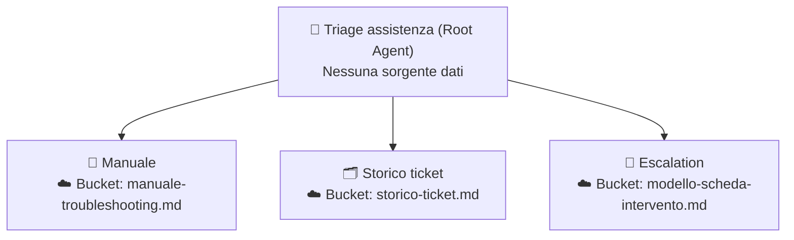

# Caso 2 · Assistenza tecnica

**Obiettivo:** aiutare il primo livello di assistenza a rispondere a una segnalazione dal campo usando solo il manuale ufficiale, consultare lo storico dei ticket e preparare la scheda di escalation per il tecnico quando necessario.

---

## 📁 Kit dati (`kit-dati/`)

Tutti i file fittizi pronti da usare nel workshop si trovano nella sottocartella [`./kit-dati/`](./kit-dati/):

| File | Uso | Descrizione |
|---|---|---|
| [`manuale-troubleshooting.md`](./kit-dati/manuale-troubleshooting.md) | **Knowledge** (Gradino 1) / **Bucket dati** (Sub-agent Manuale) | Tabella allarmi (`E101`–`E110`) e sintomi senza codice, cause probabili, procedure passo-passo e regole di escalation. **Il codice `E199` non è presente (caso limite)** |
| [`storico-ticket.md`](./kit-dati/storico-ticket.md) | **Bucket dati** (Sub-agent Storico ticket) | 20 ticket storici in tabella con matricola macchina, codice allarme, descrizione, soluzione e ore di risoluzione (inclusi 3 ticket ripetuti su `E104` per la matricola `M-0042`) |
| [`modello-scheda-intervento.md`](./kit-dati/modello-scheda-intervento.md) | **Bucket dati** (Sub-agent Escalation) | Template ufficiale della scheda intervento con i campi obbligatori per il tecnico |

---

## 🪜 Gradino 1 · Chat Agent: "Supporto manuale"

### Configurazione in Agent Designer

- **Knowledge da caricare:** [`kit-dati/manuale-troubleshooting.md`](./kit-dati/manuale-troubleshooting.md)
- **Connettori / Google Search:** Disabilitati (usa solo Knowledge)

#### Campo: `Name`
```text
G2 – Supporto manuale
```

#### Campo: `Description`
```text
Guida l'operatore di primo livello nella verifica degli allarmi macchina usando esclusivamente il manuale di troubleshooting.
```

#### Campo: `Instructions`
```text
RUOLO
Sei un assistente di primo livello per il supporto tecnico sulle macchine.

OBIETTIVO
Guidare l'operatore nella verifica di un allarme usando esclusivamente il manuale di troubleshooting.

PROCEDURA
1. Individua il codice allarme o il sintomo descritto.
2. Cerca la voce corrispondente nel manuale.
3. Riporta le cause probabili e la procedura di verifica nell'ordine del manuale.

FORMATO DELL'OUTPUT
- Allarme: codice e descrizione.
- Cause probabili.
- Procedura di verifica (passi numerati).
- Quando chiamare il tecnico.
- Fonte: sezione del manuale.

REGOLE
- Cita sempre la sezione del manuale da cui prendi la procedura.
- Non suggerire interventi che non sono nel manuale, anche se ti sembrano ragionevoli.

CASI LIMITE
- Se il codice o il sintomo non sono nel manuale, scrivi che la procedura non è documentata e consiglia l'escalation al tecnico. Non proporre verifiche generiche.
```

### 🧪 Test per salire al Gradino 2
1. **Prompt 1:** `"La macchina segnala E104, cosa devo controllare?"` → **Atteso:** Riporta cause, passi numerati e sezione del manuale per `E104`.
2. **Prompt 2:** `"Il cliente dice che l'estrusore si ferma a metà stampa senza codice."` → **Atteso:** Trova la sezione dei sintomi senza codice nel manuale e riporta i passi numerati.
3. **Prompt 3 (Caso limite / Cancello):** `"Allarme E199, come procedo?"` → **Atteso:** Dichiara che il codice `E199` non è documentato nel manuale e consiglia l'escalation al tecnico, **senza** proporre verifiche generiche inventate.

---

## 🪜 Gradino 2 · Root Agent: "Triage assistenza"

### Architettura Multi-Agente



---

### 1. Agente Principale (Root)

- **Sorgente dati:** Nessuna

#### Campo: `Name`
```text
G2 – Triage assistenza
```

#### Campo: `Description`
```text
Classifica le segnalazioni di assistenza tecnica coordinando la ricerca sul manuale di troubleshooting, l'analisi dello storico ticket e la compilazione della scheda di escalation.
```

#### Campo: `Instructions`
```text
RUOLO
Fai il triage delle segnalazioni di assistenza tecnica.

PROCEDURA
1. Chiama sempre Manuale con il codice o il sintomo.
2. Chiama sempre Storico ticket per verificare se il problema si è già presentato.
3. Chiama Escalation se: il manuale non documenta il problema, oppure il manuale dice di chiamare il tecnico, oppure lo storico mostra che il problema si è ripetuto più di 2 volte sulla stessa matricola.

FORMATO DELL'OUTPUT
- Priorità: ALTA / MEDIA / BASSA, con motivazione.
- Cosa fare subito (dal Manuale).
- Precedenti (dallo Storico ticket).
- Scheda intervento (da Escalation), solo se prevista.

REGOLE
- Non riformulare le procedure del manuale: riportale.
- Se i sub-agent danno informazioni in contrasto, segnalalo.
```

---

### 2. Sub-agent 1: `Manuale`

- **Sorgente dati:** punta al bucket dove sono ospitati i dati ([`kit-dati/manuale-troubleshooting.md`](./kit-dati/manuale-troubleshooting.md))

#### Campo: `Name`
```text
Manuale
```

#### Campo: `Description`
```text
Consulta il manuale di troubleshooting per restituire cause probabili, procedura di verifica passo-passo e condizioni di escalation per un codice allarme o sintomo.
```

#### Campo: `Instructions`
Usa le stesse istruzioni del **Gradino 1**.

---

### 3. Sub-agent 2: `Storico ticket`

- **Sorgente dati:** punta al bucket dove sono ospitati i dati ([`kit-dati/storico-ticket.md`](./kit-dati/storico-ticket.md))

#### Campo: `Name`
```text
Storico ticket
```

#### Campo: `Description`
```text
Ricerca nello storico dei ticket di assistenza casi precedenti con lo stesso codice allarme, sintomo simile o stessa matricola macchina.
```

#### Campo: `Instructions`
```text
RUOLO
Sei l'analista dello storico interventi del servizio assistenza.

OBIETTIVO
Individuare nel database storico i ticket precedenti relativi allo stesso codice allarme, a una descrizione simile o alla stessa matricola macchina.

INPUT
Codice allarme, descrizione del sintomo ed eventuale matricola macchina.

PROCEDURA
1. Cerca nel file storico-ticket.md i ticket con lo stesso codice allarme o una descrizione simile.
2. Se è indicata una matricola macchina, conta quante volte il problema si è verificato su quella specifica matricola e mettilo in evidenza.
3. Seleziona al massimo 3 ticket più pertinenti.

FORMATO DELL'OUTPUT
- Occorrenze sulla matricola indicata: [numero di ticket trovati sulla matricola, oppure "matricola non specificata"].
- Elenco ticket pertinenti (massimo 3) con: ID Ticket | Data | Matricola | Soluzione adottata | Tempo di risoluzione (ore).

REGOLE
- Cerca solo nel file storico-ticket.md. Non inventare precedenti.
- Restituisci al massimo 3 ticket con id, data, soluzione e tempo di risoluzione.

CASI LIMITE
- Se non ci sono ticket corrispondenti per codice o sintomo, scrivi esplicitamente: "Nessun ticket precedente trovato nello storico".
```

---

### 4. Sub-agent 3: `Escalation`

- **Sorgente dati:** punta al bucket dove sono ospitati i dati ([`kit-dati/modello-scheda-intervento.md`](./kit-dati/modello-scheda-intervento.md))

#### Campo: `Name`
```text
Escalation
```

#### Campo: `Description`
```text
Compila la scheda di intervento per il tecnico di secondo livello seguendo il modello ufficiale quando è richiesta l'escalation.
```

#### Campo: `Instructions`
```text
RUOLO
Sei l'addetto alla preparazione delle schede di escalation per i tecnici di secondo livello.

OBIETTIVO
Compilare la scheda intervento seguendo rigorosamente la struttura di modello-scheda-intervento.

INPUT
Dati della segnalazione, output del Manuale e output dello Storico ticket passati dal coordinatore.

PROCEDURA
1. Leggi i campi richiesti in modello-scheda-intervento.
2. Compila ciascun campo usando esclusivamente i dati ricevuti.
3. Nel campo "Ricambi ipotizzati" inserisci solo i componenti esplicitamente citati dal manuale o dalle soluzioni dello storico ticket.

FORMATO DELL'OUTPUT
Scheda intervento compilata con tutte le voci previste dal modello ufficiale.

REGOLE
- Compila la scheda intervento con i soli dati ricevuti.
- Lascia "da completare" nei campi per i quali non hai ricevuto dati (es. nome cliente o matricola mancante).
- Non assegnare ricambi se non sono indicati dal manuale o dallo storico.
```

### 🧪 Test per salire al Gradino 3
1. **Prompt 1 (Cancello):** `"Segnalazione di allarme E104 sulla matricola M-0042"`
   - **Atteso:** La risposta unisce la procedura del manuale per `E104`, mostra i precedenti dallo storico (rilevando che sulla matricola `M-0042` il problema si è già ripetuto 3 volte, quindi più di 2 volte) e genera la **Scheda intervento** compilata tramite `Escalation`.
2. **Prompt 2:** `"Segnalazione allarme E199 sulla matricola M-0018"`
   - **Atteso:** Poiché `E199` non è nel manuale, scatta l'escalation con priorità alta e scheda compilata senza verifiche o ricambi inventati.

---

## 🪜 Gradino 3 · Workflow: "Nuova segnalazione"

### Configurazione in Workflow Builder

| # | Passaggio | Tipo | Configurazione |
|---|---|---|---|
| **0** | **Trigger** | `Manual` | Campi di input: `descrizione`, `codice_allarme`, `matricola` *(quest'ultimo **non obbligatorio**)* |
| **1** | **Verifica Matricola** | `Human in the loop (Request info)` | Se `matricola` è vuota, chiede all'operatore di inserirla *(se il builder non supporta condizioni, chiedi sempre conferma della matricola o di scrivere "già indicata")* |
| **2** | **Triage Tecnico** | `Agente esistente` | Seleziona **Triage assistenza**. Prompt: `Esegui il triage per questa segnalazione. Codice: ${trigger.codice_allarme}, Descrizione: ${trigger.descrizione}, Matricola: ${trigger.matricola} ${step1.output}` |
| **3** | **Approvazione Service** | `Human in the loop (Approval)` | Il responsabile del service approva priorità e scheda intervento |
| **4** | **Notifica Tecnico** | `Azione Connettore` | Invio notifica al tecnico via Gmail o Google Chat *(oppure chiusura con output)* |

### 🧪 Test di chiusura
- Avvia il workflow lasciando vuoto il campo `matricola`: verifica che il flusso si metta in pausa su **Request info** prima di invocare l'agente `Triage assistenza`.
