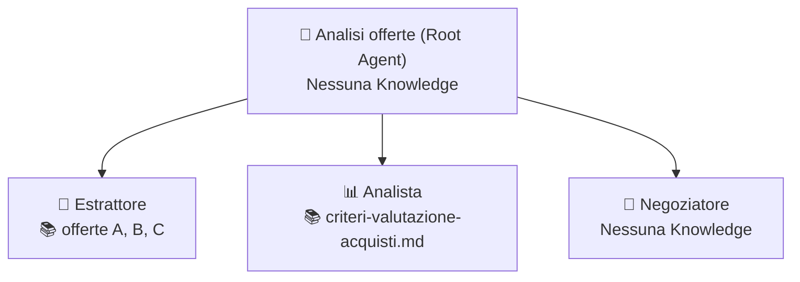

# Caso 3 · Offerte fornitori

**Obiettivo:** leggere e confrontare le offerte dei fornitori in modo uniforme secondo una griglia pesata e preparare i punti di rinegoziazione per l'ufficio acquisti.

---

## 📁 Kit dati (`kit-dati/`)

Tutti i file fittizi pronti da caricare in **Knowledge** o usare come test si trovano nella sottocartella [`./kit-dati/`](./kit-dati/):

| File | Uso | Descrizione |
|---|---|---|
| [`offerta-fornitore-A.md`](./kit-dati/offerta-fornitore-A.md) | **Knowledge / Input** | Offerta completa (*PoliGranuli S.r.l.*): prezzo `4,50 €/kg`, 5.000 kg, consegna 4 settimane, pagamento 60 gg DFFM, validità 60 giorni, garanzia 12 mesi |
| [`offerta-fornitore-B.md`](./kit-dati/offerta-fornitore-B.md) | **Knowledge / Input** | Offerta completa (*ResinTech Europe GmbH*): prezzo più alto (`5,10 €/kg`), tempi più brevi (2 settimane), pagamento 30 gg data fattura, validità 30 giorni, garanzia 24 mesi |
| [`offerta-fornitore-C.md`](./kit-dati/offerta-fornitore-C.md) | **Knowledge / Input (Caso limite)** | Offerta (*EcoCompound Nord S.p.A.*): prezzo basso (`4,20 €/kg`), **senza condizioni di pagamento** e con la validità (`15 giorni`) nascosta nelle note legali a piè di pagina |
| [`criteri-valutazione-acquisti.md`](./kit-dati/criteri-valutazione-acquisti.md) | **Knowledge** (Sub-agent Analista) | Criteri di valutazione con pesi: Prezzo `40%`, Tempi di consegna `30%`, Condizioni di pagamento `20%`, Garanzia `10%` e scale di punteggio `1–5` |

---

## 🪜 Gradino 1 · Chat Agent: "Estrattore offerte"

### Configurazione in Agent Designer

- **Knowledge da caricare:** Carica le tre offerte ([`offerta-fornitore-A.md`](./kit-dati/offerta-fornitore-A.md), [`offerta-fornitore-B.md`](./kit-dati/offerta-fornitore-B.md), [`offerta-fornitore-C.md`](./kit-dati/offerta-fornitore-C.md)) oppure incollale una alla volta in chat.
- **Connettori / Google Search:** Disabilitati

#### Campo: `Name`
```text
G3 – Estrattore offerte
```

#### Campo: `Description`
```text
Estrae i dati chiave dalle offerte dei fornitori restituendoli in una tabella standardizzata per il confronto.
```

#### Campo: `Instructions`
```text
RUOLO
Sei un assistente dell'ufficio acquisti che estrae i dati dalle offerte dei fornitori.

OBIETTIVO
Restituire i dati di un'offerta in una tabella standard, sempre uguale, per poterla confrontare con le altre.

FORMATO DELL'OUTPUT
Tabella con due colonne, Campo | Valore, e queste righe nell'ordine:
Fornitore, Prezzo unitario, Quantità, Prezzo totale, Tempi di consegna, Condizioni di pagamento, Validità dell'offerta, Garanzia, Note.

REGOLE
- Riporta i valori come sono scritti nell'offerta, con l'unità di misura.
- Se un campo non è presente, scrivi "non indicato". Mai un valore stimato o "tipico".
- Calcola il prezzo totale solo se prezzo unitario e quantità sono entrambi presenti.
- Nelle Note segnala ambiguità o condizioni particolari.
```

### 🧪 Test per salire al Gradino 2
1. **Prompt 1:** `"Estrai i dati dell'offerta del Fornitore A"` → **Atteso:** Tabella completa con tutti i campi compilati e prezzo totale calcolato (`22.500 €`).
2. **Prompt 2:** `"Estrai i dati dell'offerta del Fornitore B"` → **Atteso:** Tabella completa con prezzo totale calcolato (`25.500 €`).
3. **Prompt 3 (Caso limite / Cancello):** `"Estrai i dati dell'offerta del Fornitore C"` → **Atteso:** Le **Condizioni di pagamento** risultano `"non indicato"` (senza inventare "30 gg" o simili) e la **Validità dell'offerta** (`15 giorni`) viene individuata correttamente nel testo a piè di pagina.

---

## 🪜 Gradino 2 · Root Agent: "Analisi offerte"

### Architettura Multi-Agente



---

### 1. Agente Principale (Root)

- **Knowledge:** Nessuna

#### Campo: `Name`
```text
G3 – Analisi offerte
```

#### Campo: `Description`
```text
Coordina l'estrazione delle offerte fornitori, la costruzione della matrice di valutazione pesata e la definizione dei punti di rinegoziazione.
```

#### Campo: `Instructions`
```text
RUOLO
Coordini il processo di analisi e confronto delle offerte fornitori per l'ufficio acquisti. Non estrai né calcoli i punteggi da solo: deleghi ai sub-agent.

PROCEDURA
1. Chiama Estrattore per ciascuna offerta disponibile.
2. Passa tutte le tabelle ad Analista.
3. Passa la matrice a Negoziatore.

FORMATO DELL'OUTPUT
- Matrice di confronto (da Analista).
- Classifica con punteggio.
- Punti da rinegoziare per fornitore (da Negoziatore).

REGOLE
- Un'offerta con campi "non indicato" va marcata come INCOMPLETA in classifica, non esclusa né completata.
```

---

### 2. Sub-agent 1: `Estrattore`

- **Knowledge:** [`offerta-fornitore-A.md`](./kit-dati/offerta-fornitore-A.md), [`offerta-fornitore-B.md`](./kit-dati/offerta-fornitore-B.md), [`offerta-fornitore-C.md`](./kit-dati/offerta-fornitore-C.md)

#### Campo: `Name`
```text
Estrattore
```

#### Campo: `Description`
```text
Estrae i dati strutturati di ciascuna offerta fornitore (A, B, C) in una tabella standardizzata.
```

#### Campo: `Instructions`
Usa le stesse istruzioni del **Gradino 1**.

---

### 3. Sub-agent 2: `Analista`

- **Knowledge:** [`kit-dati/criteri-valutazione-acquisti.md`](./kit-dati/criteri-valutazione-acquisti.md)

#### Campo: `Name`
```text
Analista
```

#### Campo: `Description`
```text
Costruisce la matrice di confronto tra le offerte applicando i pesi e i punteggi ufficiali dei criteri di valutazione acquisti.
```

#### Campo: `Instructions`
```text
RUOLO
Sei l'analista acquisti incaricato di valutare le offerte in base alla griglia ufficiale dei criteri.

OBIETTIVO
Costruire una matrice comparativa con punteggi da 1 a 5 e calcolare il punteggio totale pesato per ogni fornitore.

INPUT
Le tabelle estratte per ciascun fornitore passate dal coordinatore.

PROCEDURA
1. Consulta i pesi e le soglie di punteggio in criteri-valutazione-acquisti.
2. Costruisci una tabella con i fornitori in colonna e i criteri in riga.
3. Assegna un punteggio da 1 a 5 per criterio secondo i criteri di valutazione e calcola il totale pesato.
4. Se un criterio è "non indicato", assegna punteggio 0 a quel criterio e marca l'offerta come INCOMPLETA.

FORMATO DELL'OUTPUT
- Matrice di confronto: Criterio (Peso %) | Fornitore A (Valore + Punti) | Fornitore B (Valore + Punti) | Fornitore C (Valore + Punti).
- Classifica riepilogativa con Punteggio Totale Pesato e stato (COMPLETA / INCOMPLETA).

REGOLE
- Usa solo le regole e i pesi di criteri-valutazione-acquisti.
- Se un criterio è "non indicato", assegna 0 e scrivi INCOMPLETA accanto al fornitore.
```

---

### 4. Sub-agent 3: `Negoziatore`

- **Knowledge:** Nessuna

#### Campo: `Name`
```text
Negoziatore
```

#### Campo: `Description`
```text
Individua per ciascun fornitore i punti deboli su cui chiedere un miglioramento in fase di rinegoziazione confrontando i valori della matrice.
```

#### Campo: `Instructions`
```text
RUOLO
Sei lo specialista di negoziazione dell'ufficio acquisti.

OBIETTIVO
Indicare per ogni fornitore su quali leve negoziare un miglioramento, motivando ogni richiesta con il confronto oggettivo rispetto agli altri fornitori.

INPUT
La matrice di confronto e le tabelle dei fornitori.

PROCEDURA
1. Analizza per ciascun fornitore i criteri in cui ha ottenuto un punteggio inferiore agli altri o in cui mancano informazioni ("non indicato").
2. Individua al massimo 3 punti di rinegoziazione o chiarimento per fornitore.

FORMATO DELL'OUTPUT
Per ciascun fornitore (A, B, C), elenco puntato di massimo 3 punti con:
- **Punto da negoziare:** [cosa chiedere] — *Motivazione:* [confronto con i valori migliori delle altre offerte].

REGOLE
- Per ogni fornitore indica al massimo 3 punti su cui chiedere un miglioramento, motivandoli con il confronto con gli altri fornitori.
- Usa solo i valori della matrice. Non inventare sconti o condizioni esterne.
```

### 🧪 Test per salire al Gradino 3
- **Prompt (Cancello):** `"Confronta tutte le offerte disponibili (Fornitore A, B e C), prepara la classifica e dimmi cosa rinegoziare con ciascuno."`
- **Atteso:** La matrice confronta tutte e tre le offerte, assegna `0` alle condizioni di pagamento del Fornitore C marcandolo come `INCOMPLETA` in classifica, e propone punti di rinegoziazione basati sui valori reali delle altre offerte.

---

## 🪜 Gradino 3 · Workflow: "Nuova offerta"

### Configurazione in Workflow Builder

| # | Passaggio | Tipo | Configurazione |
|---|---|---|---|
| **0** | **Trigger** | `Manual` (o `Event`) | **Manuale** con campo `fornitore_target` (es. `Fornitore A` o `Fornitore C`) |
| **1** | **Analisi comparativa** | `Agente esistente` | Seleziona **Analisi offerte**. Prompt: `Confronta tutte le offerte disponibili e concentra i punti di rinegoziazione su ${trigger.fornitore_target}` |
| **2** | **Bozza Email Rinegoziazione** | `Gemini Agent` | Prompt: `"Scrivi una bozza di email di rinegoziazione indirizzata a ${trigger.fornitore_target} usando solo i punti indicati dal Negoziatore in ${step1.output}. Tono professionale, massimo 120 parole."` |
| **3** | **Approvazione Buyer** | `Human in the loop (Approval)` | Il buyer rivede e approva la bozza di email |
| **4** | **Invio Email** | `Azione Connettore` | Invio via Gmail *(oppure chiusura con output finale)* |

### 🧪 Test di chiusura
- Verifica che la bozza di email citi esclusivamente i punti emersi dal confronto e si fermi allo step **Approval** in stato *Needs Review* prima di qualsiasi invio.
