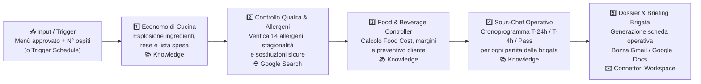

# ⚙️ Workflow Operativo di Brigata — Demo No-Code Workflow per Gemini Enterprise

Questa cartella contiene tutto il materiale (prompt dei singoli blocchi, file di Knowledge aziendale, configurazione dei connettori e input di test) per costruire passo dopo passo, in **Gemini Enterprise**, un flusso **No-Code in modalità Workflow** collegato alla metafora della **Brigata di Cucina**.

> 🔗 **Come si collega alla cartella `chatagent/`?**
> - In [`../chatagent/`](../chatagent/README.md) hai costruito la fase **creativa e conversazionale**: il *Responsabile di Brigata* dialoga con il cliente e coordina gli chef per ideare e approvare il menù.
> - Qui in `workflow/` costruisci la fase **esecutiva e di back-office**: una volta che il menù è stato approvato, parte un **Workflow No-Code sequenziale** che trasforma automaticamente quel menù in **Lista della Spesa con scarti, Analisi Allergeni, Calcolo del Food Cost & Preventivo, Cronoprogramma di Mise en Place per ogni partita e Briefing pronto da inviare su Gmail / Google Docs**.

---

## 1. Differenza tra Modalità Chat Agent e Modalità Workflow in Gemini Enterprise

Questa demo è pensata proprio per mostrare dal vivo, sullo stesso dominio ("la brigata di cucina"), quando scegliere un **Chat Agent** e quando scegliere un **Workflow No-Code**:

| Caratteristica | 💬 Modalità Chat Agent (`../chatagent/`) | ⚙️ Modalità Workflow (`./workflow/`) |
|---|---|---|
| **Obiettivo** | Esplorare, consigliare, raccogliere requisiti in modo interattivo | Eseguire un processo operativo strutturato, ripetibile e verificabile |
| **Controllo del flusso** | **Dinamico (guidato dall'LLM)**: l'orchestratore decide chi chiamare e fa domande all'utente | **Deterministico / Sequenziale (Canvas Flow)**: i passaggi vengono eseguiti in ordine fisso (`Step 1 → Step 2 → ...`) |
| **Input tipico** | Conversazione libera a più turni con il cliente | Input strutturato (un menù approvato, un form evento) o attivazione automatica (**Schedule** / Trigger) |
| **Passaggio dati** | Contesto conversazionale passato ai sotto-agenti | L'output di ogni blocco diventa l'input strutturato del blocco successivo |
| **Integrazioni tipiche** | Knowledge + Google Search per rispondere alle domande | Knowledge + Google Search + **Azioni / Connettori Workspace** (Gmail, Google Docs, Drive, Calendar) + **Human-in-the-loop** |

---

## 2. Il caso d'uso: "Dal Menù Approvato alla Messa in Linea della Brigata"

Quando un ristorante o un servizio di catering conferma un evento, il lavoro della brigata è appena iniziato: prima di accendere i fornelli servono **acquisti precisi (economato)**, **verifica sicurezza alimentare (allergeni)**, **controllo dei margini (food cost)** e **organizzazione dei tempi di cucina (mise en place)**.

Nel canvas **Flow** di Gemini Enterprise, questo processo diventa una catena lineare di **5 blocchi (step)** No-Code:



### Cosa fa ciascuno Step del Workflow

| Step | Ruolo nella Brigata | Input ricevuto | Risorse / Connettori No-Code | Output prodotto |
|---|---|---|---|---|
| **Step 1** | 📦 **Economo di Cucina** | Menù approvato + N° coperti + vincoli | **Knowledge**: `listino-fornitori-e-rese.md` | Tabella ingredienti esplosa per portata, peso netto, scarto %, peso lordo da ordinare |
| **Step 2** | 🔍 **Controllo Qualità & Allergeni** | Lista ingredienti dello Step 1 + intolleranze ospiti | **Connettore**: `Google Search` (pagine EUFIC / stagionalità) | Matrice dei 14 allergeni per portata, semaforo stagionalità e varianti sicure per gli ospiti allergici |
| **Step 3** |💶 **Food & Beverage Controller** | Quantità lorde (Step 1) + varianti (Step 2) | **Knowledge**: `listino-fornitori-e-rese.md` + `regole-food-cost-e-margini.md` | Calcolo Food Cost totale e per coperto, prezzo di vendita consigliato, alert fuori-budget |
| **Step 4** | ⏱️ **Sous-Chef Operativo** | Menù definitivo + varianti allergeni | **Knowledge**: `protocollo-servizio-e-tempi.md` | Piano di *Mise en Place* diviso in `T-24h`, `T-4h` e `Servizio (Pass)` assegnato a ogni partita |
| **Step 5** | 📋 **Direttore Operativo / Maître** | Tutti gli output degli Step 1–4 | **Connettori (opzionali)**: `Google Docs` / `Gmail` + checkpoint di conferma | **Dossier Operativo Completo** + creazione automatica documento o bozza email per i capi partita |

---

## 3. Struttura della cartella `workflow/`

```
workflow/
├── README.md                                  <- sei qui: guida generale al Workflow No-Code
├── 01-analisi-fabbisogni/
│   └── README.md                              <- Configurazione e Prompt dello Step 1 (Economo)
├── 02-controllo-allergeni-e-mercato/
│   └── README.md                              <- Configurazione e Prompt dello Step 2 (Qualità & Allergeni)
├── 03-food-cost-e-preventivo/
│   └── README.md                              <- Configurazione e Prompt dello Step 3 (Food Cost Controller)
├── 04-piano-mise-en-place/
│   └── README.md                              <- Configurazione e Prompt dello Step 4 (Sous-Chef Operativo)
├── 05-briefing-e-notifica/
│   └── README.md                              <- Configurazione e Prompt dello Step 5 (Dossier + Gmail/Docs)
├── knowledge/
│   ├── listino-fornitori-e-rese.md            <- File Knowledge: prezzi al kg, % scarto, lotti d'ordine
│   ├── regole-food-cost-e-margini.md          <- File Knowledge: target food cost, moltiplicatori e regole budget
│   └── protocollo-servizio-e-tempi.md         <- File Knowledge: tempi standard e compiti delle partite in cucina
└── esempi-input/
    └── menu-approvato-esempio.md              <- 3 input pronti da incollare per testare subito il workflow
```

---

## 4. Percorso guidato passo-passo in Gemini Enterprise

### Fase 1 — Crea il contenitore del Workflow
1. Apri **Gemini Enterprise → Agent Designer (Workflow Builder)** e avvia una nuova configurazione orientata al **flusso (Flow / Multi-step Workflow)**.
2. Assegna come **Nome**:
   ```
   Workflow Operativo di Brigata — Dal Menù al Servizio
   ```
3. Assegna come **Descrizione**:
   ```
   Workflow sequenziale no-code che riceve un menù approvato e i dettagli di un evento (numero ospiti, stagione, intolleranze, budget) ed esegue in catena: 1) esplosione ingredienti e lista della spesa con rese, 2) verifica allergeni e stagionalità, 3) calcolo del food cost e preventivo, 4) cronoprogramma di mise en place per le partite della brigata, 5) generazione del dossier operativo e bozza briefing per cucina e sala.
   ```
4. Carica nella sezione **Knowledge** i 3 file presenti nella sottocartella [`knowledge/`](./knowledge/):
   - [`listino-fornitori-e-rese.md`](./knowledge/listino-fornitori-e-rese.md)
   - [`regole-food-cost-e-margini.md`](./knowledge/regole-food-cost-e-margini.md)
   - [`protocollo-servizio-e-tempi.md`](./knowledge/protocollo-servizio-e-tempi.md)

### Fase 2 — Costruisci la catena sequenziale nel tab "Flow"
Apri la vista visuale **Flow** e configura i **5 passaggi in sequenza** seguendo nell'ordine le istruzioni contenute in ciascuna sottocartella:

1. **Step 1 (`01-analisi-fabbisogni/README.md`)**: Nodo collegato alla **Knowledge** interna (`listino-fornitori-e-rese.md`), senza Google Search.
2. **Step 2 (`02-controllo-allergeni-e-mercato/README.md`)**: Nodo con connettore **Google Search** abilitato per la verifica puntuale degli allergeni e della stagionalità.
3. **Step 3 (`03-food-cost-e-preventivo/README.md`)**: Nodo collegato alla **Knowledge** interna (`listino-fornitori-e-rese.md` e `regole-food-cost-e-margini.md`), senza Google Search.
4. **Step 4 (`04-piano-mise-en-place/README.md`)**: Nodo collegato alla **Knowledge** interna (`protocollo-servizio-e-tempi.md`), senza Google Search.
5. **Step 5 (`05-briefing-e-notifica/README.md`)**: Nodo finale di sintesi e formattazione del Dossier, con possibilità di agganciare i connettori **Google Docs** e **Gmail** (con approvazione utente *Human-in-the-loop* prima dell'invio).

> 💡 **Modalità Singolo Flusso vs Blocchi Separati nel Canvas**:
> - Se la tua versione di Agent Designer usa **nodi/step distinti sul canvas Flow**, incolla ciascuno dei 5 blocchi nel rispettivo nodo collegandoli in serie (`Step 1 → Step 2 → Step 3 → Step 4 → Step 5`).
> - Se preferisci orchestrare i 5 nodi da un **Coordinatore di Workflow** che invoca rigorosamente i 5 passaggi in ordine fisso senza fare domande intermedie all'utente, trovi il prompt di coordinamento sequenziale direttamente in [`05-briefing-e-notifica/README.md`](./05-briefing-e-notifica/README.md).

### Fase 3 — (Opzionale) Configura un Trigger automatico nella tab "Schedule"
Uno dei punti di forza della modalità **Workflow** rispetto al Chat Agent è la possibilità di eseguirlo in automatico tramite la tab **Schedule**:
- Apri la tab **Schedule** in Agent Designer.
- Imposta la frequenza su **Weekly** (es. ogni *Lunedì alle 08:30*).
- Nel prompt programmato, chiedi al workflow di elaborare il menù dell'evento settimanale (o di leggere il file `Menu_Settimana_Corrente` da Google Drive se hai abilitato il connettore Drive) e preparare nella tua Inbox il Dossier Operativo pronto da approvare.

### Fase 4 — Testa il Workflow con un input reale
Apri la tab **Preview**, copia uno degli scenari pronti in [`esempi-input/menu-approvato-esempio.md`](./esempi-input/menu-approvato-esempio.md) (oppure incolla direttamente il menù che hai generato poco prima con il **Chat Agent**!) e avvia l'esecuzione.

Osserverai il workflow attraversare tutti i 5 passaggi senza interrompersi per fare domande conversazionali, restituendo in un'unica esecuzione:
1. 📦 **Tabella Economato & Lista della Spesa** (con pesi netti, scarti e pesi lordi)
2. ⚠️ **Matrice Sicurezza Allergeni & Sostituzioni** (per gli ospiti vegetariani o intolleranti)
3. 💶 **Analisi Food Cost & Preventivo Commerciale** (costo materia prima, margine e verifica budget)
4. ⏱️ **Cronoprogramma di Cucina (`T-24h`, `T-4h`, `Pass`)** suddiviso per ogni Chef di Partita
5. ✉️ **Bozza Email / Documento di Briefing** pronta per essere inviata alla brigata

---

## 5. Perché mostrare insieme `chatagent/` e `workflow/` durante una demo

Presentare entrambi i casi d'uso in sequenza permette di raccontare una storia aziendale completa in Gemini Enterprise:
1. **Atto 1 — Co-creazione Conversazionale (`chatagent/`)**: quando il problema è aperto e richiede dialogo, ascolto del cliente e creatività, usiamo il **Chat Agent multi-agente**.
2. **Atto 2 — Automazione dei Processi (`workflow/`)**: quando la decisione è presa e bisogna eseguire calcoli, controlli di conformità, pianificazione operativa e invio di documenti senza errori né dimenticanze, passiamo l'output al **Workflow No-Code**.
