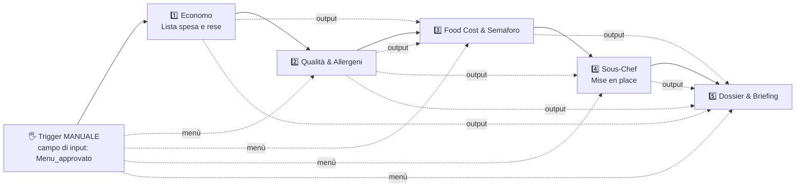

# ⚙️ Workflow Operativo di Brigata — Demo No-Code per Gemini Enterprise (Workflow Builder)

Questa cartella contiene tutto il necessario (prompt dei 5 step, file di Knowledge, input di test) per costruire in **Gemini Enterprise → Workflow Builder** il flusso che trasforma un **menù approvato** in: lista della spesa, matrice allergeni, food cost e semaforo budget, piano di mise en place e briefing di brigata.

> **Versione corretta e testata**: rispetto alla prima versione del repo, qui sono inclusi
> - il **trigger Manuale con campo di input** (il Schedule non ha campi di input e non può ricevere il menù);
> - le **variabili** che collegano ogni step al menù e agli output degli step precedenti;
> - le regole **anti-invenzione** (niente posti a sedere, colori o dettagli non presenti nel menù o nel protocollo);
> - le regole **anti-blocco** (nessuno step deve mai fermarsi a chiedere dati all'utente);
> - le correzioni a food cost e semaforo (vedi `knowledge/regole-food-cost-e-margini.md`).

---

## 1. Come è fatto il flusso



**Regola fondamentale**: in un workflow ogni step è un agente isolato. Vede **solo** quello che gli scrivi nel suo prompt. Il menù e gli output degli step precedenti **non arrivano da soli**: vanno inseriti nelle istruzioni di ogni step come variabili.

| Step | Variabili in ingresso |
|---|---|
| 1 Economo | `Menu_approvato` |
| 2 Qualità & Allergeni | `Menu_approvato`, output Step 1 |
| 3 Food Cost | `Menu_approvato`, output Step 1, output Step 2 |
| 4 Sous-Chef | `Menu_approvato`, output Step 2 |
| 5 Dossier | `Menu_approvato`, output Step 1, 2, 3, 4 (+ `Destinatari_briefing` se creato) |

---

## 2. Convenzione dei segnaposto nei prompt

Nei README degli step trovi segnaposto come `<<MENU_APPROVATO>>` e `<<OUTPUT_STEP_1>>`. **Non vanno copiati così com'è**: vanno sostituiti con la variabile vera inserita dal selettore variabili dell'editor.

| Segnaposto nel README | Cosa inserire nell'editor |
|---|---|
| `<<MENU_APPROVATO>>` | la variabile del campo `Menu_approvato` del trigger Manuale |
| `<<OUTPUT_STEP_1>>` | la variabile di output dello Step 1 |
| `<<OUTPUT_STEP_2>>` | la variabile di output dello Step 2 |
| `<<OUTPUT_STEP_3>>` | la variabile di output dello Step 3 |
| `<<OUTPUT_STEP_4>>` | la variabile di output dello Step 4 |

> 💡 **Come si inserisce una variabile**: nelle istruzioni dello step cerca nell'editor il selettore delle variabili (pulsante o menu per riferire campi del trigger e output degli step precedenti). La documentazione Google cita, per l'agent step esistente, la sintassi `${nome_step.output}`; per i nodi Gemini Agent usa il selettore se disponibile, perché la sintassi esatta può variare.
>
> 💡 **Verifica che la variabile sia entrata**: dopo il test run apri lo step e controlla il suo **Input** (nello screenshot di test: riga "Input" sopra "Output"). Se il menù non compare nell'input, il collegamento non è andato a buon fine.

---

## 3. Costruzione passo-passo

### Fase 1 — Contenitore
1. **+ New agent → Workflow → Build manually**.
2. **Nome**: `Workflow Operativo di Brigata — Dal Menù al Servizio`

### Fase 2 — Trigger MANUALE con campo di input
1. Nel canvas clicca il nodo trigger (di default può comparire un **Schedule**, "Daily at 9:00 AM").
2. Nel pannello di configurazione cambia il tipo in **Manual trigger**.
3. In **Input fields** aggiungi **un solo campo di testo**:
   - **Nome**: `Menu_approvato`
   - **Tipo**: testo (lungo, se l'editor lo permette)
   - **Obbligatorio**: sì
4. Questo campo è dove, a ogni esecuzione, si incolla il blocco con menù + ospiti + allergie + budget (vedi `esempi-input/menu-approvato-esempio.md`).
5. **(Opzionale) Secondo campo `Destinatari_briefing`**: testo, non obbligatorio. Se lo compili con gli indirizzi email dei capi partita, la bozza Outlook nasce con i destinatari già inseriti; se lo lasci vuoto, la bozza viene creata senza destinatari e li aggiungi tu. Se non lo crei, togli `<<DESTINATARI_BRIEFING>>` dal prompt dello Step 5.

### Fase 3 — Knowledge dei singoli step
Il Knowledge si carica **sul singolo nodo**, non sul workflow intero:

| Step | Knowledge da collegare | Google Search |
|---|---|---|
| 1 | `listino-fornitori-e-rese.md` | ❌ |
| 2 | nessuno | ✅ |
| 3 | `listino-fornitori-e-rese.md` + `regole-food-cost-e-margini.md` | ❌ |
| 4 | `protocollo-servizio-e-tempi.md` | ❌ |
| 5 | nessuno | ❌ (connettore **Outlook** attivo, solo creazione bozza: vedi Step 5) |

### Fase 4 — I 5 step
Crea i 5 nodi **Gemini Agent** in serie e incolla nome, descrizione e istruzioni dai README:

1. [`01-analisi-fabbisogni/README.md`](./01-analisi-fabbisogni/README.md)
2. [`02-controllo-allergeni-e-mercato/README.md`](./02-controllo-allergeni-e-mercato/README.md)
3. [`03-food-cost-e-preventivo/README.md`](./03-food-cost-e-preventivo/README.md)
4. [`04-piano-mise-en-place/README.md`](./04-piano-mise-en-place/README.md)
5. [`05-briefing-e-notifica/README.md`](./05-briefing-e-notifica/README.md)

In ogni prompt, **sostituisci i segnaposto `<<...>>` con le variabili vere** (sezione 2).

> 🔁 **Consiglio**: costruisci e prova **uno step alla volta**. Fai girare il test dopo lo Step 1; se non si ferma e produce la tabella, replica il meccanismo sugli altri.

---

## 4. Come si avvia il workflow

### A) Test dall'editor
1. Apri la tab **Test**.
2. Clicca **Start a test run**: con il trigger Manuale compare il campo `Menu_approvato`.
3. Incolla un blocco di `esempi-input/menu-approvato-esempio.md` e avvia.
4. Al termine espandi gli step per controllare **Input** e **Output** di ciascuno.

### B) Da una chat di Gemini Enterprise (il collegamento col chat agent)
Un workflow con trigger manuale si può lanciare da una chat scrivendo `@` seguito dal nome del workflow. È il modo più vicino al passaggio "menù approvato → workflow":
1. Concludi la conversazione con il **Responsabile di Brigata** (`../chatagent/`).
2. Copia il menù finale e aggiungi numero ospiti, stagione, allergie e budget.
3. In chat scrivi `@Workflow Operativo di Brigata` e incolla il blocco nel campo di input.

> ⚠️ Probabilmente il workflow deve essere acceso (**Turn on**) per comparire con `@`. Questo non è esplicitato nella documentazione: verificalo nel tuo ambiente.

### C) Schedule (opzionale, non adatto al flusso menù-per-menù)
Il trigger **Schedule** esegue il workflow a orari fissi, ma **non ha campi di input**: non può ricevere un menù incollato. Va bene solo se il menù viene letto da una fonte fissa (es. un file Drive, con relativo connettore) e se i prompt dei nodi sono scritti di conseguenza. Per la demo usa il trigger Manuale.

---

## 5. Cosa deve produrre il workflow

1. 📦 Tabella Economato e Lista della Spesa (pesi netti, scarti, pesi lordi)
2. ⚠️ Matrice allergeni e Piatti Sentinella
3. 💶 Food Cost, preventivo e semaforo budget (con verifica esplicita delle condizioni)
4. ⏱️ Cronoprogramma `T-24h` / `T-4h` / Servizio al Pass per partita
5. ✉️ Dossier operativo in 4 sezioni + **bozza** email di briefing creata in Outlook (non inviata)

---

## 6. Problemi frequenti

| Sintomo | Causa probabile | Soluzione |
|---|---|---|
| Lo step si ferma con **"Human input required"** e chiede il menù | Il menù non è arrivato nel prompt dello step | Inserisci `<<MENU_APPROVATO>>` come variabile vera nelle istruzioni e verifica l'**Input** dello step |
| La tab Test mostra solo "Start a test run" senza campi | Il trigger è ancora **Schedule** | Cambialo in **Manual trigger** e aggiungi `Menu_approvato` |
| Uno step a metà catena chiede dati già calcolati | Manca la variabile dell'output dello step precedente | Aggiungi `<<OUTPUT_STEP_n>>` nel blocco DATI IN INGRESSO |
| L'email di briefing contiene posti a sedere, colori o dettagli mai forniti | Il modello ha inventato | Le regole anti-invenzione sono già nei prompt: controlla che siano state incollate |
| Lo Step 5 si ferma e chiede un'approvazione prima di creare la bozza | Revisione umana prevista per le azioni di scrittura sui connettori | Approva la creazione della bozza (non invia nulla) |
| Lo Step 5 non crea la bozza | Connettore Outlook non abilitato sul nodo o data store Outlook non configurato dall'amministratore | Controlla il connettore sul nodo e chiedi all'admin di verificare il data store Outlook e i permessi di scrittura sulla posta |
| Il semaforo risulta verde ma il food cost % è sopra il target | Regola del verde non rispettata | Usa il nuovo Step 3 e il nuovo `regole-food-cost-e-margini.md` |

---

## 7. Struttura della cartella

```
workflow/
├── README.md                                  <- sei qui
├── 01-analisi-fabbisogni/README.md            <- Step 1 (Economo)
├── 02-controllo-allergeni-e-mercato/README.md <- Step 2 (Qualità & Allergeni)
├── 03-food-cost-e-preventivo/README.md        <- Step 3 (Food Cost)
├── 04-piano-mise-en-place/README.md           <- Step 4 (Sous-Chef)
├── 05-briefing-e-notifica/README.md           <- Step 5 (Dossier & Briefing)
├── knowledge/
│   ├── listino-fornitori-e-rese.md            <- invariato
│   ├── regole-food-cost-e-margini.md          <- AGGIORNATO (regola +10% e semaforo verde)
│   └── protocollo-servizio-e-tempi.md         <- AGGIORNATO (tempi di cottura e regole anti-invenzione)
└── esempi-input/menu-approvato-esempio.md     <- AGGIORNATO (formato per il campo Menu_approvato)
```
